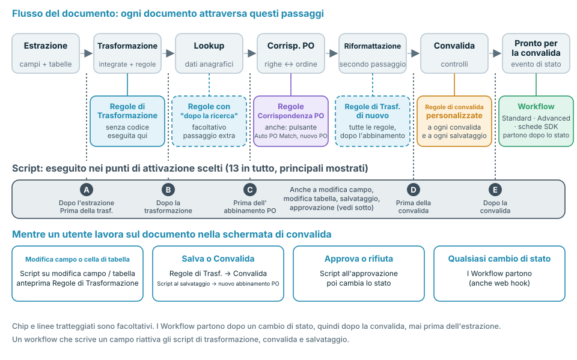
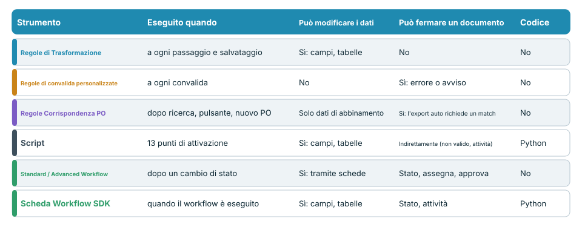
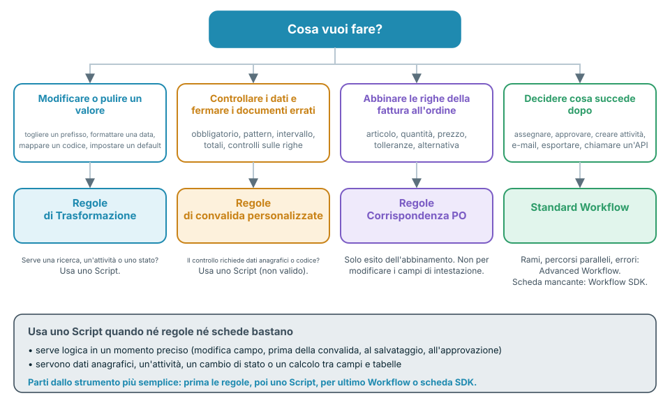

# Scegliere l'automazione giusta



Il video (quasi sei minuti) tratta gli stessi argomenti in quattro parti: **0:00** dove viene eseguito ogni strumento nel flusso del documento, **1:35** codice, workflow e confronto, **2:49** cosa può e cosa non può fare ogni strumento, **3:59** best practice ed errori comuni.

DocBits offre diversi modi per modificare, controllare e instradare i documenti: **Regole di Trasformazione**, **Regole di convalida personalizzate**, **Regole di Corrispondenza degli Ordini di Acquisto**, **Script**, **Standard Workflow**, **Advanced Workflow** e **schede Workflow SDK**. Si sovrappongono di proposito. Questa pagina ti dice quale scegliere, **quando viene eseguito ciascuno nel flusso del documento** e cosa può e cosa non può fare.

## La risposta breve

| Voglio … | Usa | Perché |
| --- | --- | --- |
| Pulire o riscrivere un valore (rimuovere spazi, aggiungere un prefisso, formato data, mappatura unità, valore predefinito) | [Regole di Trasformazione](settings/global-settings/document-types/transformation-rules.md) | Nessun codice, anteprima dal vivo, viene eseguita a ogni passaggio e a ogni salvataggio |
| Assicurarmi che i dati siano completi e plausibili e fermare i documenti che non lo sono | [Regole di convalida personalizzate](settings/global-settings/document-types/custom-validation-rules.md) | Controlli dichiarativi, errore o avviso, bloccano l'esportazione automatica |
| Abbinare le righe della fattura alle righe dell'ordine di acquisto | [Regole di Corrispondenza degli Ordini di Acquisto](settings/global-settings/document-types/more-settings/purchase-order/purchase-order-matching-rules.md) | Set di regole con tolleranze, alternative e un diagramma visivo |
| Fare qualcosa che una regola non può esprimere: una ricerca, un calcolo tra campi e tabelle, un'attività, un cambio di stato in un momento preciso | [Script](settings/global-settings/document-types/script/README.md) | Python in 13 punti di attivazione del flusso |
| Decidere **cosa succede dopo** con un documento: assegnare, approvare, creare un'attività, inviare un'e-mail, esportare, chiamare un'API | [Standard Workflow](workflow/standard-workflow-builder.md) | Schede When / And / Then su eventi di stato |
| Fare lo stesso con rami, più condizioni e percorsi di errore | [Advanced Workflow](workflow/advanced-workflow-builder.md) | Grafo visivo di nodi |
| Serve un'azione che nessuna scheda integrata offre | [Workflow SDK (Card SDK)](workflow/card-sdk.md) | La tua scheda, verificata da DocBits |

**Regola pratica: usa lo strumento meno potente che svolge il compito.** Prima le regole, poi uno Script, per ultimo un Workflow o una scheda SDK. Le regole sono più facili da leggere, più facili da testare e non possono danneggiare un documento; il codice può fare di più e richiede quindi più attenzione.

## Dove viene eseguito ogni strumento nel flusso del documento

Ogni documento attraversa gli stessi passaggi. Ogni strumento ha il suo posto in questo flusso, e quel posto determina cosa può vedere e cosa può ancora modificare.

<figure><figcaption></figcaption></figure>

In parole:

1. **L'estrazione** legge i campi di intestazione e le tabelle dal documento. Uno Script può essere eseguito **dopo l'estrazione**.
2. **La trasformazione** applica la formattazione integrata e le tue **Regole di Trasformazione**. Gli Script possono essere eseguiti prima e dopo.
3. **La ricerca nei dati anagrafici** compila campi come il fornitore. Le Regole di Trasformazione contrassegnate con **esegui dopo la ricerca** ottengono qui un passaggio aggiuntivo.
4. **L'abbinamento PO** viene eseguito solo quando l'abbinamento degli ordini di acquisto è attivo per il tipo di documento. Qui agiscono le **Regole di Corrispondenza degli Ordini di Acquisto**. Uno Script può essere eseguito **prima dell'abbinamento PO**.
5. **Riformattazione**: tutte le Regole di Trasformazione vengono eseguite di nuovo, così anche i valori scritti dalla ricerca o dall'abbinamento vengono formattati.
6. **La convalida** esegue le tue **Regole di convalida personalizzate**. Gli Script possono essere eseguiti **prima** e **dopo** la convalida.
7. Il documento ottiene lo stato **Pronto per la convalida**. È il primo momento in cui un **Workflow** può partire. I Workflow reagiscono ai cambi di stato, quindi vengono sempre eseguiti **dopo** la convalida, mai prima dell'estrazione.

Mentre una persona lavora nella schermata di convalida, si applicano altri trigger: modificare un campo o una cella di tabella esegue gli Script per le modifiche di campo e di tabella e aggiorna l'anteprima delle Regole di Trasformazione. **Salva** e **Convalida** eseguono di nuovo le Regole di Trasformazione, la convalida e gli Script di salvataggio, e abbinano di nuovo l'ordine di acquisto se il numero PO è cambiato. **Approva** esegue gli Script di approvazione prima del cambio di stato.


Un workflow che scrive un campo si comporta come una persona che salva il documento: per quella scrittura vengono eseguiti di nuovo le Regole di Trasformazione, la convalida, le Regole di convalida personalizzate e gli Script di salvataggio. Tienine conto quando un workflow e una regola modificano lo stesso campo.


## Confrontare gli strumenti

<figure><figcaption></figcaption></figure>

| | Regole di Trasformazione | Regole di convalida personalizzate | Regole di Corrispondenza PO | Script | Standard Workflow | Advanced Workflow | Scheda SDK |
| --- | --- | --- | --- | --- | --- | --- | --- |
| **Viene eseguito quando** | A ogni passaggio di trasformazione e a ogni salvataggio | A ogni esecuzione della convalida | Dopo la ricerca, **Auto PO Match**, nuovo numero PO | 13 punti di attivazione | Dopo un cambio di stato | Dopo un cambio di stato | Quando viene eseguito il suo workflow |
| **Può leggere** | Campi di intestazione, colonne di tabella | Campi, celle di tabella, totali sulle righe | Tabelle, numeri PO, righe dell'ordine di acquisto, tolleranze | Tutti i dati estratti, ricerche, utenti, gruppi, ricerca fulltext | Dati del documento, utenti, gruppi, variabili | Come sopra, più i risultati dei nodi precedenti | Campi, tabelle, ricerche, utenti, gruppi |
| **Può scrivere** | Valori di campi e colonne, righe, sotto-organizzazione | Niente: solo indicatori valido / non valido | Solo dati di abbinamento | Campi, tabelle, attività, stato | Campi, stato, assegnazione, attività, esportazione, e-mail, chiamata API | Stesse schede, più logica e variabili | Campi, tabelle, stato, attività |
| **Può fermare un documento** | No | Sì, gli errori bloccano l'esportazione automatica e **Convalida** | Sì, senza un abbinamento completo l'esportazione automatica attende quando l'abbinamento PO è attivo | Indirettamente: contrassegnare un campo come non valido, creare un'attività | Imposta lo stato, assegna, approva, rifiuta | Come sopra | Come il tipo di scheda |
| **Richiede codice** | No | No | No | Sì, Python con restrizioni | No | No | Sì, Python in un sandbox |
| **Uso tipico** | Normalizzare i valori | Campi obbligatori, formati, totali | Abbinamento delle righe | Logica speciale | Instradamento e approvazione | Instradamento con rami | Azioni per i partner |

## Decidere con quattro domande

<figure><figcaption></figcaption></figure>

1. **Un valore deve cambiare?** Usa le **Regole di Trasformazione**. Se la modifica richiede dati anagrafici, un'attività o uno stato, usa uno **Script**.
2. **Un valore deve essere controllato?** Usa le **Regole di convalida personalizzate**. Fermano un documento, ma non lo modificano mai. Se il controllo richiede dati anagrafici o codice, uno **Script** può contrassegnare il campo come non valido.
3. **Le righe della fattura devono essere abbinate a un ordine?** Usa le **Regole di Corrispondenza degli Ordini di Acquisto**. Producono solo risultati di abbinamento. Per correggere un campo di intestazione prima dell'abbinamento, usa una Regola di Trasformazione.
4. **Il passo successivo dipende dal documento?** Usa un **Workflow**. Scegli **Advanced** quando servono rami, più condizioni o percorsi di errore. Scegli una **scheda SDK** solo quando nessuna scheda integrata fa ciò che ti serve.

## Strumento per strumento

### Regole di Trasformazione

* **Usale quando** un valore è corretto nella sostanza ma sbagliato nella forma: prefissi, spazi, formati data, codici unità, valori predefiniti, un numero PO nel campo sbagliato, o tabelle che devono essere ridotte a una riga totale.
* **Vengono eseguite** al primo passaggio di trasformazione, a un passaggio facoltativo dopo la ricerca nei dati anagrafici, di nuovo dopo l'abbinamento PO e a ogni salvataggio. La schermata di convalida mostra un'anteprima.
* **Possono** modificare campi di intestazione, colonne e righe di tabella e la sotto-organizzazione. Ogni regola può essere limitata a determinati fornitori o condizioni.
* **Non possono** fermare un documento, chiamare altri sistemi, usare ricerche nei dati anagrafici o creare attività. Una regola che non può essere applicata lascia il valore com'è.
* **Approfondisci:** [Regole di Trasformazione](settings/global-settings/document-types/transformation-rules.md)

### Regole di convalida personalizzate

* **Usale quando** un documento non deve proseguire con dati errati: campi obbligatori, pattern, intervalli numerici, valori ammessi, confronto tra due campi, totali che devono tornare.
* **Vengono eseguite** a ogni convalida: nella pipeline, a ogni salvataggio e dopo che un workflow ha scritto dei dati.
* **Possono** contrassegnare un campo o una cella di tabella come **errore** (blocca l'esportazione automatica e **Convalida**, salvo bypass) o come **avviso** (visibile, non blocca).
* **Non possono** modificare dati, cercare nei dati anagrafici o chiamare servizi. Correggi prima i dati con una Regola di Trasformazione, poi controllali.
* **Approfondisci:** [Regole di convalida personalizzate](settings/global-settings/document-types/custom-validation-rules.md)

### Regole di Corrispondenza degli Ordini di Acquisto

* **Usale quando** le righe della fattura devono essere abbinate alle righe dell'ordine di acquisto: abbinamenti singoli, multipli e sul totale, tolleranze per quantità e prezzo, alternative quando la prima regola non corrisponde.
* **Vengono eseguite** dopo la ricerca nei dati anagrafici, quando clicchi su **Auto PO Match** e quando il numero PO cambia al salvataggio.
* **Possono** produrre il risultato dell'abbinamento e i dati necessari per l'approvazione. La vista diagramma mostra quale regola si applica in quale fase.
* **Non possono** riscrivere campi di intestazione, impostare uno stato o eseguire logica personalizzata. Senza un abbinamento completo, l'esportazione automatica attende quando l'abbinamento PO è attivo.
* **Approfondisci:** [Regole di Corrispondenza degli Ordini di Acquisto](settings/global-settings/document-types/more-settings/purchase-order/purchase-order-matching-rules.md)

### Script

* **Usalo quando** nessuna regola può esprimere la logica: un calcolo tra campi e tabelle, una ricerca, un'attività per un utente, un cambio di stato in un momento preciso, o una reazione a una modifica nella schermata di convalida.
* **Viene eseguito** nei punti di attivazione che scegli: dopo l'estrazione, prima e dopo la trasformazione, prima dell'abbinamento PO, prima e dopo la convalida, alle modifiche di campi e tabelle, al salvataggio e all'approvazione.
* **Può** leggere l'intero documento, usare ricerche nei dati anagrafici e la ricerca fulltext, modificare campi, flag e tabelle, creare attività e cambiare lo stato.
* **Non può** importare moduli o chiamare servizi esterni. È Python con restrizioni. Un errore in uno script viene registrato e non ferma mai l'elaborazione del documento, quindi uno script **non** è un modo affidabile per bloccare un documento: contrassegna invece il campo come non valido o crea un'attività.
* **Approfondisci:** [Script](settings/global-settings/document-types/script/README.md)

### Standard Workflow

* **Usalo quando** il passo successivo dipende dal documento: assegnare a un utente o a un gruppo, approvare o rifiutare, creare un'attività, inviare un'e-mail, esportare, impostare uno stato, chiamare un'API.
* **Viene eseguito** quando un documento raggiunge uno stato che hai scelto, cioè dopo la convalida. Può anche partire da un web hook, da una pianificazione o manualmente.
* **Può** eseguire una catena di schede: **When** (avvio), **And** (condizioni, tutte devono essere soddisfatte), **Then** (azioni in ordine).
* **Non può** creare rami, attendere più condizioni o reagire all'errore di una scheda in un percorso separato. Per questo usa un Advanced Workflow.
* **Approfondisci:** [Standard Workflow](workflow/standard-workflow-builder.md)

### Advanced Workflow

* **Usalo quando** un documento richiede percorsi diversi: rami per condizione, più condizioni combinate con ALL / ANY e un percorso per errori o condizioni non soddisfatte.
* **Viene eseguito** sugli stessi eventi di uno Standard Workflow. Richiede l'abbonamento DocFlow Advanced.
* **Può** usare le stesse schede di uno Standard Workflow, più schede di logica e variabili, disegnate come grafo.
* **Non può** agire su ciò che accade prima della convalida: parte dopo un cambio di stato. La logica precedente alla convalida appartiene a uno Script o a una regola.
* **Approfondisci:** [Advanced Workflow](workflow/advanced-workflow-builder.md)

### Workflow SDK (Card SDK)

* **Usalo quando** ti serve una scheda che non esiste, per esempio una condizione o un'azione specifica di un'applicazione partner.
* **Viene eseguito** ogni volta che viene eseguito un workflow che contiene la scheda.
* **Può** leggere e scrivere campi e tabelle, salvare il documento, cambiare lo stato e creare attività.
* **Non può** aprire connessioni di rete. Un'esecuzione è limitata a 60 secondi e 200 chiamate SDK. Una scheda diventa attiva solo dopo che DocBits l'ha verificata e approvata.
* **Approfondisci:** [Card SDK](workflow/card-sdk.md)

## Best practice

* **Inizia dallo strumento più semplice.** Una Regola di Trasformazione è meglio di uno Script per la formattazione. Una Regola di convalida personalizzata è meglio di uno Script per un controllo. Ricorri a uno Script o a una scheda SDK solo quando una regola o una scheda integrata non basta.
* **Prima correggere, poi controllare, infine instradare.** Le Regole di Trasformazione e gli Script preparano i dati, le Regole di convalida personalizzate li giudicano, i Workflow decidono cosa fare del documento. È l'ordine del flusso.
* **Un solo responsabile per campo.** Se una Regola di Trasformazione e uno Script scrivono lo stesso campo, il risultato dipende dall'ordine. Assegna a ogni campo un solo responsabile.
* **Non usare un workflow per riparare i dati.** I Workflow partono dopo la convalida, quindi una riparazione arriva tardi e innesca una nuova convalida. Ripara i dati in una regola o in uno Script prima della convalida.
* **Convalida con una regola, non con uno Script.** Un errore di Script non ferma mai un documento. Una Regola di convalida personalizzata sì.
* **Mantieni gli script piccoli e con un nome che indica lo scopo.** Un solo script per compito, con il punto di attivazione nel nome, è facile da disattivare quando qualcosa non torna.
* **Prova prima su dev o sandbox.** Usa alcuni documenti reali, controlla il risultato nella schermata di convalida, poi attiva la regola o il workflow per la produzione.
* **Controlla i log.** Il log del documento e il log del workflow mostrano cosa è stato eseguito e cosa è cambiato.

## Errori comuni

| Errore | Meglio |
| --- | --- |
| Uno Script che rimuove spazi e aggiunge prefissi ai valori | Una Regola di Trasformazione |
| Un workflow che imposta un campo dopo la convalida | Una Regola di Trasformazione o uno Script prima della convalida |
| Uno Script da cui ci si aspetta che fermi un documento non valido | Una Regola di convalida personalizzata |
| Una Regola di convalida personalizzata da cui ci si aspetta che corregga un valore | Una Regola di Trasformazione, poi la regola di convalida |
| Riscrivere il numero PO in una regola di corrispondenza PO | Una Regola di Trasformazione sul campo *Purchase Order*, prima dell'abbinamento |
| Un Advanced Workflow per un singolo *When → Then* | Uno Standard Workflow |
| Una scheda SDK per qualcosa che una scheda integrata sa fare | La scheda integrata |

## Pagine correlate

* [Regole di Trasformazione](settings/global-settings/document-types/transformation-rules.md)
* [Regole di convalida personalizzate](settings/global-settings/document-types/custom-validation-rules.md)
* [Regole di Corrispondenza degli Ordini di Acquisto](settings/global-settings/document-types/more-settings/purchase-order/purchase-order-matching-rules.md)
* [Script](settings/global-settings/document-types/script/README.md)
* [Workflow](workflow/README.md)
