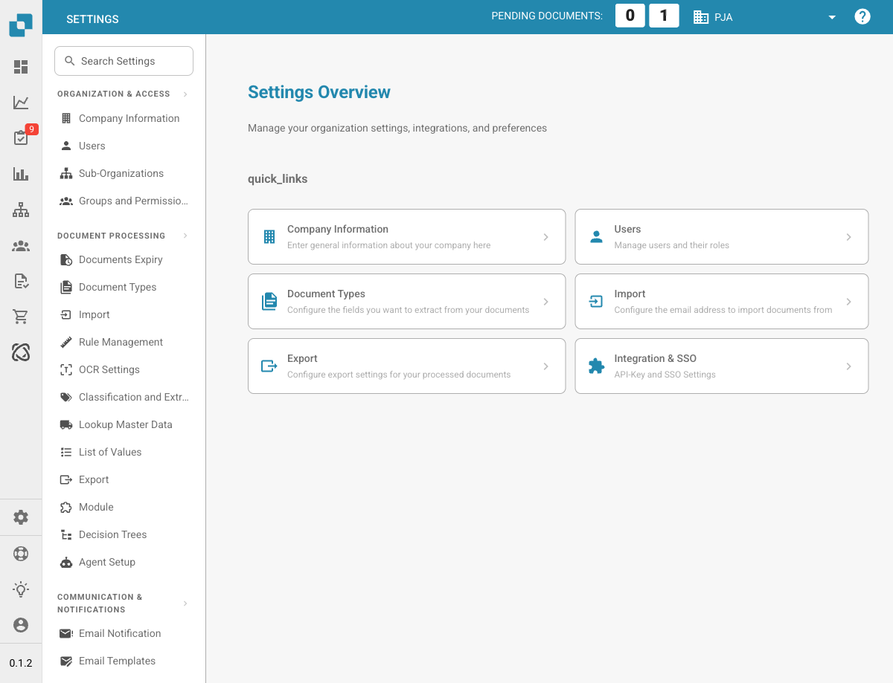

# Impostazioni

<figure><figcaption>
Pagina di panoramica delle impostazioni
</figcaption></figure>

L'area Impostazioni è il tuo punto centrale per configurare DocBits. È organizzata in cinque sezioni principali:

## 1. Organizzazione e accesso

Gestisci il profilo della tua azienda e controlla chi può accedere a cosa.

* **Company Information**: inserisci ragione sociale, indirizzo, partita IVA e altri identificativi legali.
* **Users**: aggiungi, modifica o disattiva gli account utente e assegna i ruoli (Admin, System Admin).
* **Sub-Organizations**: crea e gestisci sotto-organizzazioni per configurazioni multi-entità.
* **Groups and Permissions**: definisci gruppi di utenti e configura autorizzazioni granulari per ciascun gruppo.

## 2. Elaborazione documenti

Configura come i documenti vengono importati, elaborati ed esportati.

* **Documents Expiry**: imposta regole di eliminazione automatica dei documenti (ad es. eliminazione dopo 48 ore, 1 settimana, ecc.).
* **Document Types**: definisci e configura i tipi di documento elaborati da DocBits (fatture, ordini, bolle di consegna, ecc.), inclusi campi, colonne delle tabelle, script e altro.
* **Import**: imposta come i documenti entrano in DocBits: tramite e-mail (IMAP/Office 365), FTP o caricamento di file. Configura i tipi di file e i limiti di pagine.
* **Rule Management**: definisci le regole di risoluzione dei conflitti per la riconciliazione fattura-ordine di acquisto, incluse le impostazioni di tolleranza e i flussi di approvazione.
* **OCR Settings**: configura le soglie di qualità del riconoscimento ottico dei caratteri (OCR), l'uso dell'E-Text, la versione dell'OCR AI e il comportamento dell'estrazione delle tabelle.
* **Classification and Extraction**: imposta la suddivisione dei documenti, la formattazione degli importi, i metodi di estrazione delle tabelle, le regole di classificazione e i modelli AI.
* **Lookup Master Data**: configura come i dati estratti vengono convalidati rispetto ai dati anagrafici del tuo sistema ERP (ad es. conti fornitore, ordini di acquisto).
* **List of Values**: crea e gestisci elenchi di valori predefiniti utilizzati nei menu a tendina e nella convalida dei dati.
* **Export**: configura come e dove vengono inviati i documenti elaborati: tramite Webhook, SFTP, SMB o integrazioni Infor (IDM, ION, M3, LN).
* **Module**: attiva o disattiva funzioni opzionali come PO Dashboard, Auto Accounting, Supplier Portal, Workflow Builder, estrazione di codici QR e altro.
* **Decision Trees**: crea una logica decisionale basata su regole con un designer visuale. Supporta diverse policy (Unique, First, Priority, Collect, ecc.).
* **Agent Setup**: crea e gestisci agenti di automazione e canali di comunicazione per i flussi di lavoro di elaborazione automatica dei documenti.

## 3. Comunicazione e notifiche

Controlla come DocBits comunica con gli utenti ed elabora le e-mail in arrivo.

* **Email Notification**: configura gli avvisi e-mail per gli eventi di elaborazione dei documenti e per i cambi di stato.
* **Email Templates**: crea e gestisci modelli di e-mail riutilizzabili per le notifiche, organizzati per tipo di documento.
* **Email Ingestion**: configura come le e-mail in arrivo vengono classificate automaticamente e convertite in documenti. Include regole di classificazione, estrazione dei campi, elaborazione, gestione dei mittenti e addestramento, organizzate per tipo di documento (Orders, Invoices, Quotes, Delivery Notes, COA, PO Confirm).

## 4. Sistema e amministrazione

Monitora lo stato del sistema, gestisci le integrazioni e mantieni la sicurezza.

* **Integration & SSO**: configura le chiavi API per le integrazioni esterne e imposta il Single Sign-On (SSO) con i provider di identità.
* **Watchdog**: imposta il servizio Watchdog per l'importazione automatica di documenti da directory locali.
* **Dashboard**: personalizza il comportamento della dashboard: filtri, impostazioni di esportazione, autorizzazioni per le azioni e opzioni di visualizzazione dello stato.
* **Activity Logging**: consulta in tempo reale i log degli eventi di sistema filtrati per gravità (Debug, Info, Warning, Error), intervallo di tempo e servizio.
* **Analytics**: accedi a dashboard di analisi dettagliate, tra cui Logs Analytics, il monitoraggio Auth Security e API Metrics con Real User Monitoring (RUM).
* **Access Audit**: attiva e consulta le tracce di audit che registrano tutte le azioni di creazione, modifica ed eliminazione nella tua organizzazione per conformità e sicurezza.
* **System Licenses**: consulta e gestisci le informazioni sulle licenze API e il loro utilizzo.
* **Cache Management**: configura gli intervalli di cancellazione automatica della cache (TTL) per le cache di Received Delivery, Purchase Order e Task/Notification.
* **Fulltext Search Settings**: configura le funzionalità di ricerca full-text nei tuoi documenti e dati (richiede che il modulo Fulltext Search sia attivato).

## 5. Impostazioni fornitore

Configura il Supplier Portal e gestisci i flussi di lavoro legati ai fornitori.

* **Supplier General Settings**: imposta i campi di invito del Supplier Portal, configura gli stati del flusso di lavoro (Not Invited, Open, Pending Registration, Approved, Rejected) e gestisci le impostazioni di approvazione.
* **Email Templates**: crea e gestisci modelli di e-mail specifici per le comunicazioni con i fornitori.
* **Supplier Layout**: personalizza il layout e l'aspetto del Supplier Portal.
* **Export Configuration**: configura come i dati dei fornitori vengono esportati verso sistemi esterni.
* **Supplier Group**: crea e gestisci gruppi di fornitori per categorizzare e organizzare i tuoi fornitori.
* **User and Supplier Group Mapping**: collega gli utenti interni a gruppi di fornitori specifici per controllare visibilità e accesso.
