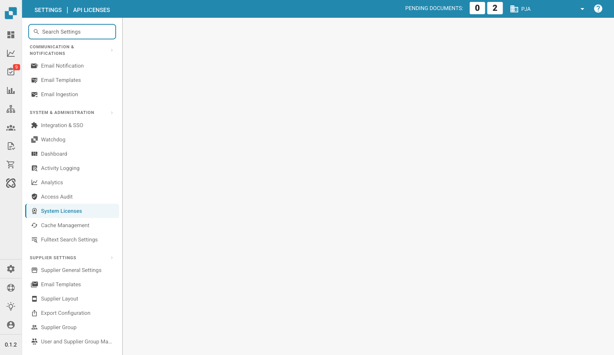

# Licenze di sistema

<figure><figcaption>
Pagina delle licenze di sistema
</figcaption></figure>

La pagina Licenze di sistema (chiamata anche Licenze API) mostra tutti i pacchetti software di terze parti utilizzati da DocBits, con i relativi numeri di versione e le licenze open source associate. Queste informazioni sono fornite a scopo di conformità e trasparenza.
