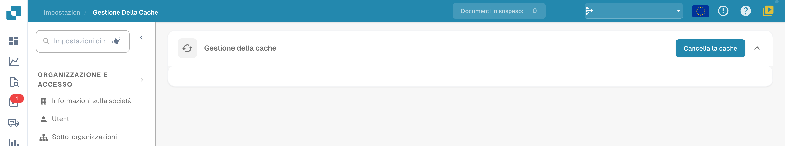

# Gestione della cache

Apri **Impostazioni → Gestione della cache**. Nella versione illustrata è disponibile **Cancella la cache**. Il comando invalida i dati memorizzati nella cache; il loro successivo caricamento può richiedere nuove richieste.

<figure><figcaption>
Gestione della cache con il comando Cancella la cache. Questa vista non mostra oggetti, interruttori per singola cache o valori TTL. Il comando non è stato eseguito durante la verifica.
</figcaption></figure>

## Prima di cancellare la cache

Verifica che lo svuotamento sia pertinente al problema osservato e considera l’effetto sugli utenti. Non usare una tabella o un valore TTL di una vecchia versione come istruzione per questa schermata: tali controlli non sono presenti nella vista illustrata.
