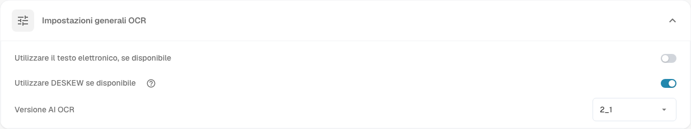

# Elaborazione documenti

Le impostazioni di **Elaborazione Documenti** determinano come DocBits legge, arricchisce ed esporta i documenti. Aprire **Impostazioni** e scegliere l’area desiderata in **Elaborazione Documenti**.

* [Impostazioni OCR](ocr-settings.md): come viene letto il testo dei documenti.
* [Ricerca dei dati anagrafici](master-data-lookup.md): come i valori estratti vengono confrontati con i dati anagrafici.
* [Calcolo della data di scadenza](due-date-calculation.md): come vengono calcolate le date di scadenza.
* [Esportazione](export.md): dove e come vengono esportati i documenti elaborati.

Ad esempio, aprire **Impostazioni OCR** per esaminare **Impostazioni generali OCR**. L’opzione **Utilizzare il testo elettronico, se disponibile** utilizza il testo elettronico incorporato. L’opzione **Utilizzare DESKEW se disponibile** raddrizza le pagine scansionate. L’opzione **Versione AI OCR** seleziona la versione del motore di riconoscimento. Consultare [Impostazioni OCR](ocr-settings.md) per i dettagli sui controlli.

<figure><figcaption>
Le impostazioni OCR generali sono un’area dell’elaborazione dei documenti. I valori selezionati dipendono dall’organizzazione.
</figcaption></figure>

Altre aree di questa sezione sono [Importazione](import/README.md), [Classificazione ed estrazione](classification-and-extraction/README.md), [Gestione delle regole](rule-manager/README.md), [Elenchi di valori](list-of-values.md) e [Modulo](module/README.md).

Se un’impostazione non si comporta come previsto, verificarla prima con un documento di prova. Una modifica può influire su tutti i nuovi documenti dell’organizzazione.
