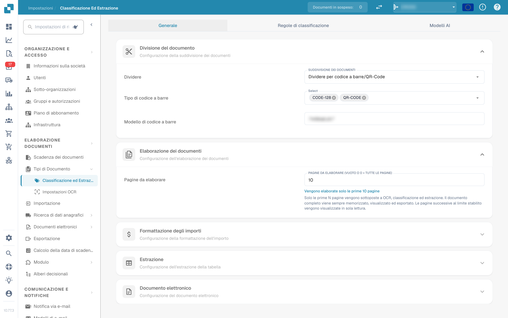
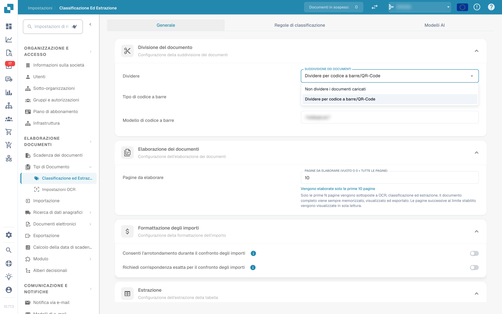
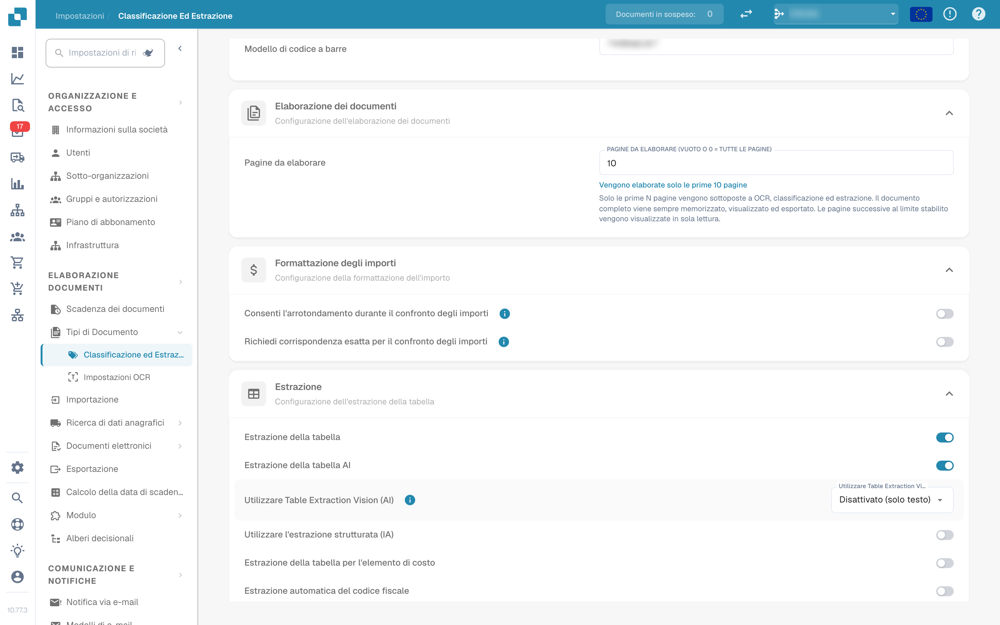
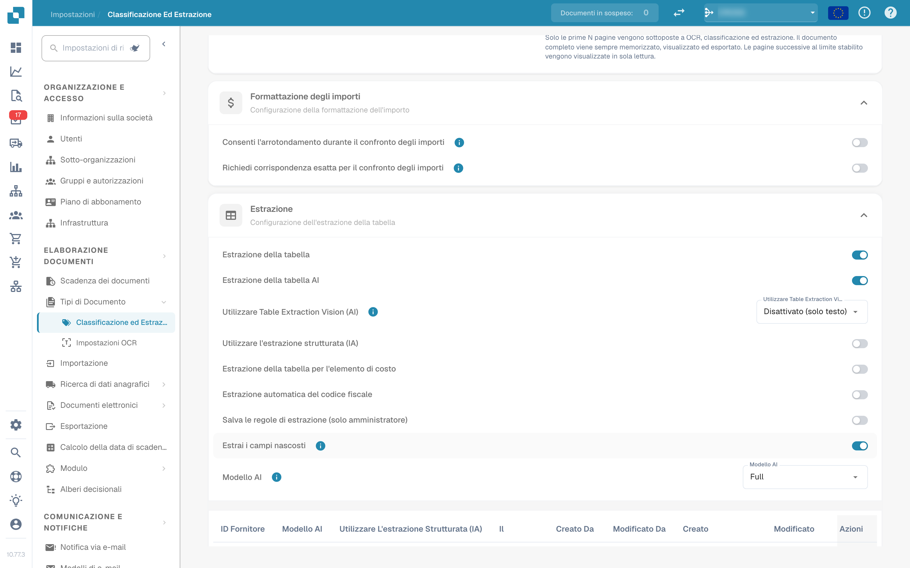
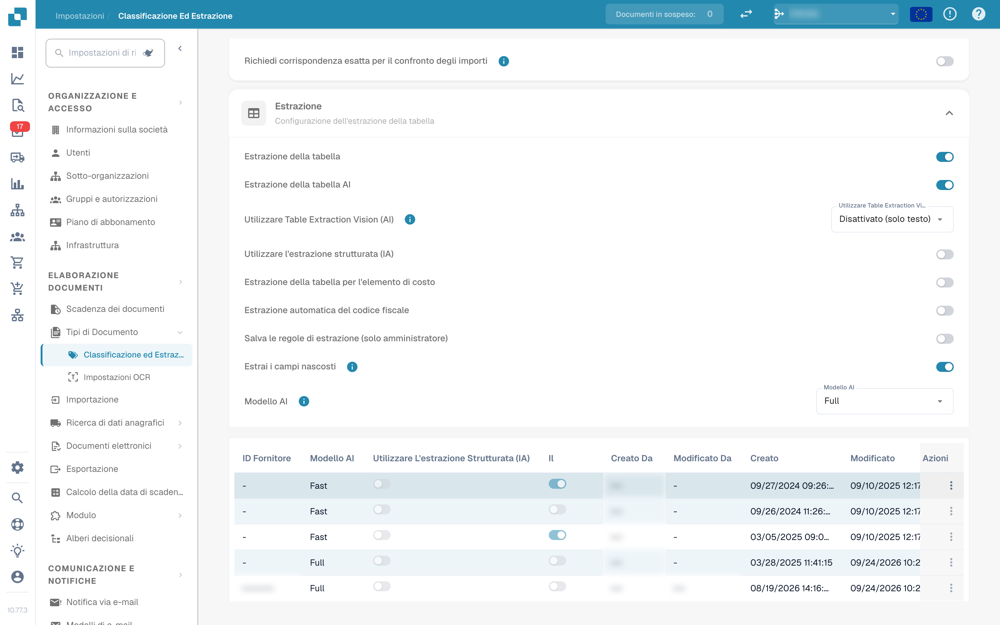
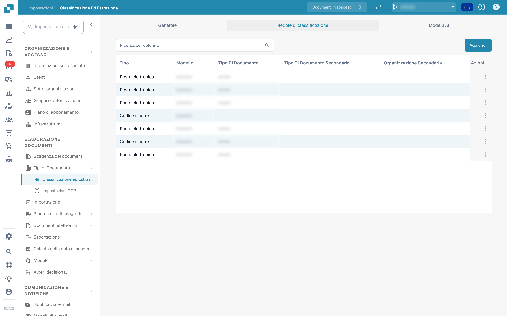
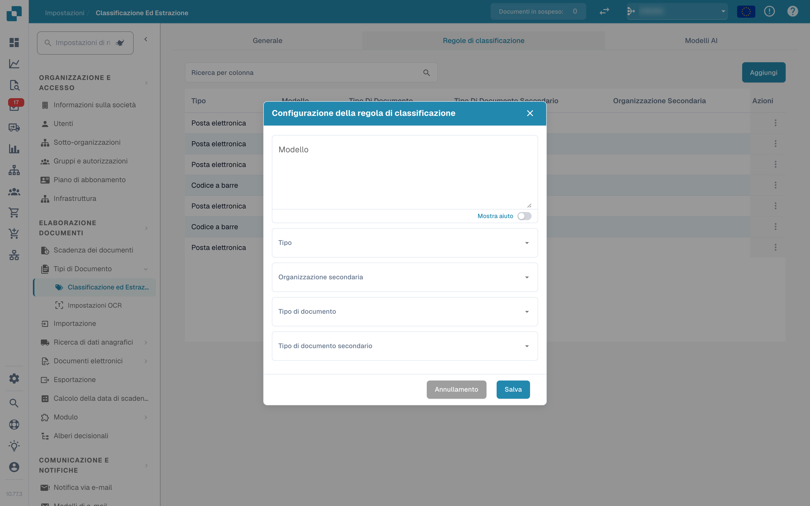
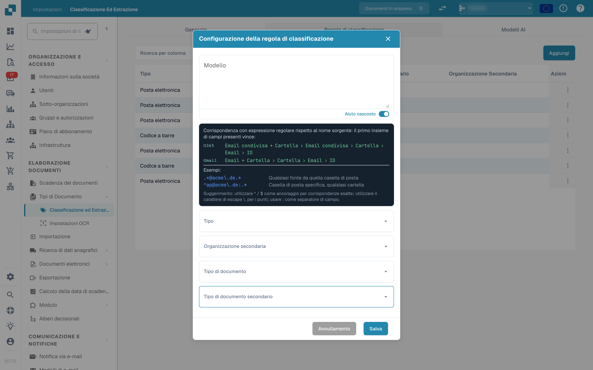
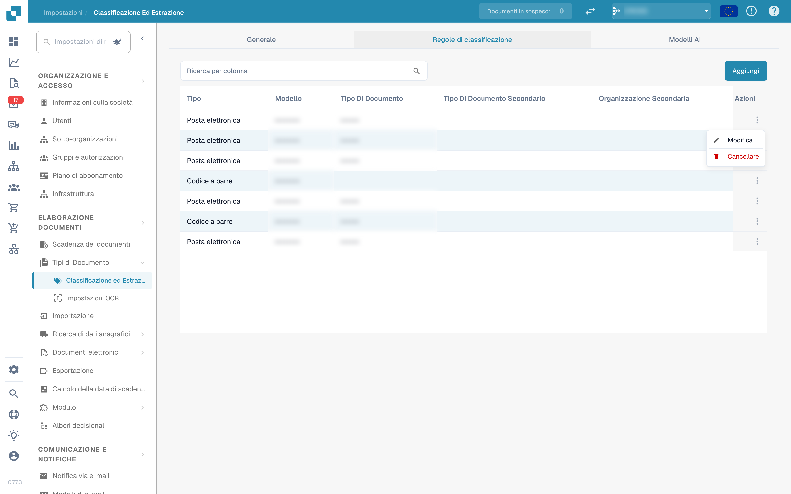
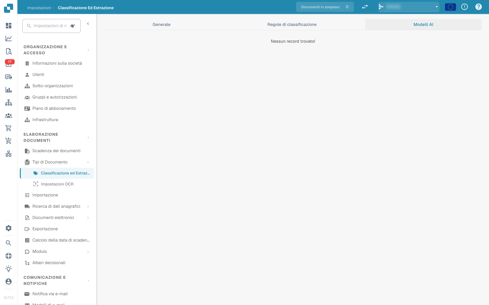

# Classificazione ed estrazione

<figure><figcaption>
Impostazioni di classificazione ed estrazione
</figcaption></figure>

## Panoramica

Nelle impostazioni **Classificazione ed estrazione** puoi:

* controllare come vengono **divisi** i documenti caricati e quante pagine vengono elaborate
* configurare la **formattazione degli importi** per il confronto degli importi
* impostare l'**estrazione della tabella**, incluso il modello AI usato per fornitore
* attivare o disattivare l'elaborazione dei file **ZUGFeRD** non supportati
* definire **regole di classificazione** che assegnano automaticamente un tipo di documento
* verificare i **modelli AI** e le loro etichette addestrate

La pagina ha tre schede: **Generale**, **Regole di classificazione** e **Modelli AI**. La scheda *Modelli AI* viene mostrata solo quando il modulo per modelli ed etichette è abilitato per la tua organizzazione.

| Scheda | Contenuto |
|---|---|
| Generale | Divisione del documento, Elaborazione dei documenti, Formattazione degli importi, Estrazione, Documento elettronico |
| Regole di classificazione | Regole regex che classificano i documenti in base al nome della fonte |
| Modelli AI | Modelli addestrati su misura con le loro etichette, tipi di documento e priorità |

## Accesso alle impostazioni di classificazione ed estrazione

Vai su **Impostazioni → Tipi di Documento → Classificazione ed Estrazione**.

## Generale

La scheda **Generale** raggruppa le impostazioni in sezioni espandibili. Tutte le modifiche vengono salvate immediatamente quando cambi un valore; non esiste un pulsante di salvataggio separato.

### Divisione del documento

**Dividere** stabilisce se un documento caricato viene diviso in più documenti quando su una delle sue pagine compare un codice a barre. Il menu a discesa offre:

* **Non dividere i documenti caricati** – il valore predefinito; il documento viene elaborato come un unico file.
* **Dividere per codice a barre/QR-Code** – il documento viene diviso a ogni codice a barre rilevato.

<figure><figcaption>
Opzioni di divisione nella sezione «Divisione del documento»
</figcaption></figure>

Quando è selezionato **Dividere per codice a barre/QR-Code**, compaiono altri due campi:

* **Tipo di codice a barre** – uno o più tipi di codice a barre da rilevare, ad esempio *CODE-128* o *QR-CODE*.
* **Modello di codice a barre** – un'espressione regolare a cui deve corrispondere il valore del codice a barre prima che la divisione venga attivata. Lascialo vuoto per dividere su qualsiasi codice a barre dei tipi selezionati. Il modello viene validato prima di essere salvato; un'espressione non valida viene segnalata immediatamente.

Dopo una divisione riuscita il documento principale viene eliminato e le pagine proseguono come documenti separati che condividono lo stesso batch.

### Elaborazione dei documenti

**Pagine da elaborare** limita quante pagine vengono elaborate con OCR, classificate ed estratte per documento.

<figure><figcaption>
Pagine da elaborare nella sezione «Elaborazione dei documenti»
</figcaption></figure>

* Vuoto o **0** significa che vengono elaborate tutte le pagine.
* Un numero *N* limita OCR, classificazione ed estrazione alle prime *N* pagine. Il documento completo viene comunque memorizzato, visualizzato ed esportato; le pagine oltre il limite sono mostrate in sola lettura.

### Formattazione degli importi

Due interruttori controllano come gli importi vengono confrontati con i dati anagrafici e gli ordini di acquisto.

<figure><figcaption>
Sezione «Formattazione degli importi»
</figcaption></figure>

* **Consenti l'arrotondamento durante il confronto degli importi** – se abilitato, è consentita una tolleranza di ±0,5. Se disabilitato, si applica ±0,05.
* **Richiedi corrispondenza esatta per il confronto degli importi** – se abilitato, gli importi devono corrispondere esattamente, senza tolleranza. Se disabilitato, si applica ±0,05.

Solo uno dei due interruttori può essere attivo alla volta; attivandone uno si disattiva l'altro.

### Estrazione


**Prerequisiti per un'estrazione della tabella funzionante**

* Il tipo di documento ha **colonne della tabella** (Impostazioni → Impostazioni globali → Tipi di Documento → [Colonne della tabella](../../global-settings/document-types/table-columns/README.md)). Senza colonne non c'è nulla in cui estrarre.
* **Estrazione della tabella** o **Estrazione della tabella AI** è attiva di seguito, per tutta l'organizzazione.
* Il documento contiene testo leggibile: è stato eseguito l'OCR, oppure per i PDF digitali viene usato l'E-Text ([Impostazioni OCR](../ocr-settings.md)).
* Addestramento e modelli AI sono **per fornitore**. Una tabella addestrata si applica solo ai documenti del fornitore su cui è stata addestrata.


Puoi estrarre tabelle dai documenti attivando **Estrazione della tabella** o **Estrazione della tabella AI**. Una tabella addestrata (basata su AI o manuale) è sempre collegata a un fornitore specifico.

<figure><figcaption>
Interruttori dell'estrazione della tabella
</figcaption></figure>

**Estrazione della tabella:** Attiva l'estrazione della tabella basata su regole. Le tabelle vengono addestrate per fornitore nella schermata di validazione (*Go to table extraction view*).\
Scopri di più sull'addestramento [qui](../../../setup/document-training/training-line-fields-table-training/defining-tables-and-columns.md).

**Estrazione della tabella AI:** Usa l'AI per estrarre la tabella di qualsiasi fornitore senza addestramento. Se i risultati per un fornitore non sono abbastanza precisi, addestra la tabella di quel fornitore; le regole salvate hanno quindi la precedenza sull'AI per quel fornitore.

**Utilizzare Table Extraction Vision (AI):** L'AI legge l'immagine della pagina invece del livello di testo. È utile con documenti scansionati e tabelle senza una chiara struttura di testo; è più lenta. Il menu a discesa accanto all'interruttore stabilisce con quale intensità viene usata l'immagine della pagina:

* **Disattivato (solo testo)** – Viene usato solo il livello di testo. Questo è il valore predefinito.
* **Solo immagini** – Viene letta solo l'immagine della pagina.
* **Ibrido (testo e immagini)** – Livello di testo e immagine della pagina vengono combinati nella stessa richiesta.
* **Auto (deciso per documento)** – DocBits decide per documento se il livello di testo è sufficiente.

**Utilizzare l'estrazione strutturata (IA):** L'AI restituisce la tabella in una struttura fissa che viene mappata direttamente sulle colonne della tabella configurate. Consigliato quando le intestazioni di colonna variano molto tra i documenti. Facendo clic sull'impostazione si apre un'anteprima di quali campi e colonne l'AI richiederà esattamente: i campi di intestazione e le colonne di riga sono elencati con la loro origine (campi standard richiesti o disattivati), insieme alla modalità di output attesa (ad esempio *strict* – nessuna colonna aggiuntiva). I campi configurati per il tipo di documento ma disattivati non vengono richiesti all'AI.

**Estrazione della tabella per l'elemento di costo:** Se abilitato, DocBits può estrarre elementi di costo dalle tabelle a livello di riga e classificarli di conseguenza.\
Una spiegazione dettagliata è disponibile [qui](table-extraction-for-costing-element.md).

**Estrazione automatica del codice fiscale:** Se abilitato, il sistema compila automaticamente il campo **Codice fiscale** nella schermata di validazione, a condizione che sia configurato un campo per il codice fiscale.\
Maggiori informazioni su questa impostazione [qui](auto-extract-tax-code.md).

**Salva le regole di estrazione (solo amministratore):** Solo gli amministratori possono fare clic su *Save Rules* durante l'addestramento delle tabelle. Attiva questa opzione quando gli utenti salvano ripetutamente regole che compromettono l'estrazione di un fornitore.

**Estrai campi nascosti:** Vengono estratti anche i campi contrassegnati come nascosti nelle impostazioni dei campi. Utile quando un valore serve per una regola o un'esportazione ma non deve essere mostrato nella schermata di validazione.

**Modello AI:** Seleziona il livello AI usato per l'estrazione della tabella. Sono disponibili sei opzioni: **Full** (massima precisione, il più lento, 2 token per documento), **Fast** (predefinito; 1 token per documento), **Nexus** e **Nexus Flash** (famiglia di modelli alternativa, opzionale), oltre a **Auto** e **Auto Nexus**, in cui DocBits decide per documento quanto deve essere potente il modello. La tabella sotto il selettore mostra:

* quali **fornitori** usano quale modello AI
* se usano l'estrazione strutturata (AI) e l'E-Text
* opzioni per eliminare una voce e riportare così il fornitore al valore predefinito

Questa impostazione è spiegata in dettaglio [qui](ai-model.md).

#### Perché la tabella è diversa per fornitore?

Tutto ciò che DocBits apprende su una tabella viene memorizzato **per fornitore**:

* **Regole salvate** (addestramento della tabella): posizione della tabella e mappatura delle sue colonne sul layout di quel fornitore.
* **Tag della tabella AI e regole di formattazione**: indicazioni che l'utente ha salvato per la tabella AI di quel fornitore.
* **Modello AI specifico del fornitore**: il livello scelto per quel fornitore in *More settings* nella schermata di validazione.

Il fornitore A con regole salvate mostra quindi una tabella deterministica nella scheda *Extracted table* della schermata di validazione, mentre il fornitore B senza regole riceve la *AI Extracted table*. Per far comportare il fornitore B come A, addestra una volta la tabella di B. Per reimpostare un fornitore, elimina le sue regole nella schermata di validazione o reimposta i suoi dati di addestramento nella tabella Modello AI.

#### Chiavi di preferenza

Ogni interruttore di questa sezione viene memorizzato come preferenza dell'organizzazione. Usa la chiave quando imposti il valore tramite l'API (`/preferences/set_preference`), uno script o il MCP di DocBits (`get_preference` / `set_preference`).

| Impostazione (etichetta UI) | Chiave di preferenza | Valori |
|---|---|---|
| Dividere | `SPLIT_DOCUMENT_ON_BARCODE` | `true` / `false` |
| Tipo di codice a barre | `SPLIT_DOCUMENT_BARCODE_TYPE` | elenco di nomi dei tipi di codice a barre |
| Modello di codice a barre | `SPLIT_DOCUMENT_BARCODE_PATTERN` | stringa regex |
| Pagine da elaborare | `RESTRICT_TO_PAGES` | numero; vuoto o `0` = tutte le pagine |
| Consenti l'arrotondamento durante il confronto degli importi | `AMOUNTS_ROUNDING` | `true` / `false` |
| Richiedi corrispondenza esatta per il confronto degli importi | `AMOUNTS_NO_ROUNDING` | `true` / `false` |
| Estrazione della tabella | `TABLE_EXTRACTION_SETTING` | `true` / `false` |
| Estrazione della tabella AI | `USE_AI_TABLE_EXTRACTION` | `true` / `false` |
| Utilizzare Table Extraction Vision (AI) | `TABLE_EXTRACTION_VISION_MODE` | `off` (predefinito), `vision`, `hybrid`, `auto` |
| Utilizzare Table Extraction Vision (AI) – vecchio interruttore | `TABLE_EXTRACTION_USE_VISION` | `true` / `false`; equivale a `vision` |
| Utilizzare l'estrazione strutturata (IA) | `USE_STRUCTURED_EXTRACTION` | `true` / `false` |
| Estrazione della tabella per l'elemento di costo | `CHARGES_TABLE_EXTRACTION` | `true` / `false` |
| Estrazione automatica del codice fiscale | `AUTO_EXTRACT_TAX_CODE` | `true` / `false` |
| Salva le regole di estrazione (solo amministratore) | `ONLY_ADMIN_CAN_SAVE_RULES` | `true` / `false` |
| Estrai campi nascosti | `EXTRACT_HIDDEN_FIELDS` | `true` / `false` |
| Modello AI | `AI_MODEL` | `gpt-6-sol` (Full), `gpt-6-luna` (Fast), `qwen3.8-max` (Nexus), `glm-5.3-flash` (Nexus Flash), `auto` (Auto), `auto-nexus` (Auto Nexus) |
| Versione dell'estrazione della tabella (finestra di conferma) | `TBL_EXT_VERSION` | stringa di versione |
| Impostazioni OCR → Usa i dati AI per le tabelle se disponibili | `USE_AI_DATA_FOR_TABLE` | `true` / `false` |
| Impostazioni OCR → Usa E-Text se disponibile | `USE_ETEXT_IF_AVAILABLE` | `true` / `false` |

Note:

* Le preferenze booleane vengono memorizzate come stringhe `true` / `false`; una chiave mai impostata vale `false`. Se invii `1` o `0`, DocBits memorizza `true` / `false`.
* Un `AI_MODEL` non impostato significa **Fast**.
* Un `TABLE_EXTRACTION_VISION_MODE` non impostato viene ricavato dal vecchio interruttore `TABLE_EXTRACTION_USE_VISION`: `true` dà `vision`, qualsiasi altro valore dà `off`.
* La modifica di una chiave ha effetto per i documenti elaborati successivamente. Riavvia un documento per riestrarlo con la nuova impostazione.
* Le scelte per fornitore (E-Text, modello AI, regole salvate) non sono preferenze dell'organizzazione; si impostano nella schermata di validazione sotto *More settings* per un documento di quel fornitore.

### Documento elettronico

**Elaborazione di ZUGFeRD PDF non supportati:** Se abilitato, le versioni **ZUGFeRD** non supportate vengono elaborate come PDF standard e l'XML incorporato viene ignorato.

L'elenco delle versioni **ZUGFeRD** supportate è disponibile [qui](../../global-settings/document-types/edi/zugferd/README.md).

## Regole di classificazione

La scheda **Regole di classificazione** elenca le regole che assegnano automaticamente un tipo di documento durante l'elaborazione. Ogni regola confronta un **modello regex** con il nome della fonte del documento e, in caso di corrispondenza, imposta il tipo di documento e facoltativamente un tipo di documento secondario.

Passa alla scheda facendo clic su **Regole di classificazione** nella parte superiore della pagina.

<figure><figcaption>
Scheda «Regole di classificazione» con la tabella delle regole
</figcaption></figure>

La tabella ha una riga per regola con queste colonne:

* **Tipo** – dove viene applicato il modello. Esistono due tipi: **Codice a barre** ed **E-mail**.
* **Modello** – l'espressione regolare memorizzata per la regola.
* **Tipo di documento** – il tipo di documento assegnato quando il modello corrisponde.
* **Tipo di documento secondario** – il tipo di documento secondario assegnato quando il modello corrisponde.
* **Organizzazione secondaria** – l'organizzazione secondaria a cui è limitata la regola. Vuoto significa che la regola vale per tutte le organizzazioni secondarie.
* **Azioni** – il menu di riga con *Modifica* e *Cancellare*.

Il campo di ricerca sopra la tabella filtra tutte le colonne, compresi i testi visualizzati delle colonne a discesa.

### Aggiungere una regola di classificazione

1.  Fai clic su **Aggiungi** sopra la tabella.

    <figure><figcaption>
Finestra «Configurazione della regola di classificazione»
</figcaption></figure>
2. Compila i campi:
   * **Modello** (obbligatorio) – l'espressione regolare cercata dalla regola.
   * **Tipo** (obbligatorio) – **Codice a barre** o **E-mail**. Questo decide a quale nome della fonte viene confrontato il modello.
   * **Organizzazione secondaria** *(facoltativo)* – limita la regola a un'organizzazione secondaria.
   * **Tipo di documento** – il tipo di documento assegnato quando il modello corrisponde.
   * **Tipo di documento secondario** *(facoltativo)* – un tipo più specifico; l'elenco dipende dal tipo di documento selezionato. Cambiando il tipo di documento si azzera il tipo di documento secondario.
3.  Fai clic su **Salva**.

La finestra valida il modello prima del salvataggio. Un modello già usato da un'altra regola viene rifiutato con *Il modello esiste già*; un modello vuoto viene rifiutato con il messaggio del campo obbligatorio.

#### Aiuto sul modello

L'interruttore **Mostra aiuto** sotto il campo del modello apre un riferimento in linea con i formati del nome della fonte a cui viene confrontato il modello:

* **O365** – `Email condivisa + Cartella › Email condivisa › Cartella › Email › ID`
* **Gmail** – `Email + Cartella › Cartella › Email › ID`

<figure><figcaption>
Pannello di aiuto sul modello nella finestra della regola
</figcaption></figure>

Esempi nel pannello:

* `.*@acme\.de.*` – qualsiasi fonte da quella casella di posta
* `^ap@acme\.de:.*` – una casella di posta specifica, qualsiasi cartella

Suggerimento: usa `^` / `$` come ancoraggio per corrispondenze esatte, esegui l'escape dei punti come `\.` e usa `:` come separatore di campo. Vince il primo insieme di campi presente nel nome della fonte.

Se usi il tipo **E-mail**, il modello viene confrontato con i nomi della casella di posta e della cartella del messaggio importato, non con il contenuto del documento.

### Modificare una regola di classificazione

1.  Fai clic sui tre punti nella colonna **Azioni** della regola che vuoi modificare.

    <figure><figcaption>
Menu di riga con Modifica e Cancellare
</figcaption></figure>
2.  Seleziona **Modifica**. La finestra si apre con i valori attuali della regola.

    <figure><figcaption>
Modifica di una regola di classificazione esistente
</figcaption></figure>
3. Apporta le modifiche a modello, tipo, organizzazione secondaria, tipo di documento o tipo di documento secondario.
4.  Fai clic su **Salva**.

Vale la stessa validazione dell'aggiunta: il modello non deve essere vuoto e non deve duplicare quello di un'altra regola.

### Eliminare una regola di classificazione

1. Fai clic sui tre punti nella colonna **Azioni**.
2. Seleziona **Cancellare**.

La regola viene rimossa immediatamente dall'elenco. L'eliminazione di una regola non modifica i documenti già classificati con essa.

## Modelli AI

La scheda **Modelli AI** mostra i modelli addestrati su misura disponibili per la classificazione dei documenti e le loro etichette. Compare solo quando il modulo per modelli ed etichette è abilitato per la tua organizzazione.

<figure><figcaption>
Scheda «Modelli AI»
</figcaption></figure>

Se per l'organizzazione non è disponibile alcun modello proprio, la scheda mostra *Nessun record trovato!*.

### Modelli

Ogni modello è una voce espandibile con:

* il **nome del modello** e il badge **Predefinito** sul modello usato quando non si applica nulla d'altro.
* il numero di **etichette** addestrate per quel modello.
* per modello, una volta espanso: **Tipo**, **Solo la prima pagina** e **Versione**.

Sotto queste informazioni sono elencate le etichette del modello.

### Etichette

Le etichette sono ciò che il modello impara. Ogni etichetta associa un modello riconosciuto dal modello a un tipo di documento.

* **Nome** – il nome dell'etichetta.
* **Modello successivo** – un modello che continua l'elaborazione dell'output di questa etichetta.
* **TIPO DI DOC** – il tipo di documento assegnato dall'etichetta.
* **Tipo di documento secondario** – un tipo più specifico per l'etichetta.
* **Priorità** – l'ordine in cui vengono valutate le etichette; prima i numeri più bassi.

Il campo di ricerca sopra la tabella delle etichette filtra le etichette del modello selezionato.

### Modificare un'etichetta

Fai clic sull'icona a matita di una riga di etichetta per aprire la finestra di modifica. Offre **Modello successivo** e **Tipo di documento**; imposta uno dei due, perché la finestra richiede un modello successivo o un tipo di documento. Fai clic su **Salva** per applicare la modifica.

## Pagine correlate

* [Modello AI](ai-model.md) – i sei livelli di estrazione e come un fornitore ottiene il proprio modello
* [Estrazione automatica del codice fiscale](auto-extract-tax-code.md)
* [Estrazione della tabella per l'elemento di costo](table-extraction-for-costing-element.md)
* [Impostazioni OCR](../ocr-settings.md)
