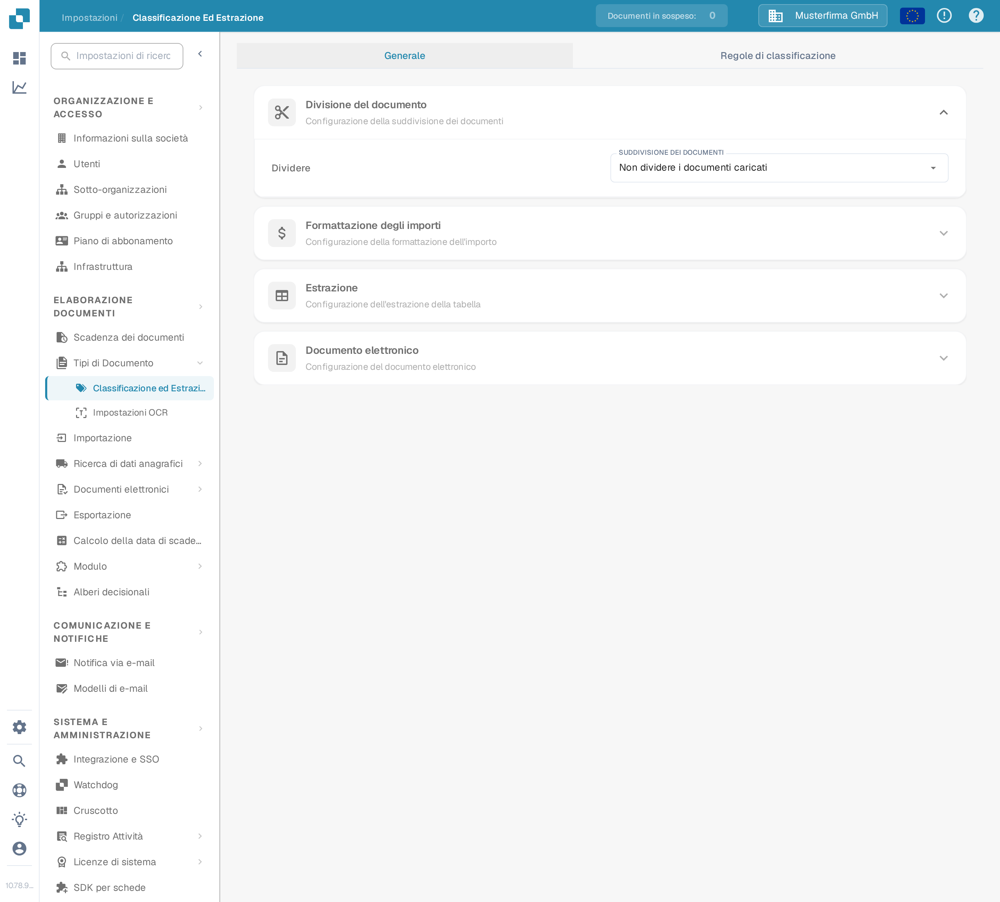
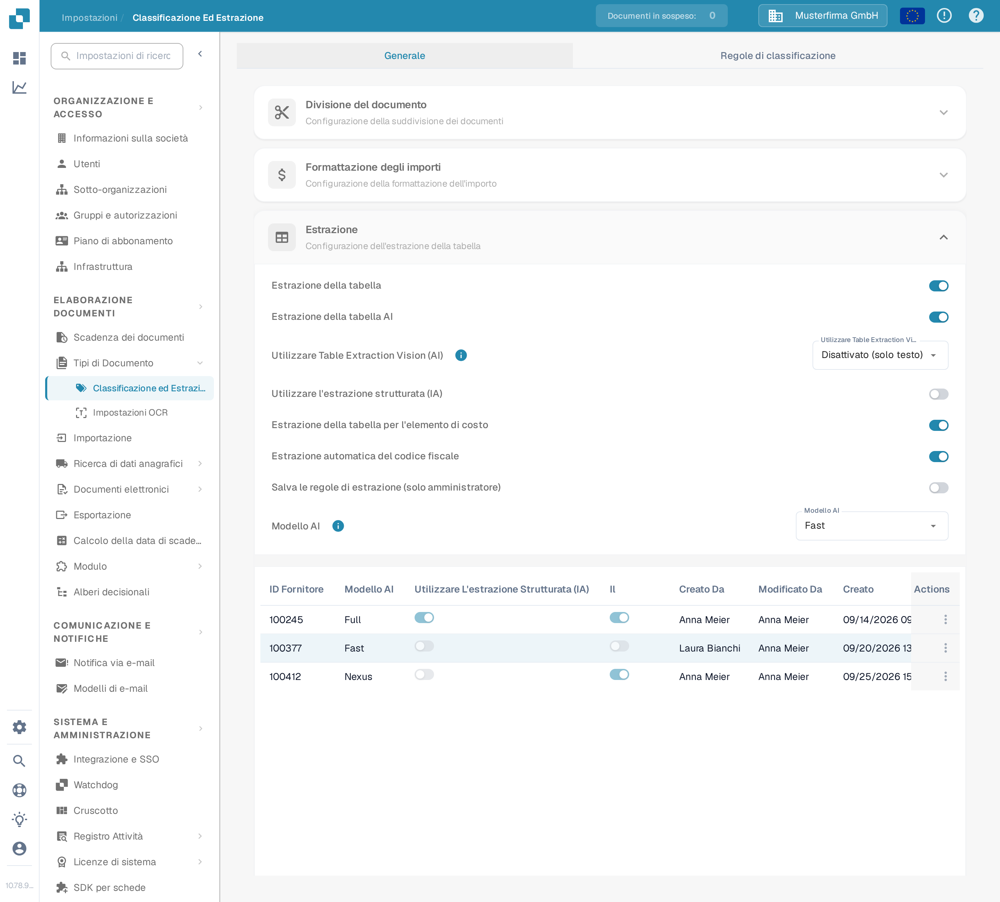
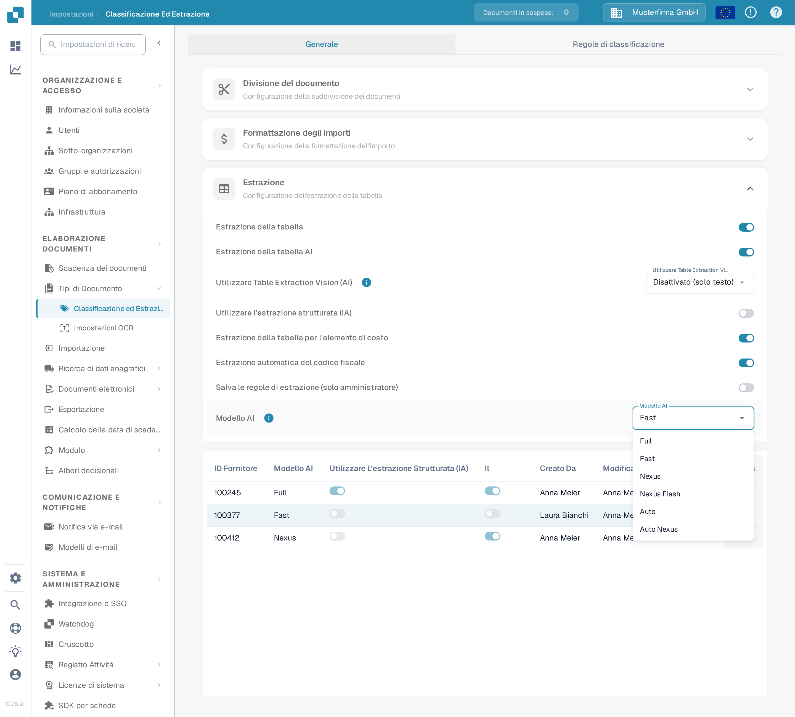
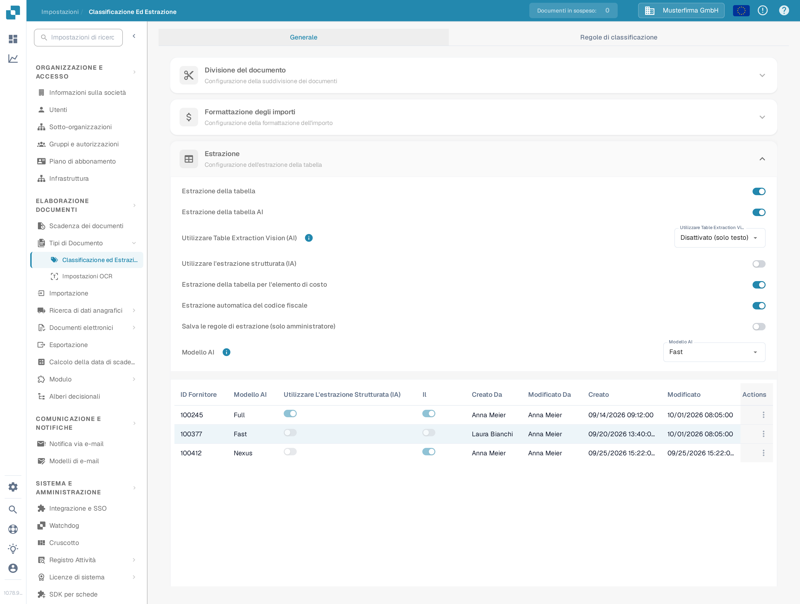
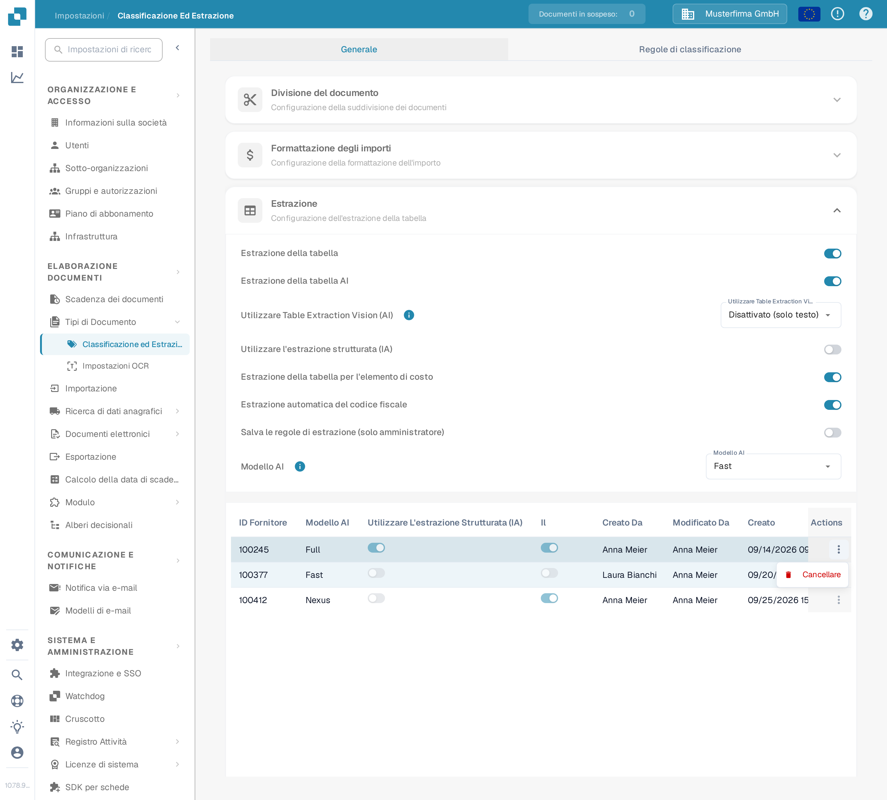

# Modello AI

## Panoramica

L'impostazione **Modello AI** consente di definire quale modello AI viene utilizzato per impostazione predefinita per l'**estrazione dei campi** e l'**estrazione delle tabelle** durante l'elaborazione dei documenti.\
In questa sezione puoi consultare il costo in token di ciascun modello e vedere quale modello è attualmente assegnato a ciascun fornitore.

## Come Accedere

1.  Vai su **Impostazioni** → **Elaborazione Documenti** → **Classificazione ed Estrazione**

    <figure><figcaption>
Apri <strong>Impostazioni → Elaborazione Documenti → Classificazione ed Estrazione</strong>.
</figcaption></figure>
2.  Scorri verso il basso fino alla sezione **Estrazione**

    <figure><figcaption>
La sezione <strong>Estrazione</strong> contiene l'impostazione <strong>Modello AI</strong> e la tabella di assegnazione per fornitore.
</figcaption></figure>

## Opzioni del Modello AI

DocBits offre sei opzioni di modello AI per l'estrazione dei campi e delle tabelle. Si differenziano per l'equilibrio tra **precisione di estrazione**, **velocità di elaborazione** e **costo in token per documento** — così puoi adattare l'opzione al tipo di documenti che elabori. Passa il mouse sull'icona informativa accanto all'impostazione per vedere il costo in token dell'opzione attualmente selezionata. Se nessun modello è impostato per un fornitore, il valore non impostato equivale a **Fast**.

* **Full** – L'opzione più approfondita, con la massima precisione di estrazione. Ideale per layout complessi, scansioni di bassa qualità o documenti in cui la precisione è la priorità. Essendo l'opzione più potente, è anche la più lenta, a **2 token per documento**.
* **Fast** – Un'opzione bilanciata che unisce una buona precisione a un'elaborazione più rapida e a un costo inferiore. È il livello predefinito: i fornitori senza una propria impostazione del modello AI usano Fast, a **1 token per documento**.
* **Nexus** – Un'opzione attivabile su richiesta che si basa su un'altra famiglia di modelli (Qwen 3.8 Max). Utile quando vuoi una seconda opinione per i fornitori su cui Fast e Full non concordano, oppure quando il modello alternativo legge meglio un particolare layout, a **1 token per documento**.
* **Nexus Flash** – Un livello più rapido della famiglia Nexus (GLM-5.3 Flash). Elabora i documenti più velocemente di Nexus allo stesso costo in token, a **1 token per documento**.
* **Auto** – Non è un modello a sé: documento per documento, DocBits decide se basta Fast o se serve Full, così i documenti complessi ricevono automaticamente il modello più potente, a **1 token per documento**.
* **Auto Nexus** – Come Auto, ma limitato alla famiglia di modelli Nexus (Nexus Flash e Nexus). I documenti restano completamente fuori dalla famiglia di modelli standard, a **1 token per documento**.

| Opzione         | Ideale per                                                                                  | Precisione    | Velocità      | Costo in token |
| --------------- | ------------------------------------------------------------------------------------------- | ------------- | ------------- | -------------- |
| **Full**        | Layout complessi, scansioni scadenti, esigenze di alta precisione                           | Massima       | La più lenta  | 2 / documento  |
| **Fast**        | Documenti di tutti i giorni (predefinito quando non è impostato nulla)                      | Alta          | Veloce        | 1 / documento  |
| **Nexus**       | Fornitori per cui la famiglia di modelli alternativa dà risultati migliori (su attivazione) | Alta          | Veloce        | 1 / documento  |
| **Nexus Flash** | Qualità Nexus con elaborazione più rapida                                                   | Alta          | Più veloce    | 1 / documento  |
| **Auto**        | Qualità di documenti mista senza regolazioni manuali                                        | Per documento | Per documento | 1 / documento  |
| **Auto Nexus**  | Decisioni automatiche limitate alla famiglia Nexus                                          | Per documento | Per documento | 1 / documento  |

<figure><figcaption>
Il menu a discesa <strong>Modello AI</strong> con le sei opzioni disponibili.
</figcaption></figure>

## Tabella di Assegnazione del Modello AI

Puoi anche configurare **modelli AI** specifici per fornitore direttamente nella **Schermata di validazione**, per mettere a punto la precisione dell'estrazione per singoli fornitori.\
\
Per ulteriori informazioni, consulta la documentazione corrispondente [qui](../../../../end-user-and-partner-section/end-user-section/validation-screen/supplier-specific-ai-model-for-field-and-table-extraction.md).

La tabella di assegnazione mostra le impostazioni del modello AI per ciascun fornitore e include i seguenti dettagli:

* **ID Fornitore** – L'identificatore unico del fornitore
* **Modello AI** – Il livello di modello AI attualmente assegnato al fornitore
* **Utilizzare L'estrazione Strutturata (IA)** – Indica se l'estrazione strutturata è attivata per quel fornitore
* **E-Text** – Indica se la funzione E-Text è attivata
* **Creato Da / Modificato Da / Creato / Modificato** – Chi ha impostato la voce e quando
* **Actions** – Contiene l'opzione per eliminare la voce

<figure><figcaption>
La tabella di assegnazione mostra l'etichetta del livello per fornitore, mai l'identificatore raw del modello.
</figcaption></figure>

### Elimina la voce – Ripristina le impostazioni specifiche del fornitore

Per ripristinare l'impostazione del modello AI di un fornitore al valore predefinito:

1.  Clicca sui tre punti nella colonna **Actions** accanto alla voce del fornitore e seleziona **Cancellare**.

    <figure><figcaption>
Apri il menu delle azioni della riga e scegli <strong>Cancellare</strong>.
</figcaption></figure>
2.  Apparirà una finestra di conferma—conferma di voler eliminare la voce.

    <figure><figcaption>
Conferma l'eliminazione nella finestra di dialogo.
</figcaption></figure>

Una volta eliminata, la voce scompare e il fornitore torna a utilizzare il **modello AI** predefinito per l'**estrazione dei campi** e l'**estrazione delle tabelle**.
