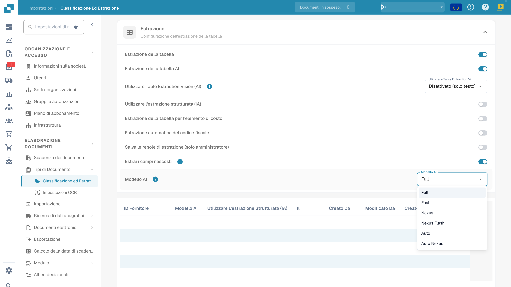

# Modello AI

## Ambito del modello

Apri **Impostazioni → Elaborazione documenti → Classificazione ed estrazione** e individua **Modello AI** nella sezione di estrazione. La configurazione dell’organizzazione viene usata quando non esiste una preferenza applicabile al template di estrazione corrente.

<figure><figcaption>
Menu Modello AI con Full, Fast, Nexus, Nexus Flash, Auto e Auto Nexus. Sono livelli del prodotto. Le righe di preferenze sono mascherate; nessun modello è stato cambiato.
</figcaption></figure>

## Scegliere un livello

Le sei opzioni visibili sono **Full**, **Fast**, **Nexus**, **Nexus Flash**, **Auto** e **Auto Nexus**. I nomi non garantiscono un particolare modello sottostante, prezzo, tempo o grado di precisione. Confronta gli stessi documenti rappresentativi e controlla campi, tabelle, tempi e costi nelle condizioni attuali dell’ambiente.

## Preferenze del template

La preferenza specifica viene salvata per organizzazione e template di estrazione (`tfidf_id`). Un fornitore può avere più template con preferenze indipendenti: cambiare una voce non aggiorna automaticamente tutti i suoi documenti o template. Una preferenza non impostata non significa sempre Fast.

Consulta [Modello AI specifico del fornitore](../../../../end-user-and-partner-section/end-user-section/validation-screen/supplier-specific-ai-model-for-field-and-table-extraction.md) per l’accesso dalla schermata di convalida.

## Rimuovere una preferenza

Prima di eliminare una voce, identifica il template e tutte le preferenze interessate. L’eliminazione può rimuovere più preferenze del template, non soltanto il livello AI. Esamina l’eventuale conferma della versione in uso prima di procedere. Successivamente si applicano la configurazione dell’organizzazione e i valori di ripiego pertinenti; gli altri template possono mantenere impostazioni indipendenti.

La modifica non rielabora automaticamente i documenti storici e non garantisce convalida, abbinamento degli ordini, approvazione o esportazione. Durante questa verifica non sono stati eliminati template né eseguite nuove estrazioni.
