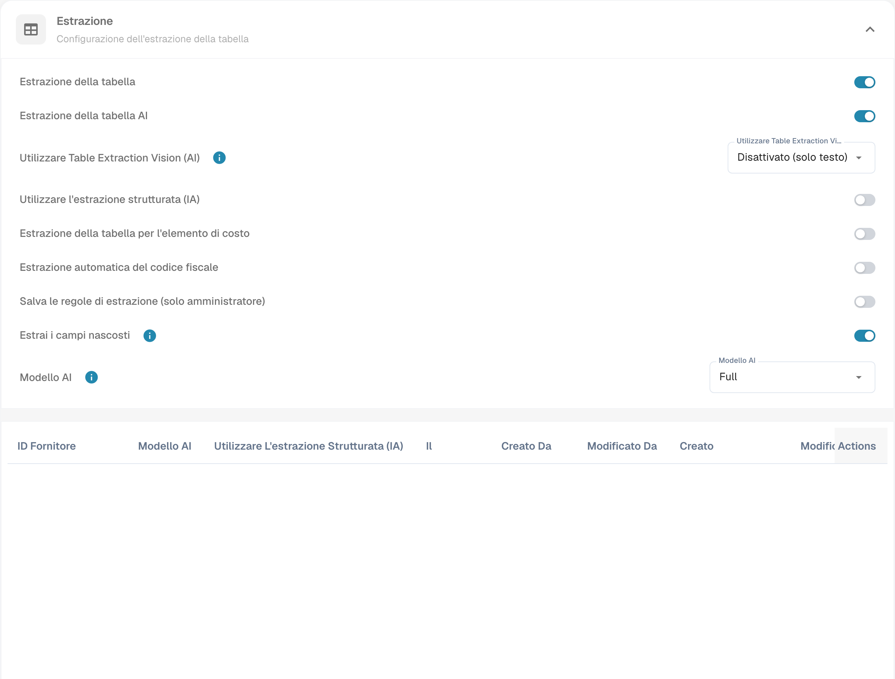

# Estrarre automaticamente il codice d’imposta

Aprire le impostazioni di classificazione ed estrazione del tipo di documento e cercare l’estrazione automatica del codice d’imposta. Verificare la configurazione prevista prima di attivarla e salvarla.

<figure><figcaption>
Impostazioni per l’estrazione automatica del codice d’imposta. La voce Estrazione automatica del codice fiscale indica qui il Tax Code ERP.
</figcaption></figure>

Quando la funzione è attiva ed è configurato un campo per il codice d’imposta, DocBits può compilarlo automaticamente durante la convalida. Confrontare il codice ottenuto con il documento e la configurazione ERP. L’immagine mostra le impostazioni, non un’estrazione fiscale verificata. La tabella conserva codici tecnici e regole dell’esempio di integrazione; verificare i valori specifici della propria azienda.

<table data-full-width="true"><thead><tr><th>Tipo di fattura</th><th></th><th>Codice d’imposta</th><th>Oppure nel campo di testo</th><th>Numero dell’ordine di acquisto</th><th>Paese del fornitore</th><th>Regola</th></tr></thead><tbody><tr><td>Fattura di costi</td><td>Con importo dell’imposta</td><td>NAGDH</td><td>LD + % (arrotondato all’importo assoluto più alto)</td><td>Vuoto</td><td>I primi due caratteri dell’identificativo fiscale  oppure il paese dell’indirizzo del fornitore: tccom120.cadr → tccom130.cadr, campo tcom130.ccty</td><td>Quando il paese corrisponde a quello dell’azienda</td></tr><tr><td>Fattura di costi</td><td>Senza importo dell’imposta</td><td>NAGD0</td><td>LD + % (arrotondato all’importo assoluto più alto)</td><td>Vuoto</td><td>I primi due caratteri dell’identificativo fiscale  oppure il paese dell’indirizzo del fornitore: tccom120.cadr → tccom130.cadr, campo tcom130.ccty</td><td>Quando il paese corrisponde a quello dell’azienda</td></tr><tr><td>Fattura di costi</td><td>Senza importo dell’imposta</td><td>EUDH</td><td>ED 0 %</td><td>Vuoto</td><td>I primi due caratteri dell’identificativo fiscale  oppure il paese dell’indirizzo del fornitore: tccom120.cadr → tccom130.cadr, campo tcom130.ccty</td><td>Quando il paese è diverso da quello dell’azienda ed è membro dell’UE nella tabella dei paesi (tcmcs010)</td></tr><tr><td>Fattura di ordine</td><td>Con importo dell’imposta</td><td>NAHGH</td><td>IG + % (arrotondato all’importo assoluto più alto)</td><td>Non vuoto</td><td>I primi due caratteri dell’identificativo fiscale  oppure il paese dell’indirizzo del fornitore: tccom120.cadr → tccom130.cadr, campo tcom130.ccty</td><td>Quando il paese corrisponde a quello dell’azienda</td></tr><tr><td>Fattura di ordine</td><td>Senza importo dell’imposta</td><td>NAHG0</td><td>IG + % (arrotondato all’importo assoluto più alto)</td><td>Non vuoto</td><td>I primi due caratteri dell’identificativo fiscale  oppure il paese dell’indirizzo del fornitore: tccom120.cadr → tccom130.cadr, campo tcom130.ccty</td><td>Quando il paese corrisponde a quello dell’azienda</td></tr><tr><td>Fattura di ordine</td><td>Con importo dell’imposta</td><td>EUGH</td><td>ED 0 %</td><td>Non vuoto</td><td>I primi due caratteri dell’identificativo fiscale  oppure il paese dell’indirizzo del fornitore: tccom120.cadr → tccom130.cadr, campo tcom130.ccty</td><td>Quando il paese è diverso da quello dell’azienda ed è membro dell’UE nella tabella dei paesi (tcmcs010)</td></tr><tr><td>Fattura di costi</td><td>Senza importo dell’imposta</td><td>IMGD</td><td>ID 0 %</td><td>Vuoto</td><td>I primi due caratteri dell’identificativo fiscale  oppure il paese dell’indirizzo del fornitore: tccom120.cadr → tccom130.cadr, campo tcom130.ccty</td><td>Quando il paese è diverso da quello dell’azienda e non è membro dell’UE nella tabella dei paesi (tcmcs010)</td></tr><tr><td>Fattura di ordine</td><td>Con importo dell’imposta</td><td>IMHG</td><td>IG 0 %</td><td>Non vuoto</td><td>I primi due caratteri dell’identificativo fiscale  oppure il paese dell’indirizzo del fornitore: tccom120.cadr → tccom130.cadr, campo tcom130.ccty</td><td>Quando il paese è diverso da quello dell’azienda e non è membro dell’UE nella tabella dei paesi (tcmcs010)</td></tr></tbody></table>

Nell’interfaccia, Estrazione automatica del codice fiscale indica qui il Tax Code dell’integrazione ERP, non l’identificativo fiscale personale italiano.
