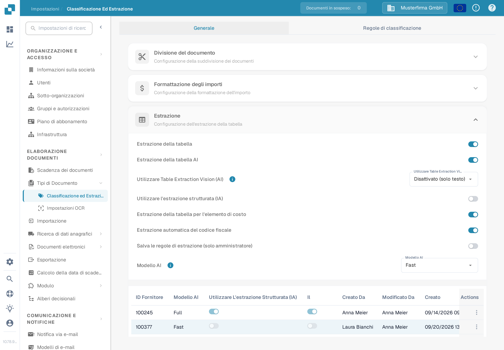

# Estrazione della tabella per l'elemento di costo

Gli elementi di costo sono addebiti o altri importi rappresentati come righe della tabella della fattura. Se questa funzione è abilitata e il documento contiene righe estratte, DocBits può classificare quelle righe rispetto agli elementi di costo configurati per l'organizzazione. Un revisore può correggere la classificazione di una riga nella tabella del documento.

## Abilitare l'impostazione

1. Apri **Impostazioni → Elaborazione del documento → Classificazione ed estrazione**.
2. Rimani su **Generale** e expandi **Estrazione**.
3. Trova **Estrazione della tabella per l'elemento di costo** sotto i campi richiesti per l'estrazione della tabella. Un amministratore può attivare questo interruttore per l'organizzazione.

<figure><figcaption>
L'interruttore è disattivato nell'organizzazione sintetica Musterfirma GmbH. Non è stato modificato per questa guida.
</figcaption></figure>


Il solo interruttore non crea elementi di costo né righe di fattura. Configura prima gli elementi e importa i dati necessari. La guida collegata [configurazione degli elementi di costo](../../../../infor-integration-and-configuration/importing-customer-master-data/m3/table-extraction-for-costing-element.md) spiega l'esempio M3. Consulta [Classificazione ed estrazione](README.md) per le altre impostazioni di estrazione.


## Revisionare o correggere una riga

Apri un documento la cui tabella della fattura contiene righe estratte e controlla l'icona dell'elemento di costo accanto alla riga interessata. Seleziona l'icona per aprire le classificazioni disponibili. Scegli l'elemento di costo configurato corretto, oppure scegli **Uncategorize** se la riga è un articolo ordinario. Poi revisiona la riga risultante e i totali prima di salvare il documento.

Se l'icona o una classificazione manca, conferma prima che il documento contenga righe estratte, che la funzione sia abilitata e che un elemento di costo sia configurato per l'organizzazione. Il documento sintetico Musterfirma GmbH usato per questo controllo della documentazione non conteneva righe di fattura estratte, quindi il menu di classificazione non ha potuto essere mostrato né utilizzato. I passaggi sopra riflettono il controllo di documento attuale; nessuna classificazione è stata salvata durante questo controllo.
