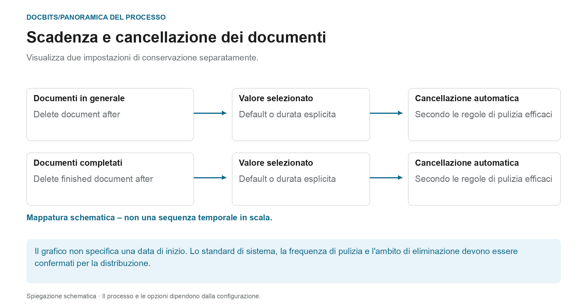

# Scadenza dei documenti

## Due regole di conservazione invece di un periodo di cancellazione generale

<figure><figcaption>
Visualizza due impostazioni di conservazione separatamente. Il diagramma è schematico; le impostazioni attive della tua organizzazione determinano il comportamento effettivo.
</figcaption></figure>

La scadenza dei documenti distingue la conservazione generale dei documenti dalla conservazione dei documenti completata. Controlla entrambe le impostazioni insieme ai requisiti del tuo processo e all'archivio di destinazione previsto.

| Impostazione | Cosa dovresti chiarire |
| --- | --- |
| **Delete document after** | Quale valore di conservazione dei documenti è effettivamente efficace nella tua organizzazione. |
| **Delete finished document after** | Quale valore si applica ai documenti completati, completamente elaborati ed esportati. |
| **Default** | Quale standard di sistema è archiviato nella distribuzione. Il solo nome non indica la durata. |

Il diagramma **non è una linea temporale in scala**. Non specifica né l'inizio tecnico del periodo di conservazione né quale impostazione abbia la precedenza. Un valore a discesa da solo non stabilisce un tempo di eliminazione preciso al secondo. Per una pianificazione affidabile, verificare anche la frequenza con cui viene eseguita la pulizia.

### Esportazione, conservazione e backup separati

Un'esportazione riuscita non dimostra che la copia DocBits sia già stata eliminata. Al contrario, l'eliminazione di un documento in DocBits non rimuove un ERP memorizzato in modo indipendente o una copia di archivio. I backup possono avere regole di conservazione separate; l'eliminazione di un documento dal sistema live non dimostra che tutte le copie di backup siano state rimosse contemporaneamente.

Controlla le scadenze prima di apportare modifiche e concorda l'archivio di destinazione e la gestione dei backup. La panoramica [Archiviazione, conservazione e cancellazione dei dati](../../../security/data-storage-and-retention.md) spiega le differenze tra documenti, file intermedi OCR, registri e backup.

<figure><figcaption>
Impostazioni di Documents Expiry
</figcaption></figure>

In Elaborazione documenti → Scadenza documenti, configurare la conservazione dei documenti. Controlla le impostazioni effettive, l'archivio di destinazione e l'ambito di eliminazione per la tua organizzazione prima di modificarli.

Due impostazioni controllano l'eliminazione automatica:

| Impostazione | Cosa controlla |
|---------|------------------|
| **Delete document after** | Per quanto tempo viene conservato un qualsiasi documento elaborato prima di essere eliminato automaticamente. |
| **Elimina documento finito dopo** | Per quanto tempo viene conservato un documento concluso (completamente elaborato ed esportato) prima di essere eliminato automaticamente. |

Per ciascuna impostazione scegli un intervallo di tempo dal menu a discesa:

<figure><figcaption>
Periodi di conservazione disponibili
</figcaption></figure>

| Opzione | Significato |
|--------|---------|
| **Default** | Usa il periodo di conservazione predefinito del sistema (nessuna personalizzazione). |
| **48 Hours** | Valore di ritenzione esplicito di 48 ore; confermare l'inizio del periodo e il programma di pulizia separatamente. |
| **1 Week** | Valore di conservazione esplicito di una settimana. |
| **2 Weeks** | Valore di conservazione esplicito di due settimane. |
| **4 Weeks** | Valore di conservazione esplicito di quattro settimane. |

Queste impostazioni supportano la conservazione pianificata dei documenti. Non sostituiscono la conferma dei periodi di conservazione effettivi, dell'archivio di destinazione e del trattamento dei backup per la propria organizzazione.
