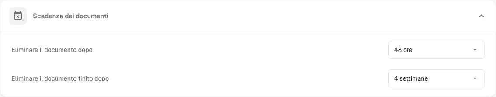
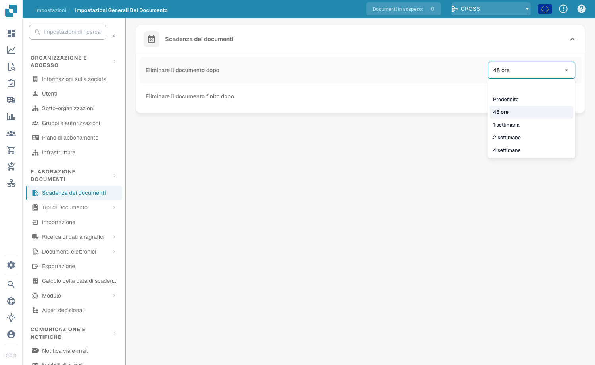

# Documents Expiry

<figure><figcaption>
Impostazioni di Documents Expiry
</figcaption></figure>

In **Document Processing → Documents Expiry** controlli per quanto tempo DocBits conserva i tuoi documenti prima di eliminarli automaticamente. Questo ti aiuta a gestire lo spazio di archiviazione, ad applicare le politiche di conservazione dei dati e a rispettare le norme legali o aziendali sui tempi di conservazione dei documenti.

Due impostazioni controllano l'eliminazione automatica:

| Impostazione | Cosa controlla |
|---------|------------------|
| **Delete document after** | Per quanto tempo viene conservato un qualsiasi documento elaborato prima di essere eliminato automaticamente. |
| **Delete finished document after** | Per quanto tempo viene conservato un documento concluso (completamente elaborato ed esportato) prima di essere eliminato automaticamente. |

Per ciascuna impostazione scegli un intervallo di tempo dal menu a discesa:

<figure><figcaption>
Periodi di conservazione disponibili
</figcaption></figure>

| Opzione | Significato |
|--------|---------|
| **Default** | Usa il periodo di conservazione predefinito del sistema (nessuna personalizzazione). |
| **48 Hours** | Elimina 48 ore dopo l'elaborazione. |
| **1 Week** | Elimina dopo una settimana. |
| **2 Weeks** | Elimina dopo due settimane. |
| **4 Weeks** | Elimina dopo quattro settimane. |

Entrambe le impostazioni fanno in modo che i documenti non vengano conservati nel sistema più a lungo del necessario: questo evita un uso inutile dello spazio di archiviazione e mantiene ordinato il flusso di lavoro dei documenti. Sono particolarmente importanti per le organizzazioni che devono rispettare specifici requisiti normativi sulla conservazione dei documenti.
