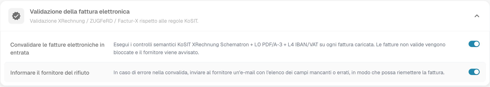
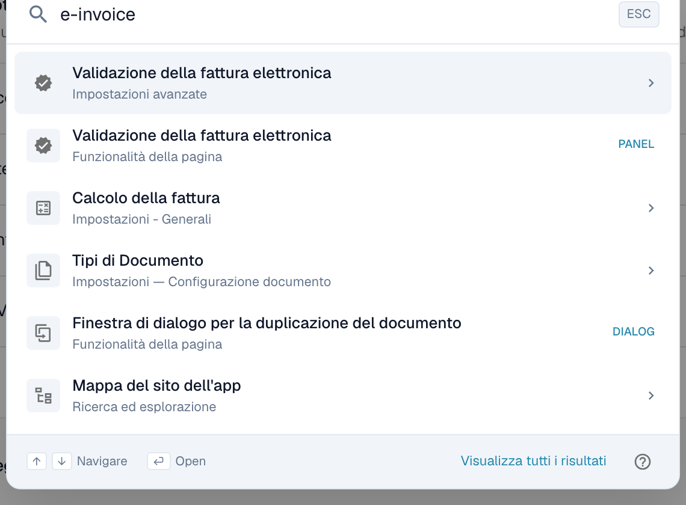

# Documenti elettronici

DocBits convalida le fatture elettroniche in entrata (e-invoice) rispetto agli standard ufficiali — **XRechnung**, **ZUGFeRD** e **Factur-X** — e instrada eventuali problemi rilevati al gestore giusto. Il gruppo di impostazioni **Documenti elettronici** (in **Elaborazione dei documenti**) ha queste pagine:

* [**Validazione della fattura elettronica**](validation-rules/): scegli quali versioni e profili di fattura elettronica accetti e imposta la gravità di ogni regola di validazione per la tua organizzazione.
* [**Rapporto di convalida**](validation-rules/validation-report.md): cosa vede un utente quando una fattura non supera la validazione: i risultati in linguaggio semplice, il passo successivo e la possibilità di rifiutare il documento.
* [**Validazione per ogni tipo di documento**](validation-rules/validation-per-document-type.md): per gli amministratori: attiva la validazione e imposta se blocca, per ogni tipo di documento, con un registro delle modifiche.
* [**Instradamento delle notifiche**](notification-routing.md): assegna i risultati di validazione all'agente AI Workforce che deve gestirli.

Insieme ti permettono di decidere **cosa viene considerato un problema** su una fattura elettronica in entrata e **chi se ne occupa**.

## Attivare o disattivare la convalida delle fatture elettroniche

Le pagine Documenti elettronici hanno effetto solo dopo che la **convalida delle fatture elettroniche è attivata per il tipo di documento**. L'interruttore si trova sul tipo di documento stesso, non nel menu Documenti elettronici.

Vai a **Impostazioni → Tipi di documento → Fattura → Impostazioni avanzate** e apri la sezione **Convalida fattura elettronica**.

<figure><figcaption>
Attiva o disattiva la convalida delle fatture elettroniche per tipo di documento, con notifica facoltativa al fornitore
</figcaption></figure>

* **Convalida le fatture elettroniche in entrata**: l'interruttore principale. Quando è **attivo**, ogni fattura caricata viene controllata con le regole Schematron KoSIT XRechnung più i controlli semantici L0 (PDF/A-3) e L4 (IBAN/IVA), usando le gravità impostate nella pagina [Validazione della fattura elettronica](validation-rules/). Le fatture non valide vengono bloccate. Quando è **disattivato**, le fatture saltano completamente la convalida delle fatture elettroniche e le pagine Validazione della fattura elettronica e Instradamento delle notifiche non hanno effetto.
* **Notifica al fornitore in caso di rifiuto**: appare una volta attivata la convalida. Quando è **attivo**, una fattura rifiutata invia un'email al fornitore con l'elenco dei campi mancanti o errati così da poterla riemettere. Chi riceve e gestisce ogni risultato si configura nella pagina [Instradamento delle notifiche](notification-routing.md).

> La convalida delle fatture elettroniche si configura **per tipo di documento**. Attualmente si applica al tipo di documento **Fattura**; attivala su ogni tipo di documento da convalidare.

Puoi anche saltare direttamente qui con la **ricerca rapida globale**: premi <kbd>Cmd</kbd> + <kbd>K</kbd> (<kbd>Ctrl</kbd> + <kbd>K</kbd> su Windows e Linux) ovunque in DocBits e digita _e-invoice_.

<figure><figcaption>
Digita «e-invoice» nella ricerca rapida per saltare direttamente all'interruttore.
</figcaption></figure>
