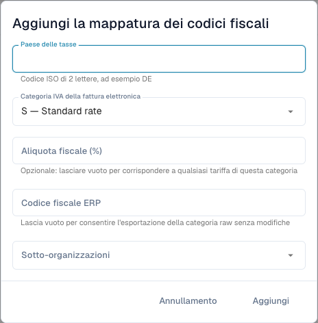

# Associare categorie IVA delle fatture elettroniche ai codici ERP

<figure><figcaption>
Modulo di mappatura fiscale prima di salvare una voce. Alcune descrizioni delle categorie restano in inglese nell’interfaccia attuale; i codici tecnici non cambiano.
</figcaption></figure>

Una fattura elettronica può contenere una categoria IVA come **S** anziché il codice fiscale ERP. La mappatura ne definisce la conversione. È distinta dalle correzioni degli importi fiscali e dalle regole di validazione.

## Requisiti

Servono accesso amministrativo, paese fiscale, categoria e aliquota della fattura e un codice ERP valido concordato con l'amministratore. Confermare organizzazione e sotto-organizzazione. La pagina deve essere disponibile nella versione utilizzata.

## Aggiungere e verificare

1. Aprire **Impostazioni → Documenti elettronici → Mappatura codici fiscali** e controllare le voci.
2. Scegliere l'aggiunta di una mappatura.
3. Inserire il paese fiscale con codice ISO di due lettere, per esempio `DE`.
4. Selezionare la categoria: **S** standard, **Z** aliquota zero, **E** esente o **O** fuori ambito. Non scambiarle per evitare un errore.
5. Inserire la percentuale per un'aliquota specifica. Vuoto accetta qualsiasi aliquota di quella categoria, come indicato nel modulo.
6. Inserire codice ERP e sotto-organizzazioni pertinenti. Un codice ERP vuoto consente espressamente la categoria originale non convertita: usarlo solo se accettata dalla destinazione.
7. Aggiungere e controllare paese, categoria, aliquota, codice, ambito e stato attivo salvati.
8. Provare una fattura rappresentativa verso una destinazione controllata. Verificare codice effettivo nell'ERP e risposta, oltre al caso di mappatura mancante/errata.

Una fattura tedesca `S` con aliquota `19` richiede il codice configurato per quel caso. Ricavarlo dall'ERP; un esempio non è un valore predefinito di produzione.

## Risolvere errori

Confrontare paese, categoria, aliquota, ambito e attivazione. Verificare la risposta prima di ripetere un export dal risultato incerto. Eliminare la mappatura cambia le operazioni future, senza annullare gli export passati.

Vedere [Validazione fatture elettroniche](validation-rules.md) ed [Esportazione](../export.md).
