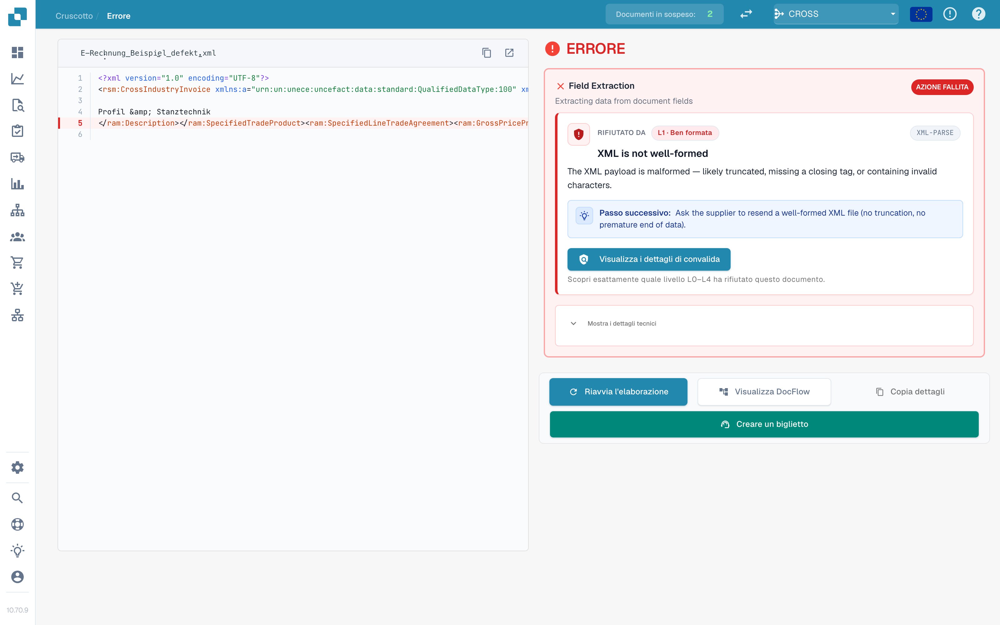
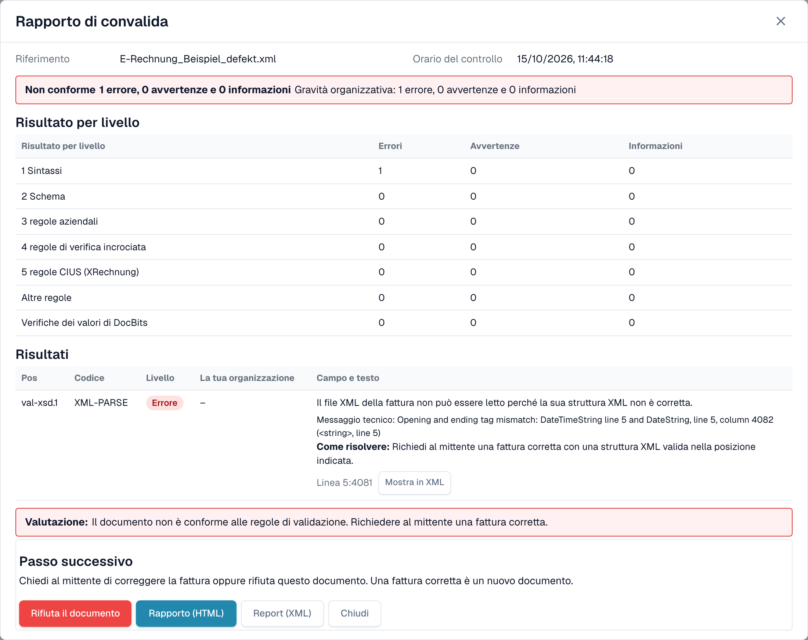
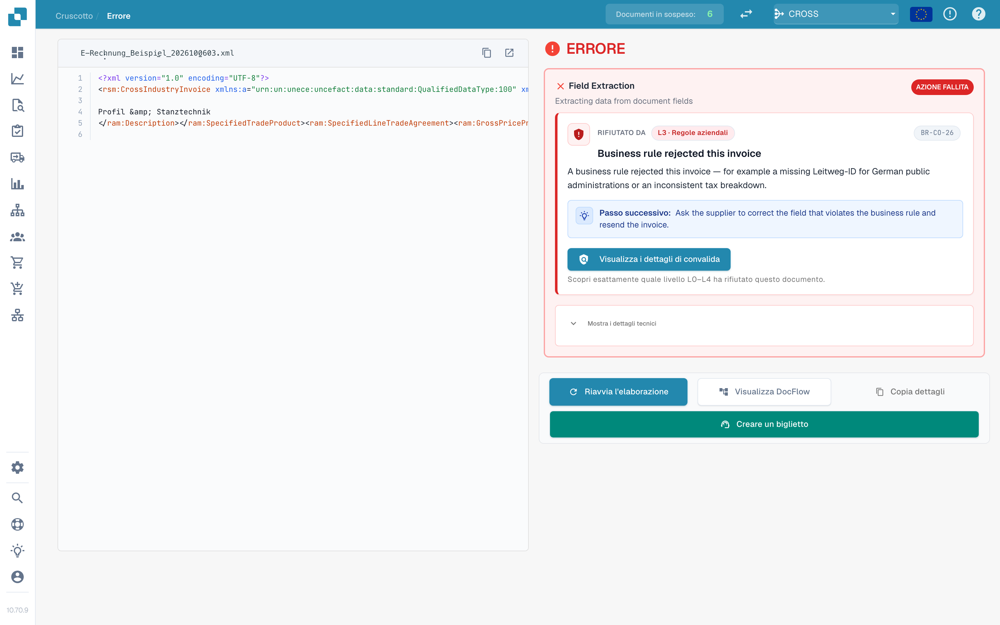

# La schermata di errore per una fattura elettronica rifiutata

Quando carichi una fattura elettronica errata, DocBits non la perde. Il documento riceve lo stato **Errore** e la schermata di errore ti dice cosa non va, dove e cosa fare dopo. Questa pagina mostra due esempi: un file XML non ben formato e una fattura che viola una regola aziendale.

> Una fattura riceve lo stato **Errore** solo quando la validazione è **attiva** e **bloccante** per il suo tipo di documento. Vedi [Validazione per ogni tipo di documento](validation-per-document-type.md).

## Esempio 1: il file XML è danneggiato

Un fornitore invia un file XML in cui un tag di chiusura non corrisponde al tag di apertura. Il file non può essere letto, quindi DocBits si ferma al primo controllo, **L1 · Ben formata**.

<figure><figcaption>
La schermata di errore per un file XML danneggiato. La riga errata è evidenziata nell'XML. File di esempio con dati fittizi.
</figcaption></figure>

La schermata ha due lati:

* **A sinistra: il file XML.** DocBits mostra il file con i numeri di riga. La riga con il problema è evidenziata in rosso. Usa i pulsanti sopra il file per copiare l'XML o aprirlo in una nuova scheda.
* **A destra: la spiegazione.** La scheda **Rifiutato da** indica il controllo che ha fermato il file (qui **L1 · Ben formata**) e il codice della regola (qui `XML-PARSE`). Sotto vedi un titolo in linguaggio semplice (*XML is not well-formed*), una breve spiegazione e il blocco **Passo successivo**.

Seleziona **Visualizza i dettagli di convalida** per aprire il [rapporto di convalida](validation-report.md) completo.

<figure><figcaption>
Il rapporto del file danneggiato: un errore al livello 1 Sintassi, con il messaggio tecnico e la posizione
</figcaption></figure>

Il rapporto indica la posizione esatta (qui riga 5, colonna 4081) e riporta il messaggio tecnico del parser XML. Seleziona **Mostra in XML** per passare a quella riga. L'indicazione **Come risolvere** ti dice di chiedere al mittente un file corretto.

## Esempio 2: la fattura viola una regola aziendale

L'XML è corretto, ma manca un campo obbligatorio. Ad esempio, il venditore non può essere identificato perché non è presente alcun identificativo del venditore, identificativo di registrazione o identificativo IVA (regola `BR-CO-26`).

<figure><figcaption>
La schermata di errore per un errore di regola aziendale: il livello <strong>L3 · Regole aziendali</strong>, il codice della regola e un passo successivo
</figcaption></figure>

Qui la scheda indica il livello **L3 · Regole aziendali** e il codice `BR-CO-26`. Il rapporto elenca tutti i risultati della fattura, vedi [Rapporto di convalida](validation-report.md).

## I pulsanti sotto la scheda

| Pulsante | Cosa fa |
| --- | --- |
| **Riavvia l'elaborazione** | Esegue di nuovo l'elaborazione del documento, ad esempio dopo aver modificato un'impostazione. Il controllo usa le impostazioni attuali. |
| **Visualizza DocFlow** | Mostra il workflow del documento. |
| **Copia dettagli** | Copia i dettagli dell'errore, ad esempio per un messaggio al tuo amministratore. |
| **Creare un biglietto** | Apre un ticket di supporto con i dettagli dell'errore. |

Seleziona **Mostra i dettagli tecnici** sulla scheda per le informazioni tecniche grezze.

## Cosa fare dopo

* **Errori:** chiedi al mittente una fattura corretta oppure [rifiuta il documento](validation-next-step-and-reject.md). Una fattura corretta è un nuovo documento.
* **Solo avvertenze:** il documento non è bloccato. Puoi continuare.

## Pagine correlate

* [Rapporto di convalida](validation-report.md): tutti i risultati, livello per livello.
* [Passo successivo e rifiuto di un documento](validation-next-step-and-reject.md)
* [Validazione per ogni tipo di documento](validation-per-document-type.md): attiva la validazione e imposta il blocco.
