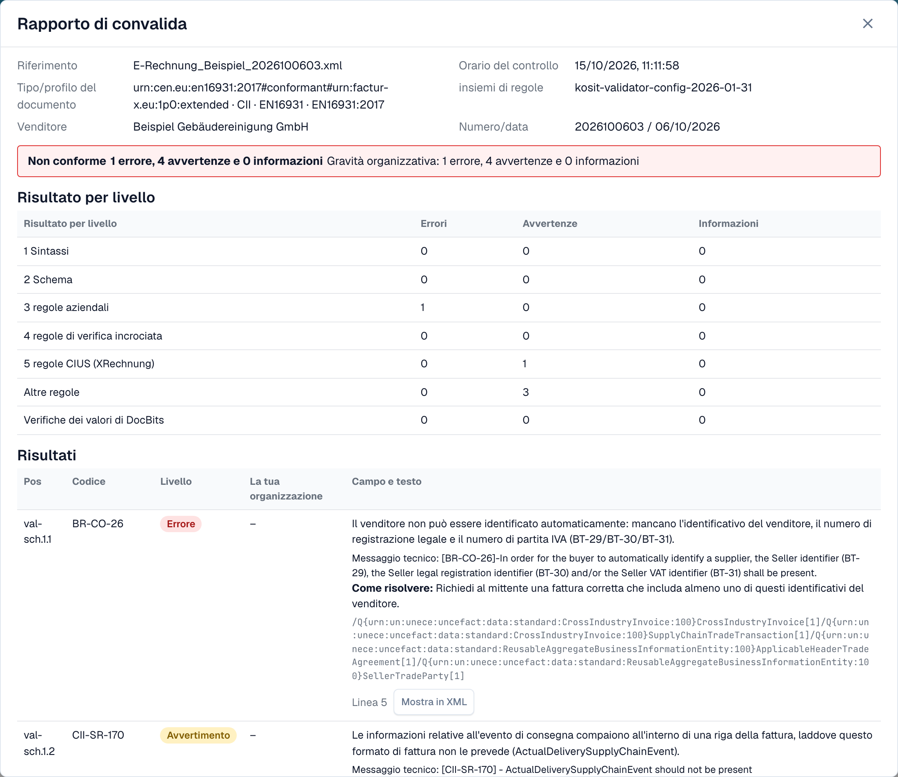
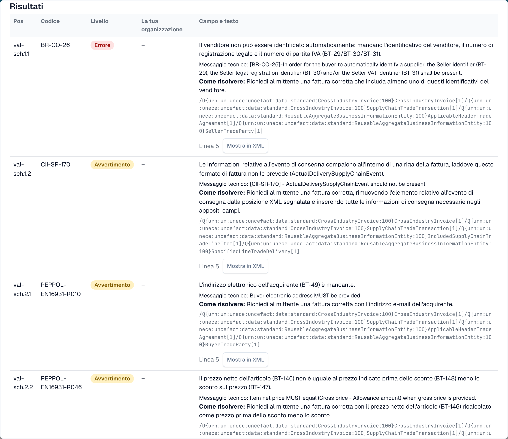

# Rapporto di convalida

Quando DocBits rifiuta una fattura elettronica, puoi leggere esattamente il perché. Il **rapporto di convalida** elenca ogni risultato in linguaggio semplice, ti dice cosa correggere e mostra il passo successivo. Lo apri dal documento, non dalle impostazioni.

Questa pagina è per chi elabora le fatture. Gli amministratori impostano le regole nella pagina [Validazione della fattura elettronica](validation-rules.md) e scelgono per ogni tipo di documento se un controllo non superato blocca la fattura, vedi [Validazione per ogni tipo di documento](validation-per-document-type.md).

## Quando un documento riceve un errore

Se la validazione è **attiva** e **bloccante** per il tipo di documento, una fattura con un risultato bloccante passa allo stato **Errore**. Apri il documento dal cruscotto. La vista di errore mostra l'XML a sinistra e il motivo a destra.

<figure><figcaption>
La vista di errore: l'XML della fattura e il primo risultato bloccante con un passo successivo. Fattura di esempio con nomi fittizi.
</figcaption></figure>

La scheda a destra indica il livello che ha rifiutato la fattura (ad esempio **L3 · Regole aziendali**), il codice della regola (ad esempio `BR-CO-26`), una breve spiegazione e un **Passo successivo**. Seleziona **Visualizza i dettagli di convalida** per aprire il rapporto completo.

## Leggere il rapporto

<figure><figcaption>
La parte alta del rapporto: i dati del file, il verdetto e il risultato per ogni livello
</figcaption></figure>

Il rapporto inizia con i dati del file:

| Campo | Cosa mostra |
| --- | --- |
| **Riferimento** | Il nome del file della fattura. |
| **Orario del controllo** | Quando DocBits ha eseguito il controllo. Un rapporto salvato non cambia più. |
| **Tipo/profilo del documento** | Il formato della fattura, ad esempio CII ed EN 16931. |
| **insiemi di regole** | La versione dei set di regole usati da DocBits. |
| **Venditore** | Il venditore, letto dall'XML. |
| **Numero/data** | Il numero e la data della fattura, letti dall'XML. |

Sotto i dati del file vedi il **verdetto**, ad esempio **Non conforme**, con il numero di errori, avvertenze e informazioni. Se la tua organizzazione ha cambiato la gravità di una regola, una seconda riga **Gravità organizzativa** mostra i conteggi dopo le impostazioni della tua organizzazione.

### Risultato per livello

La tabella **Risultato per livello** mostra quanti errori, avvertenze e informazioni ha trovato ogni controllo. I controlli si basano l'uno sull'altro:

| Livello | Cosa controlla |
| --- | --- |
| **1 Sintassi** | L'XML è ben formato. |
| **2 Schema** | La struttura rispetta lo schema XML ufficiale. |
| **3 regole aziendali** | I campi obbligatori sono presenti e corretti (regole `BR-…`). |
| **4 regole di verifica incrociata** | I campi sono coerenti tra loro, ad esempio le somme. |
| **5 regole CIUS (XRechnung)** | Le regole tedesche aggiuntive di XRechnung. |
| **Altre regole** | Ulteriori regole, ad esempio le regole PEPPOL. |
| **Verifiche dei valori di DocBits** | Controlli aggiunti da DocBits, ad esempio IBAN e partita IVA. |

> Per le fatture con profilo EN 16931 o EXTENDED, le regole specifiche di XRechnung vengono mostrate come **avvertenze**, non come errori.

## I risultati

<figure><figcaption>
Ogni risultato ha un codice, un livello, un testo comprensibile e un suggerimento su come risolvere
</figcaption></figure>

Ogni risultato è una riga:

* **Pos** e **Codice**: la posizione nel rapporto e il codice della regola, ad esempio `BR-CO-26`.
* **Livello**: **Errore**, **Avvertimento** o **Informazione**.
* **La tua organizzazione**: il livello dopo le impostazioni della tua organizzazione. Un trattino indica che la tua organizzazione non ha cambiato il livello.
* **Campo e testo**: il problema in linguaggio semplice, il campo interessato (ad esempio *BT-29 Seller identifier*), il messaggio tecnico del validatore e **Come risolvere**.
* **Linea** e **Mostra in XML**: seleziona **Mostra in XML** per chiudere il rapporto e passare alla riga nel visualizzatore XML.

DocBits ha testi in linguaggio semplice per le regole più comuni. Per una regola senza un testo di questo tipo, il rapporto mostra il messaggio tecnico del validatore.

## Passo successivo

* [Passo successivo e rifiuto di un documento](validation-next-step-and-reject.md): cosa fare dopo aver letto il rapporto.

## Pagine correlate

* [Validazione della fattura elettronica](validation-rules.md): versioni accettate, profili e gravità di ogni regola.
* [Validazione per ogni tipo di documento](validation-per-document-type.md): attiva la validazione e imposta il blocco.
* [Instradamento delle notifiche](notification-routing.md): chi gestisce quale risultato.
