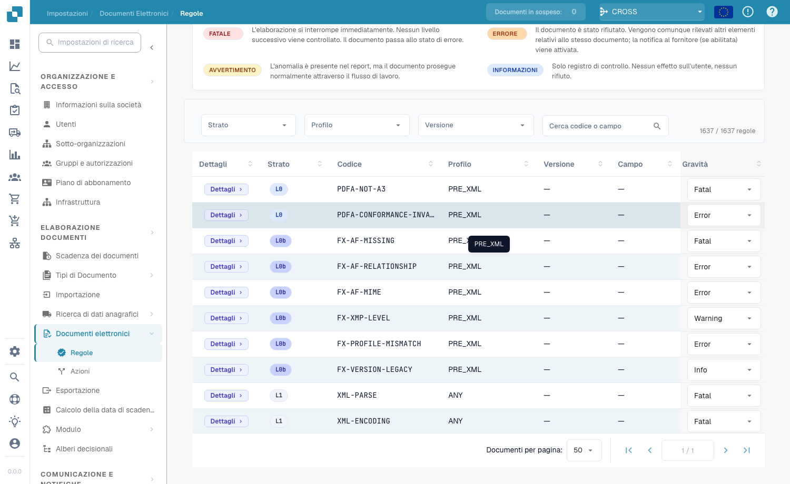

# Gravità delle regole

Ogni regola di validazione ha una gravità. Puoi cambiare la gravità di ogni regola per la tua organizzazione. Questa pagina fa parte di [Validazione della fattura elettronica](validation-rules.md). Solo gli amministratori dell'organizzazione possono cambiare le gravità.

<figure><figcaption>
La tabella completa delle regole con sovrascrittura della gravità per regola
</figcaption></figure>

La tabella delle regole elenca tutte le regole di validazione (oltre 1.600 in totale). Filtra per **Livello (Layer)**, **Profilo** o **Versione**, oppure cerca per codice o campo. Per ogni regola puoi sovrascrivere la **Gravità** dal menu a discesa per adattarla alla policy della tua organizzazione — ad esempio, riducendo una regola da `ERROR` a `WARNING` in modo che non rifiuti più il documento.

Il significato di **FATAL**, **ERROR**, **WARNING** e **INFO** è spiegato in [Configurazione della validazione e versioni accettate](validation-setup.md#profili-accettati-e-modello-di-gravita). Una gravità modificata compare anche nel [rapporto di convalida](validation-report.md) nella colonna **La tua organizzazione**.
