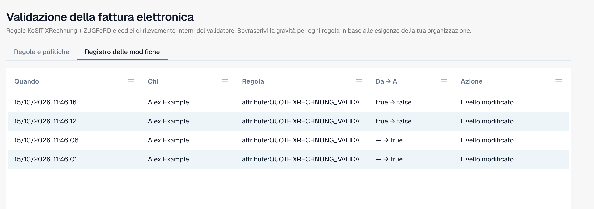

# Registro delle modifiche

Il **Registro delle modifiche** registra ogni modifica delle impostazioni di validazione. Fa parte di [Validazione della fattura elettronica](./). Solo gli amministratori dell'organizzazione possono vederlo.

Apri la scheda **Registro delle modifiche** accanto a **Regole e politiche**.

<figure><figcaption>
Il registro delle modifiche con quattro voci di esempio. Il nome dell'utente è sostituito da un nome di esempio.
</figcaption></figure>

| Colonna    | Cosa mostra                                                                                              |
| ---------- | -------------------------------------------------------------------------------------------------------- |
| **Quando** | L'ora della modifica.                                                                                    |
| **Chi**    | L'utente che ha fatto la modifica.                                                                       |
| **Regola** | L'impostazione o la regola che è cambiata.                                                               |
| **Da → A** | Il valore precedente e il nuovo valore.                                                                  |
| **Azione** | Il tipo di modifica. Le righe della procedura guidata si possono aprire per vedere le singole modifiche. |

L'elenco mostra 50 voci per pagina.

Ogni modifica nella tabella [Validazione per ogni tipo di documento](validation-per-document-type.md) crea una voce dopo la tua conferma.
