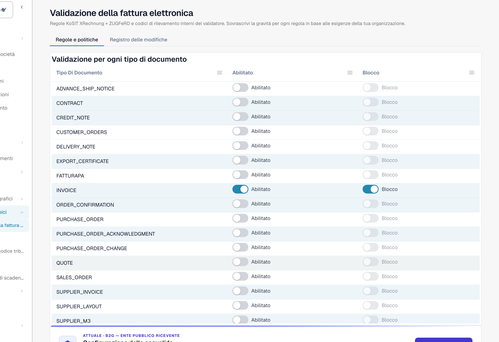
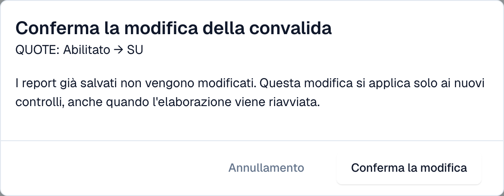

# Validazione per ogni tipo di documento

Gli amministratori decidono, per ogni tipo di documento, se DocBits convalida le fatture elettroniche in entrata e se un controllo non superato blocca il documento. Ogni modifica viene confermata e registrata nel [registro delle modifiche](validation-change-log.md).

> Solo gli **amministratori dell'organizzazione** possono cambiare queste impostazioni. Gli altri utenti vedono la tabella in sola lettura oppure non la vedono.

## La tabella

Vai a **Impostazioni → Documenti elettronici → Validazione della fattura elettronica**. La scheda **Regole e politiche** inizia con la tabella **Validazione per ogni tipo di documento**.

<figure><figcaption>
Una riga per ogni tipo di documento con gli interruttori Abilitato e Blocco. Organizzazione di esempio.
</figcaption></figure>

| Interruttore  | Cosa fa                                                                                                                                                                                                                           |
| ------------- | --------------------------------------------------------------------------------------------------------------------------------------------------------------------------------------------------------------------------------- |
| **Abilitato** | DocBits convalida ogni fattura elettronica in entrata di questo tipo di documento e salva un [rapporto di convalida](validation-report.md).                                                                                       |
| **Blocco**    | Un risultato di tipo errore blocca il documento, che passa allo stato **Errore**. Quando il blocco è disattivato, DocBits salva il rapporto e il documento prosegue. Puoi attivare **Blocco** solo quando **Abilitato** è attivo. |

Se un tipo di documento ha sovrascritture per sottotipi, la tabella mostra una nota al riguardo.

## Cambiare un'impostazione

1. Seleziona l'interruttore che vuoi cambiare.
2. DocBits mostra **Conferma la modifica della convalida** con il tipo di documento e la modifica, ad esempio _QUOTE: Abilitato → SU_.

<figure><figcaption>
Ogni modifica richiede una conferma
</figcaption></figure>

3. Leggi la nota: **I report già salvati non vengono modificati.** La modifica si applica solo ai nuovi controlli, anche quando l'elaborazione di un documento viene riavviata.
4. Seleziona **Conferma la modifica**, oppure **Annullamento** per mantenere l'impostazione precedente.

Se non hai l'autorizzazione, DocBits mostra un messaggio che indica che serve un amministratore dell'organizzazione, e non cambia nulla.

## Pagine correlate

* [Validazione della fattura elettronica](./)
* [Registro delle modifiche](validation-change-log.md)
* [Configurazione della validazione e versioni accettate](validation-setup.md)
* [Rapporto di convalida](validation-report.md)
* [Attivare o disattivare la convalida delle fatture elettroniche](../#attivare-o-disattivare-la-convalida-delle-fatture-elettroniche)
