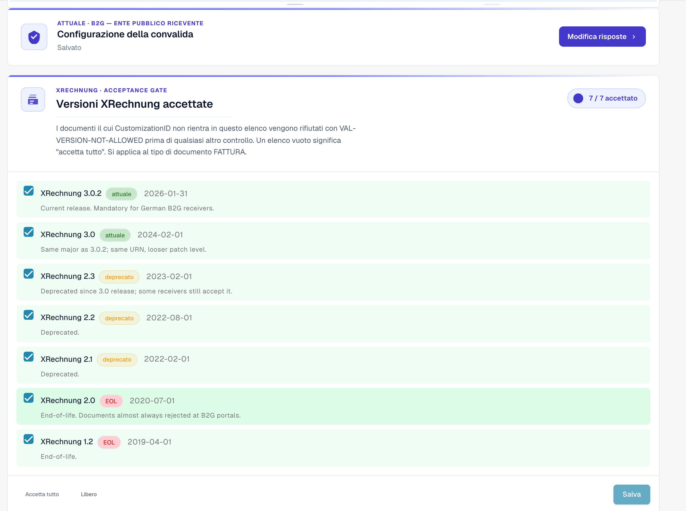
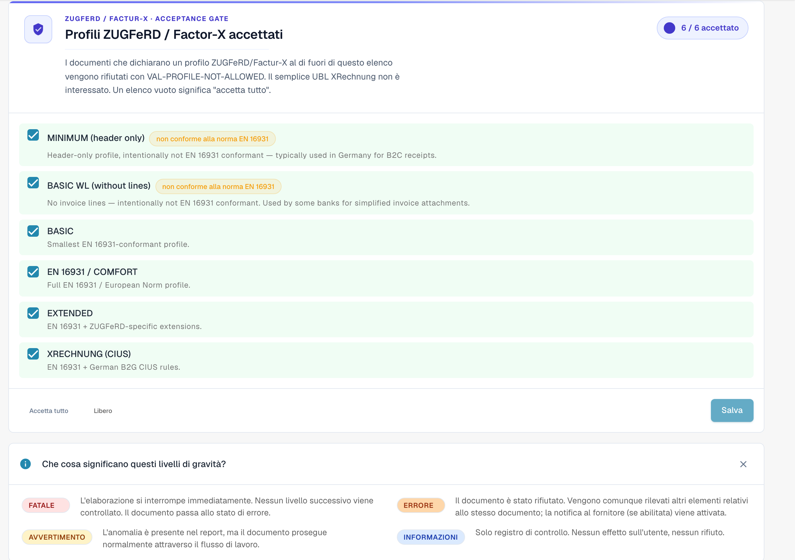

# Configurazione della validazione e versioni accettate

Questa pagina spiega la procedura guidata di configurazione, le versioni XRechnung accettate e i profili accettati della pagina [Validazione della fattura elettronica](validation-rules.md). Solo gli amministratori dell'organizzazione possono modificare queste impostazioni.

## Configurazione della validazione

<figure><figcaption>
Configurazione della validazione e versioni XRechnung accettate
</figcaption></figure>

La scheda **Configurazione della validazione** mostra il tuo profilo di validazione attuale (ad esempio *B2G — Public Sector Receiver*). Fai clic su **Modifica risposte** per rieseguire la procedura guidata di configurazione e cambiare lo standard rispetto al quale convalidi.

## Versioni XRechnung accettate

Il gate **Versioni XRechnung accettate** elenca tutte le versioni di XRechnung. Seleziona le versioni che accetti: i documenti il cui CustomizationID è fuori da questo elenco vengono rifiutati con `VAL-VERSION-NOT-ALLOWED` prima di qualsiasi altro controllo. Un elenco vuoto significa "accetta tutto". Ogni versione è contrassegnata come **current**, **deprecated** o **EOL** insieme alla sua data di rilascio.

## Profili accettati e modello di gravità

<figure><figcaption>
Profili accettati e significato di ciascuna gravità
</figcaption></figure>

Scegli quali **profili** accettare (BASIC WL, BASIC, EN 16931 / COMFORT, EXTENDED, XRECHNUNG (CIUS)) tramite **Accetta tutto** / **Cancella**, quindi **Salva**.

Ogni regola di validazione ha una **gravità** che decide cosa succede quando si attiva:

| Gravità | Effetto |
|---------|---------|
| **FATAL** | Interrompe immediatamente l'elaborazione. Nessun livello successivo viene controllato; il documento passa in Errore. |
| **ERROR** | Il documento viene rifiutato. Gli altri rilevamenti dello stesso documento vengono comunque mostrati; la notifica al fornitore (se abilitata) viene attivata. |
| **WARNING** | Compare nel report di validazione, ma il documento prosegue normalmente nel flusso. |
| **INFO** | Solo log di audit. Nessun effetto visibile all'utente né rifiuto. |

### Cosa cambia la procedura guidata

La scheda **Configurazione della validazione** più in basso nella pagina apre una procedura guidata con **Modifica risposte**. La procedura guidata sostituisce l'intero insieme delle sovrascritture delle regole della tua organizzazione. DocBits ti avvisa prima del salvataggio. Controlla con attenzione il passaggio **Rivedi e applica**.

Continua con: [Gravità delle regole](validation-rule-severities.md) e [Validazione per ogni tipo di documento](validation-per-document-type.md).
