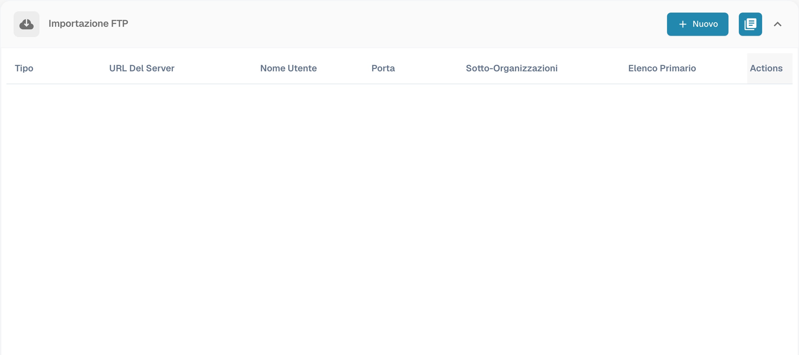
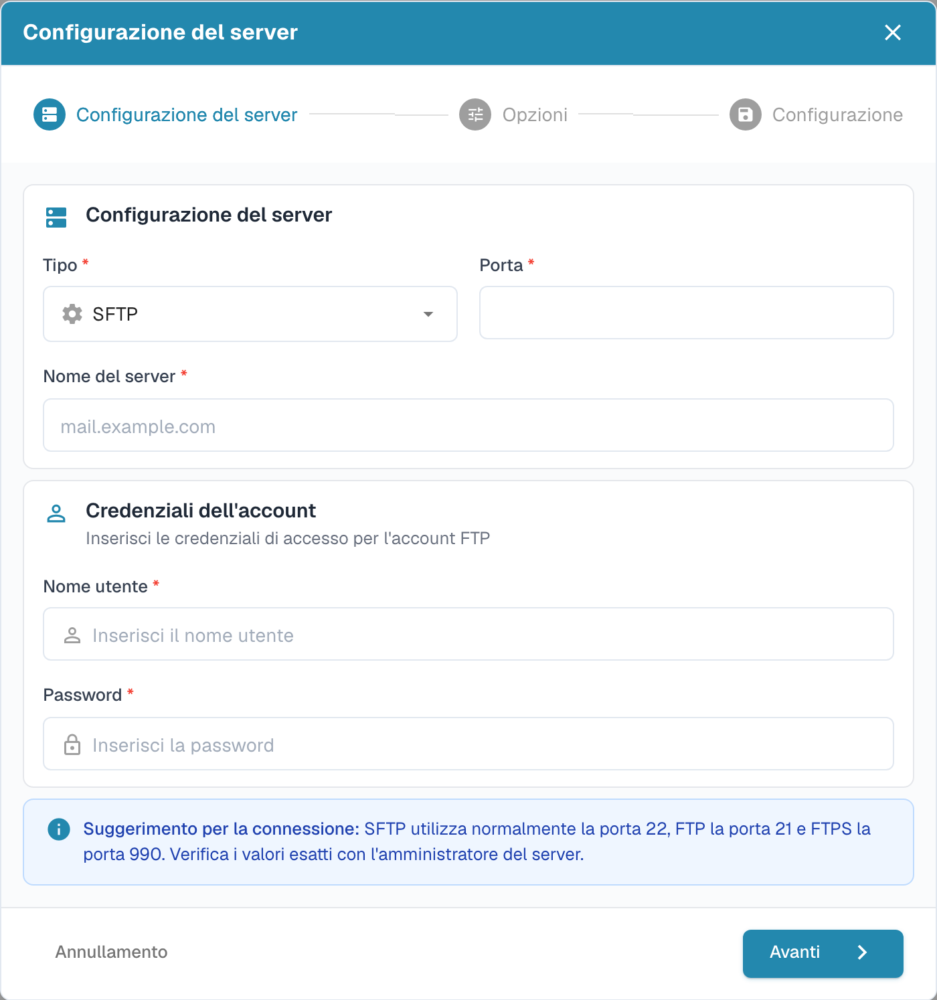
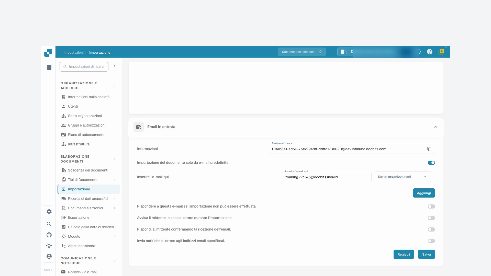
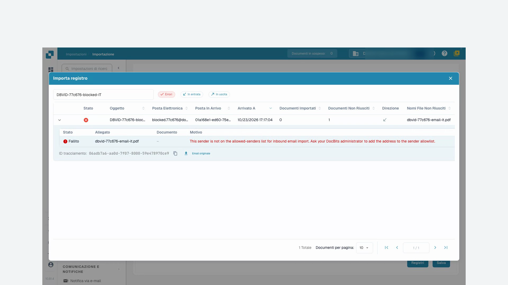

# Importazione

Le impostazioni di importazione determinano il trattamento dei documenti e consentono di configurare la ricezione automatica tramite FTP o e-mail. Apri **Impostazioni → Elaborazione documenti → Importazione**.

## Opzioni dei documenti

Controlla il limite di pagine, i giorni del termine di pagamento predefinito e il formato della data. Le pagine oltre il limite configurato possono essere scartate. Il valore predefinito documentato per questa funzione è 60 pagine; verifica la configurazione dell’organizzazione prima di importare.

## Importazione FTP

Servono un server FTP compatibile, credenziali autorizzate e una cartella di importazione dedicata accessibile all’account del server.

<figure><figcaption>
Panoramica delle connessioni di importazione FTP.
</figcaption></figure>

### Configurare una connessione

Crea una connessione. La procedura guidata inizia con la configurazione del server, poi continua con opzioni e configurazione di importazione.

<figure><figcaption>
Configurazione del server nella procedura di importazione FTP.
</figcaption></figure>

| Impostazione | Significato |
| --- | --- |
| Protocollo e porta | Scegli FTP, FTPS o SFTP e la porta confermata dall’amministratore del server. |
| Server e credenziali | Indirizzo del server e account autorizzato a leggere la cartella di importazione. |
| Modelli dei nomi di file | Limitano l’importazione ai nomi corrispondenti. |
| Sotto-organizzazione | Determina l’assegnazione dei documenti importati. |
| Chiave API | Se presente, deve corrispondere all’organizzazione corretta. Non pubblicarne il valore. |
| Cartella principale e cartella di importazione | Indicano la posizione dei file sul server. |
| Archiviazione dopo l’importazione | Sposta i file importati correttamente nella cartella di archivio indicata. L’account deve avere i permessi necessari. |
| Includere sottocartelle | Estende la ricerca alle cartelle subordinate. |

Controlla tutti i passaggi prima di salvare. Poi verifica separatamente se la connessione è attiva. Le azioni disponibili includono test della connessione, registri, attivazione, disattivazione, modifica ed eliminazione. Leggi l’esito del test e i registri prima dell’importazione abituale. Le immagini mostrano l’elenco e il primo passaggio della procedura non salvata, non una connessione al server verificata.

## Importazione e-mail {#email-import}

Una connessione raccoglie documenti da una propria casella tramite IMAP o OAuth Microsoft365. L’inoltro a un indirizzo fornito da DocBits è un metodo distinto; consulta [E-mail in entrata](../module/inbound-emails.md).

### Allegati supportati

I tipi importati includono `.pdf`, `.tiff` / `.tif`, `.eml`, `.dat`, `.xml`, `.edi` e `.purchaseorder`.

Oltre al tipo dichiarato dal server di posta, DocBits riconosce i documenti dal contenuto reale. Questo conta quando un allegato inoltrato riceve il tipo generico `application/octet-stream` invece di `application/pdf` o `application/xml`.

* I messaggi `.eml` inoltrati e gli allegati Outlook `winmail.dat` (TNEF) vengono estratti per importare i documenti contenuti.
* Un XML con tipo generico viene riconosciuto dalla dichiarazione `<?xml`, accettando un BOM iniziale UTF-8 o UTF-16 (LE/BE). Attualmente solo queste codifiche BOM vengono rilevate automaticamente dal contenuto. Un nome che termina in `.xml` consente l’importazione indipendentemente dalla codifica.
* Le immagini incorporate, come loghi di firma e immagini PNG, JPG, GIF o BMP, vengono ignorate e non contano come importazioni non riuscite.
* Se l’indirizzo in entrata prevede una risposta per gli errori di importazione, la notifica viene inviata all’indirizzo di risposta configurato.

### Connessione IMAP

Crea una connessione nella sezione di importazione e-mail e scegli IMAP. Controlla cifratura SSL o TLS, server, porta, nome della configurazione o utente, indirizzo e-mail e password. Seleziona la sotto-organizzazione e l’indirizzo delle notifiche di errore. Se compare una chiave API, verifica il contesto dell’organizzazione.

Dopo la creazione puoi scegliere la cartella di posta e lo spostamento dei messaggi elaborati in un’altra cartella. Se queste opzioni non sono ancora disponibili, modifica la connessione salvata. Secondo la configurazione, puoi anche unire i documenti allegati, inviare una conferma al mittente e bloccare nomi di file duplicati. Controlla oggetto e testo della conferma prima di attivarla.

Salvare e attivare sono azioni distinte. Il menu può offrire test della connessione, registri di connessione e importazione, modifica, attivazione, disattivazione ed eliminazione.

### OAuth Office365

Crea una connessione e-mail e scegli OAuth Office365. Avvia l’autenticazione Microsoft. Se appare un codice dispositivo, copia quello di DocBits nella pagina Microsoft indicata e accedi all’account corretto. Torna in DocBits e completa l’autenticazione.

Controlla sotto-organizzazione, cartella, casella condivisa facoltativa, cartella di destinazione dei messaggi elaborati e indirizzo delle notifiche di errore. Conferma anche l’instradamento verso DocBits o AI Workforce, se disponibile. Salva e scegli quando attivare o avviare l’importazione. OAuth Office365 – Tenant richiede i dati di registrazione dell’applicazione dell’organizzazione; confermali con l’amministratore e consulta [E-mail in entrata](../module/inbound-emails.md).

### Registri di importazione

I registri di connessione aiutano a indagare i problemi di comunicazione; quelli di importazione mostrano gli esiti precedenti. Il registro aggregato della sezione e-mail comprende le connessioni configurate. Puoi filtrare per oggetto o mittente, ordinare tramite le intestazioni e cambiare l’ordine delle colonne. Analizza il messaggio prima di ripetere l’importazione.

## Video tutorial: Casella di posta e ricerca errori


Casella di posta e ricerca errori


[Guarda con sottotitoli e capitoli](https://docbits-videos.fra1.cdn.digitaloceanspaces.com/settings-assistant/email-import-admin/v2/it.html)

Alcune etichette native possono rimanere in un’altra lingua. Gli identificatori tecnici dei campi sono conservati.

Sotto impostazioni e importazione, utilizzo l'indirizzo in entrata di DocBits in questo esempio. Una casella di posta collegata direttamente è un metodo di importazione separato. Per la formazione, lavoro in un'organizzazione demo dedicata con fatture sintetiche. Le notifiche rimangono disattivate.

Per prima cosa controllo l'indirizzo di ricezione mostrato e l'ambito. L'indirizzo appartiene esattamente a questa organizzazione e al suo ambiente. Per un'altra azienda o un ambiente di produzione, utilizzo sempre l'indirizzo effettivamente mostrato lì.

Qui limito l'ingresso al nostro mittente di test approvato. Seleziono l'assegnazione a una sotto-organizzazione solo se fa parte del processo previsto. Salvo l'impostazione e la apro di nuovo. Il mittente consentito è stato mantenuto; le e-mail di risposta automatica restano disattivate in questa formazione.

<figure><figcaption>
Mittente consentito salvato con le notifiche disattivate
</figcaption></figure>

Per questa formazione, un messaggio di test è stato inviato direttamente all'elaborazione delle e-mail in entrata di DocBits. Questo test non conferma la consegna di e-mail esterne. Nel registro, controllo l'oggetto, il mittente e l'allegato importato. Poi verifico il documento effettivamente creato.

Apro il documento corrispondente e confronto l'allegato PDF con la fattura in DocBits. Il nome del file, il numero di fattura, il fornitore e l'importo devono corrispondere. Un'importazione riuscita non dice nulla su un'approvazione o una registrazione ERP.

Un secondo test controllato proviene da un mittente non autorizzato. Nel registro, cerco specificamente questo ingresso e attivo il filtro degli errori. I dettagli indicano il mittente rifiutato. Controllo la causa utilizzando l'oggetto e l'ID di tracciamento, invece di avviare l'importazione più volte.

In un caso reale, chiarisco prima se questo mittente è persino autorizzato. Una modifica approvata all'elenco dei mittenti viene salvata e controllata di nuovo. Successivamente, verifico un nuovo ingresso di test univoco fino al documento creato. Per gli errori tecnici, consegno l'ID di tracciamento e il messaggio di errore concreto.

<figure><figcaption>
Importazione non riuscita con allegato, motivo e identificativo di tracciamento
</figcaption></figure>
