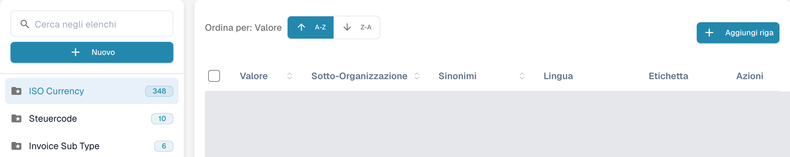
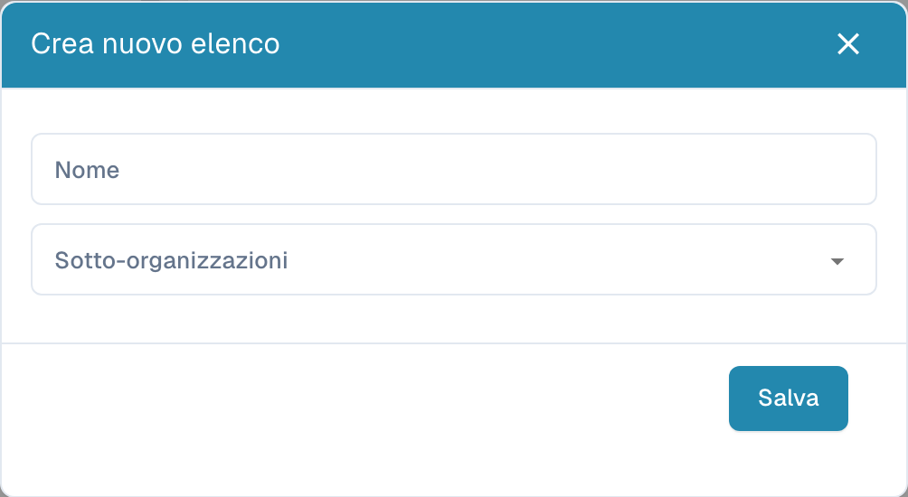
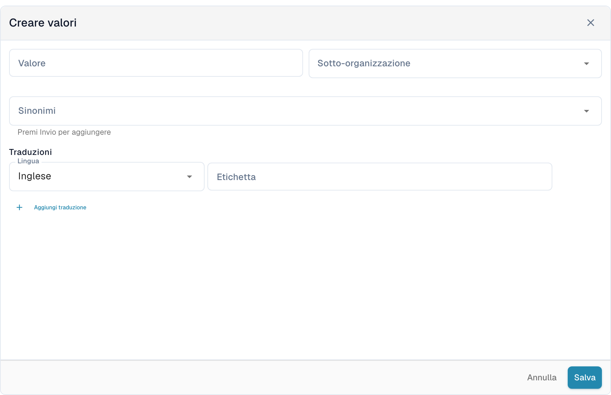

# Elenchi di valori

## Video tutorial: Dati anagrafici ed elenchi di valori


Fonti dei dati anagrafici, elenchi di valori e impostazioni dei dati master in DocBits


Il video mostra le fonti dei dati anagrafici, gli elenchi di valori e le impostazioni dei dati master di un tipo di documento.

Gli elenchi di valori contengono opzioni predefinite per i campi del documento. Un campo può usare un elenco per presentare le opzioni nella convalida. Le etichette possono essere tradotte; il valore tecnico resta uguale in tutte le lingue.

## Aprire gli elenchi

Nelle impostazioni, aprire la ricerca dei dati anagrafici e selezionare gli elenchi di valori. Il campo **Cerca negli elenchi**, a sinistra, permette di trovare un elenco. Selezionarne il nome per aprire le voci a destra. La cartella con una stella identifica un elenco di sistema; il numero accanto al nome indica quante voci sono state caricate.

<figure><figcaption>
Vista degli elenchi di valori con i nomi configurati nascosti.
</figcaption></figure>

<figure><figcaption>
L’elenco di sistema selezionato apre la tabella delle voci. A-Z e Z-A ordinano i valori; Aggiungi riga apre il modulo. Valori e nomi personalizzati sono nascosti; i nomi degli elenchi di sistema, come ISO Currency, sono dati esistenti.
</figcaption></figure>

## Creare un elenco

1. Selezionare **Nuovo** sopra i nomi degli elenchi.
2. Inserire il **Nome** e, se necessario, selezionare le **Sotto-organizzazioni** per limitare l’ambito dell’elenco.
3. **Salva** crea l’elenco. La **X** chiude la finestra senza creare un elenco.

<figure><figcaption>
Nuovo apre la finestra vuota Crea nuovo elenco con Nome, Sotto-organizzazioni, X e Salva. Questa vista non mostra un elenco salvato.
</figcaption></figure>

Per eliminare un elenco creato dalla propria organizzazione, usare l’opzione di eliminazione nel menu a tre punti accanto al nome e confermare solo l’elenco previsto. Gli elenchi di sistema non presentano questo menu di eliminazione e non possono essere eliminati.

## Aggiungere e modificare le voci

1. Selezionare l’elenco a sinistra, poi **Aggiungi riga** sopra la tabella.
2. Inserire il **Valore** memorizzato e, se necessario, la sua **Sotto-organizzazione**.
3. Aggiungere i **Sinonimi** desiderati. Confermare ciascuno con **Invio** per aggiungerlo al campo.
4. Sotto **Traduzioni**, selezionare una **Lingua** e inserire un’**Etichetta** non vuota. Una nuova voce richiede almeno una traduzione completa.
5. **Salva** crea la voce. **Annulla** o la **X** chiude il modulo senza salvarla.

<figure><figcaption>
Aggiungi riga apre Creare valori sotto la tabella: Valore, Sotto-organizzazione, Sinonimi, Lingua, Etichetta e Aggiungi traduzione. Salva crea la voce; Annulla abbandona la bozza non salvata.
</figcaption></figure>

Per modificare una voce, selezionare la riga o l’opzione di modifica in **Azioni**. I campi protetti restano di sola lettura; anche il valore memorizzato può essere bloccato quando esistono già traduzioni. **Annulla** abbandona le modifiche non salvate.

L’opzione di duplicazione nel menu della riga crea un’altra voce. Per più voci, selezionare le caselle e usare il pulsante di copia sopra la tabella. L’eliminazione è disponibile per le voci della propria organizzazione e rimuove la voce selezionata; le voci di sistema non presentano questa azione. Un elenco di sistema può contenere sia voci protette sia voci della propria organizzazione.

## Importare da CSV

Questa interfaccia non offre la precedente importazione CSV dal menu **Azioni**. I vecchi passaggi per caricare un CSV non si applicano a questa schermata; usare **Aggiungi riga** per inserirvi i valori.

## Aggiungere traduzioni

Nel modulo della voce, selezionare **Lingua** e inserire l’**Etichetta**. Usare **Aggiungi traduzione** per aggiungere un’altra lingua e la sua etichetta. Completare o rimuovere le righe di traduzione aggiuntive lasciate vuote prima di salvare. Quando una riga di traduzione può essere rimossa, il suo cestino la rimuove prima dal modulo; salvare per applicare la modifica.

Il testo visualizzato può variare secondo la lingua, ma il valore tecnico resta identico. Senza un’etichetta per la lingua attiva, viene mostrato il valore tecnico. Le voci di sistema e le traduzioni ereditate possono avere campi protetti; modificare solo i dati della propria organizzazione i cui campi sono modificabili.
