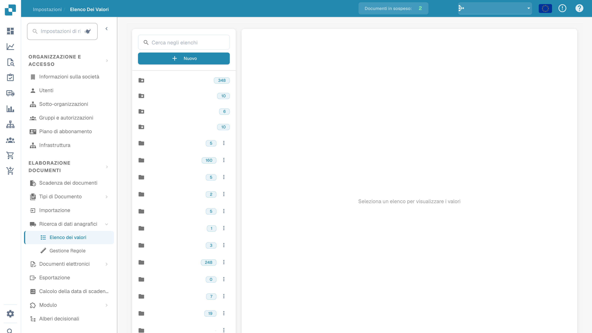

# Elenchi di valori

## Video tutorial: Dati anagrafici ed elenchi di valori


Fonti dei dati anagrafici, elenchi di valori e impostazioni dei dati master in DocBits


Il video mostra le fonti dei dati anagrafici, gli elenchi di valori e le impostazioni dei dati master di un tipo di documento.

Gli elenchi di valori contengono opzioni predefinite per i campi del documento. Un campo può usare un elenco per presentare le opzioni nella convalida. Le etichette possono essere tradotte; il valore tecnico resta uguale in tutte le lingue.

## Aprire gli elenchi

Nelle impostazioni, aprire la ricerca dei dati anagrafici e gli elenchi di valori. Selezionare un elenco per consultarne le voci. Nell’immagine i nomi configurati sono nascosti.

<figure><figcaption>
Vista degli elenchi di valori con i nomi configurati nascosti.
</figcaption></figure>

## Creare un elenco

1. Scegliere la creazione di un nuovo elenco.
2. Inserire un nome e, se necessario, limitarlo a una sotto-organizzazione.
3. Controllare i dati prima di salvare.

Gli elenchi contrassegnati come standard sono forniti dal sistema e non possono essere eliminati. Prima di eliminare un elenco personalizzato, verificare quali campi lo utilizzano: l’azione può avere effetto immediato.

## Aggiungere e modificare le voci

Aprire l’elenco previsto e usare il comando di aggiunta di una riga. Per ogni voce, controllare:

| Proprietà | Significato |
| --- | --- |
| Valore | Valore tecnico memorizzato da DocBits, uguale per tutte le lingue. |
| Etichetta | Testo visualizzato nella lingua selezionata. Senza un’etichetta per la lingua attiva, viene mostrato il valore tecnico. |
| Lingua | Lingua dell’etichetta. |
| Sotto-organizzazioni | Ambito in cui la voce è disponibile; senza limitazioni, vale per tutte le sotto-organizzazioni. |
| Sinonimi | Varianti riconosciute come equivalenti al valore, ad esempio EURO e € per EUR. Confermare ogni sinonimo nel relativo campo. |

Verificare tutte le proprietà prima di salvare. I comandi di modifica ed eliminazione dipendono dai permessi e dalla voce selezionata. Le righe predefinite del sistema non possono essere eliminate.

## Importare da CSV

Nell’elenco previsto, aprire le azioni e l’importazione CSV. Selezionare il file e il delimitatore corretto, per esempio `;` oppure `,`. Controllare struttura e contenuto del file prima di avviare l’importazione.

## Aggiungere traduzioni

Per una voce, aggiungere una lingua e inserire l’etichetta prevista. Ripetere per le altre lingue necessarie, quindi verificare e salvare. Le righe predefinite possono ricevere etichette tradotte anche quando non possono essere eliminate.

La traduzione dell’etichetta non modifica il valore tecnico. Dopo le modifiche previste, verificare il campo in convalida nella lingua desiderata. L’immagine mostra la consultazione degli elenchi, non modifiche salvate o un’importazione eseguita.
