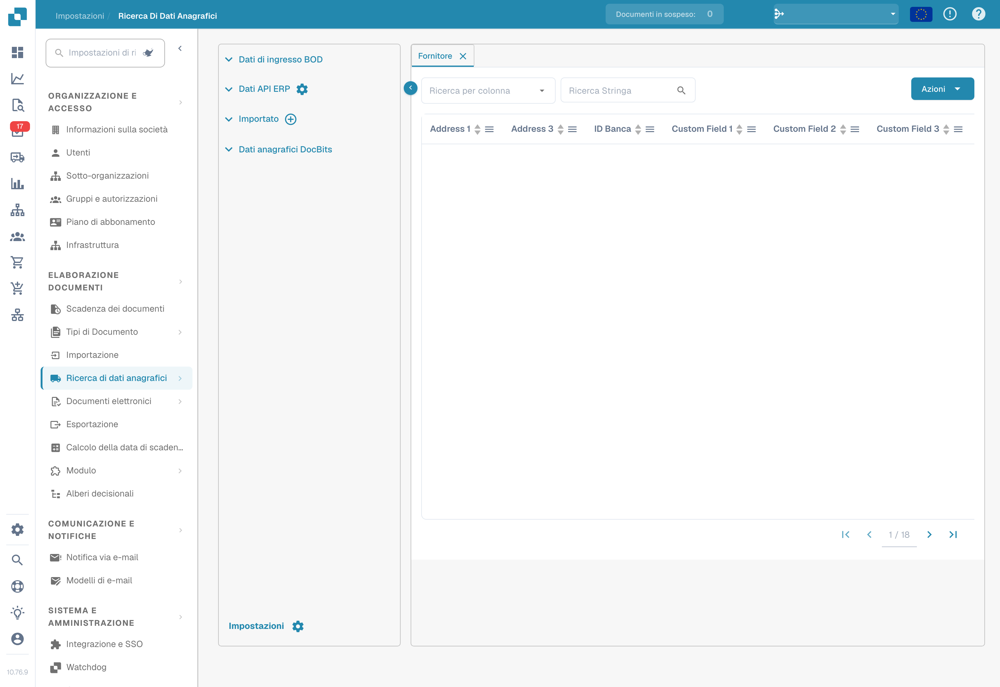
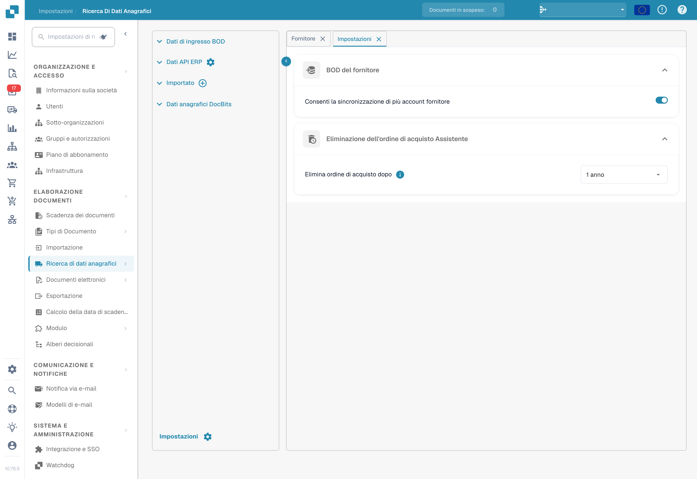

# Ricerca dei dati anagrafici

## Video tutorial: Dati anagrafici ed elenchi di valori


Fonti dei dati anagrafici, elenchi di valori e impostazioni dei dati master in DocBits


Il video mostra le fonti dei dati anagrafici, gli elenchi di valori e le impostazioni dei dati master di un tipo di documento.




La **Ricerca dei dati anagrafici** (barra laterale: **Lookup Master Data**) consente di visualizzare e gestire i dati anagrafici che DocBits utilizza per convalidare i dati estratti dai documenti rispetto al sistema ERP. È essenziale per un PO matching accurato, la convalida dei fornitori e il completamento automatico dei campi. Aprila da **Impostazioni → Elaborazione dei documenti → Lookup Master Data**.

<figure><figcaption>
Ricerca dei dati anagrafici: sorgenti e tabella dei fornitori, con i valori dell’organizzazione nascosti.
</figcaption></figure>

## Origini dati

Il pannello di sinistra elenca quattro categorie di origini dati:

| Origine | Descrizione |
|---------|-------------|
| **BOD Input Data** | Dati ricevuti tramite messaggi Infor BOD (Business Object Document). |
| **ERP API Data** | Dati recuperati direttamente dal sistema ERP tramite API. Fai clic sull'icona dell'ingranaggio per configurare la connessione API. |
| **Imported** | Dati importati manualmente (ad esempio tramite caricamento CSV). Fai clic sull'icona **+** per aggiungere nuovi dati. |
| **DocBits Master Data** | Dati anagrafici interni gestiti all'interno di DocBits. |

## Tabella dati

Selezionando un'origine dati, i relativi dati vengono visualizzati a destra in una tabella ricercabile e ordinabile:

* **Schede**: ogni scheda è un tipo di dato anagrafico (ad esempio Fornitore, Ordine d'acquisto, Articolo).
* **Ricerca**: filtra per colonna (**Search by column**) o cerca per testo (**Search String**).
* **Azioni**: aggiornare le etichette delle colonne, nascondere le colonne vuote, aggiornare gli alias o scaricare i dati in formato CSV.
* **Paginazione**: naviga tra grandi insiemi di dati con i controlli di pagina.

Le tabelle Fornitore e Ordine d'acquisto includono colonne come ID fornitore, Nome fornitore, Indirizzo, Bank Id, Numero OdA, ID articolo, Descrizione, Quantità, Prezzo unitario, Importo totale, Valuta e Stato, oltre agli eventuali campi personalizzati.

## Impostazioni

Fai clic su **Settings** (icona dell'ingranaggio) in basso a sinistra nel pannello delle origini dati per aprire le impostazioni dei dati anagrafici.

<figure><figcaption>
Impostazioni dei dati anagrafici: sincronizzazione dei fornitori e conservazione degli ordini di acquisto. I valori visualizzati non sono stati modificati.
</figcaption></figure>

### BOD del fornitore

**Consenti sincronizzazione di più account fornitore**

* **Attivato**: un singolo fornitore può avere più elementi `<FinancialParty>` nel BOD (spesso a causa di più IBAN o conti finanziari). Tutte le voci `<FinancialParty>` vengono estratte e salvate nella tabella dei fornitori, in modo da poter memorizzare più attributi finanziari.
* **Disattivato**: viene estratto solo l'ultimo elemento `<FinancialParty>` trovato per il fornitore. Gli attributi finanziari precedenti (ad esempio IBAN aggiuntivi) vengono ignorati e vengono salvati solo i dati dell'ultima occorrenza.

### Assistente per l’eliminazione degli ordini di acquisto

**Delete Purchase Order After**: scegli quando devono essere rimossi gli ordini d'acquisto chiusi. Dopo il periodo selezionato, i record vengono eliminati automaticamente.


Per scoprire come caricare i dati anagrafici in DocBits, consulta [Importare i dati anagrafici](../../../infor-integration-and-configuration/importing-customer-master-data/).

