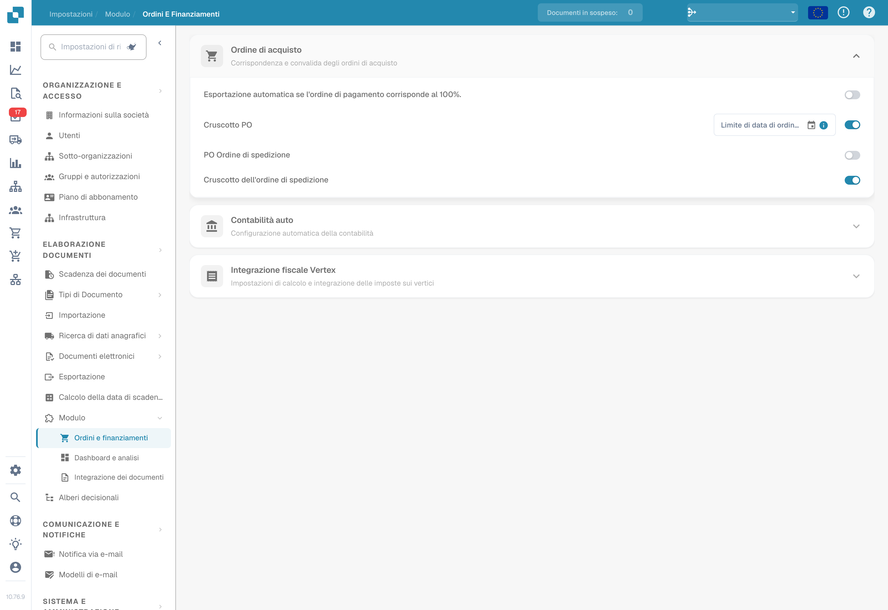
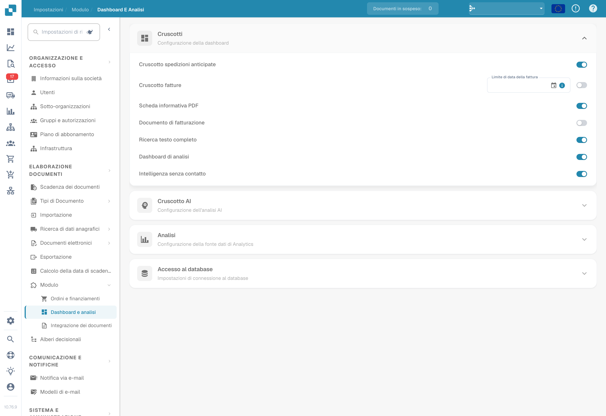

# Modulo

<figure><figcaption>
Moduli per ordini e finanze. L’opzione con il testo «ordine di pagamento» riguarda il confronto con l’ordine di acquisto (PO). Nessuna opzione è stata modificata.
</figcaption></figure>

<figure><figcaption>
Moduli di integrazione dei documenti, inclusi i dati anagrafici personalizzati e DocBits Operator. Nessun modulo è stato attivato durante la cattura.
</figcaption></figure>

<figure><figcaption>
Moduli per dashboard e analisi nello stato configurato; nessun interruttore è stato modificato.
</figcaption></figure>

La pagina Module ti permette di attivare o disattivare le funzionalità opzionali di DocBits. Ogni sezione raggruppa moduli correlati che possono essere attivati o disattivati.

## Ordine di acquisto

Impostazioni per PO Matching e validazione.

| Impostazione | Descrizione |
|---------|-------------|
| **Auto Export if PO matched 100%** | Esporta automaticamente il documento quando il PO Matching raggiunge il 100%. |
| **PO Dashboard** | Attiva il dashboard degli ordini d'acquisto. Include il campo **PO Date Limit** per limitare i dati degli ordini per data. |
| **PO Shipment Order** | Attiva l'elaborazione degli ordini di spedizione collegati agli ordini d'acquisto. |
| **Dashboard ordini di spedizione** | Attiva un dashboard dedicato agli ordini di spedizione. |

## Contabilizzazione automatica

| Impostazione | Descrizione |
|---------|-------------|
| **Auto Accounting** | Attiva la contabilizzazione automatica dei documenti. Seleziona il tipo di ERP (ad es. LN, M3). |

## Dashboard

| Impostazione | Descrizione |
|---------|-------------|
| **Dashboard anticipato delle spedizioni** | Dashboard per il monitoraggio delle attività di spedizione anticipata. |
| **Invoice Dashboard** | Dashboard per il monitoraggio e l'analisi delle fatture. |
| **Ricerca testo completo** | Attiva la ricerca full-text in tutti i documenti. |
| **Analytics Dashboard** | Attiva il dashboard di panoramica analitica. |

## Accesso al database

| Impostazione | Descrizione |
|---------|-------------|
| **DB Access** | Attiva l'accesso diretto al database per l'organizzazione. |

## Dashboard IA

| Impostazione | Descrizione |
|---------|-------------|
| **AI Document Warehouse** | Analisi del magazzino documentale basata sull'IA. |
| **Dashboard v2** | Dashboard aggiornato con funzionalità migliorate. |
| **Clickhouse Direct Access** | Attiva l'accesso diretto al database Clickhouse. |
| **Supplier Statistics** | Attiva statistiche e report a livello di fornitore. |

## Spedizione e fornitore

| Impostazione | Descrizione |
|---------|-------------|
| **Supplier Portal** | Attiva il portale fornitori per la collaborazione con i fornitori. |

## Tipo di documento

| Impostazione | Descrizione |
|---------|-------------|
| **Workflow Builder** | Crea e personalizza i workflow di elaborazione dei documenti. |
| **Annotation Mode** | Consente agli utenti di annotare i documenti nella vista di validazione. |
| **Show Report** | Attiva la generazione di report per i documenti. |
| **Inbound Emails** | Attiva la gestione delle email in entrata per tipo di documento. |
| **Models & Labels** | Gestisci i modelli IA e le etichette per il riconoscimento dei documenti. |
| **Document Script** | Attiva gli script personalizzati per l'elaborazione dei documenti. |
| **Document Scan** | Attiva la funzionalità di scansione dei documenti. |
| **Codice a barre/QR Estrazione codice** | Estrae i dati dei codici a barre/QR code dai documenti. Seleziona i tipi di codice supportati. |
| **Dati anagrafici personalizzati** | Attiva i campi personalizzati dei dati anagrafici. |
| **Tasks & Notifications** | Attiva la gestione delle attività e le notifiche. Include l'interruttore **Dashboard Tasks Count**. |
| **DocBits Operator** | Attiva l'automazione del browser DocBits Operator. |
| **DocNet** | Attiva il networking documentale DocNet. |
| **IDM ACL Updater** | Aggiorna le liste di controllo degli accessi (ACL) di Infor Document Management. Carica un file ION-Mapping e configura le associazioni tra Infor-Doctype e ACL. |
| **Barcode Assignment** | Attiva l'assegnazione dei codici a barre ai documenti. |
| **Imposta segno negativo per note di credito** | Applica automaticamente il segno negativo agli importi delle note di credito. |

## Flusso di connessione BOD

| Impostazione | Descrizione |
|---------|-------------|
| **BOD Connection Stream** | Attiva l'integrazione BOD (Business Object Document). Mostra lo **Stream Name** usato per la connessione. |

## Analisi

| Impostazione | Descrizione |
|---------|-------------|
| **Use PostgreSQL for Quality Analytics** | Passa da Prometheus (in tempo reale, si azzera a ogni deploy) a PostgreSQL (persistente per 90 giorni, analisi dei trend, campi con le prestazioni peggiori). |

## Integrazione fiscale Vertex

| Impostazione | Descrizione |
|---------|-------------|
| **Integrazione fiscale del vertice** | Attiva il calcolo delle imposte con Vertex. Configura **Base URL**, **Client ID** e **Client Secret**. Usa **Test Connection** per verificare. |
