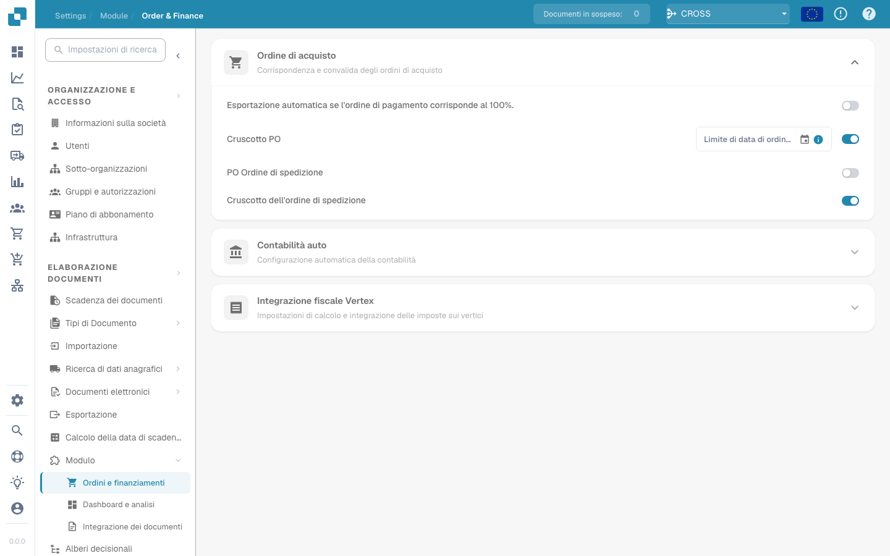

# IDM ACL Updater

## Panoramica

Il modulo ACL-Updater è responsabile dell'aggiornamento e della gestione degli elenchi di controllo degli accessi (ACL) all'interno di DocBits. Ciò garantisce che siano in atto autorizzazioni e misure di sicurezza adeguate per l'accesso e la gestione dei documenti.

## Istruzioni di attivazione

Per attivare il modulo ACL-Updater, attenersi alla seguente procedura:

1. Passare a **Impostazioni**.
2. Seleziona **Elaborazione documenti**.
3. Select **Module**.
4. Vai a **Tipo documento**.
5. Attiva **IDM ACL-Updater** abilitando lo slider corrispondente.

Una volta attivato il modulo, puoi selezionare un file di mappatura **ION** da utilizzare.

<figure><figcaption></figcaption></figure>

### Aggiunta delle informazioni ACL

Per aggiungere informazioni ACL, fare clic sul pulsante **Aggiungi**. È quindi possibile specificare i seguenti dettagli:

* **IDM Document Type**
* **Current IDM ACL Status**
* **New IDM ACL Status**

<figure><figcaption></figcaption></figure>

