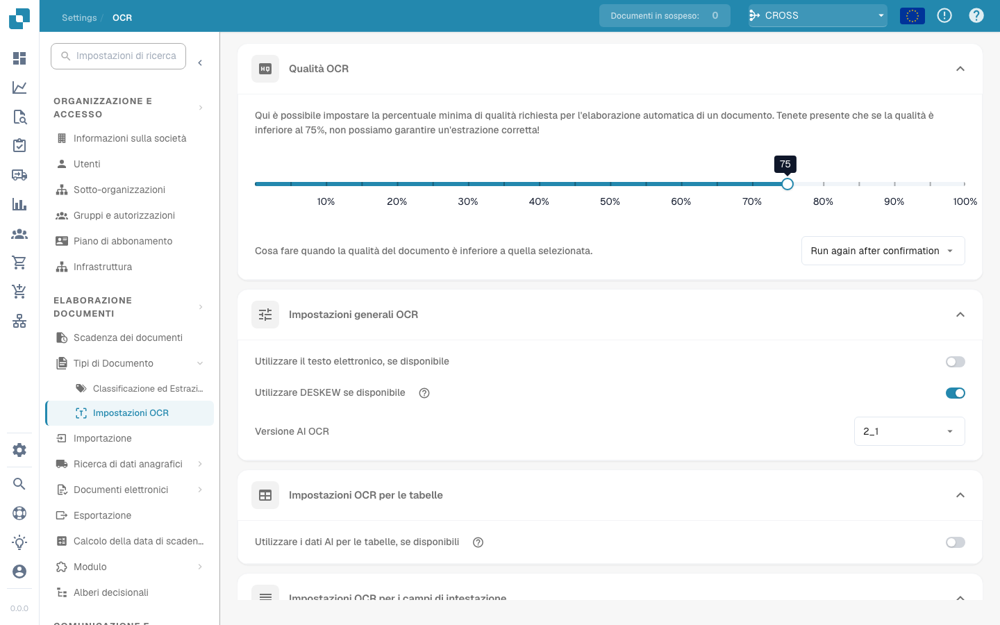

# Impostazioni OCR


DocBits OCR e testo elettronico spiegato: impostazioni, qualità ed estrazione dell'intestazione


## Panoramica

Nelle impostazioni **OCR (Riconoscimento ottico dei caratteri)**, puoi configurare il modo in cui OCR viene applicato durante l'elaborazione del documento. Ciò include la specifica della qualità minima richiesta, la scelta se utilizzare il testo incorporato (e-text), la selezione della versione OCR e altro ancora. Questa pagina fornisce una spiegazione dettagliata di tutte le impostazioni disponibili.

## Come accedere alle impostazioni OCR

Per accedere alle impostazioni OCR:

*   Passare a: **Impostazioni** → **Elaborazione documenti** → **OCR Impostazioni**

    <figure><figcaption></figcaption></figure>

## Qualità OCR

In questa sezione è possibile impostare la qualità minima del documento richiesta per l'elaborazione OCR regolando il cursore della qualità. Spostare il dispositivo di scorrimento a sinistra o a destra per diminuire o aumentare rispettivamente la soglia di qualità.

Se un documento non soddisfa il livello di qualità definito, DocBits fornisce tre opzioni per gestirlo:

* **Run Anyway**\
  Il documento verrà elaborato indipendentemente dalla sua qualità.
* **Esegui di nuovo dopo la conferma**\
  **DocBits** farà una pausa e ti chiederà di confermare se procedere con l'elaborazione.
* **Throw Error**\
  L'elaborazione del documento verrà interrotta completamente e verrà visualizzato un messaggio di errore che indica che il documento non ha raggiunto la soglia di qualità richiesta.

<figure><figcaption></figcaption></figure>

## Impostazioni OCR generali

* **Usa testo elettronico se disponibile**\
  Se abilitato, **DocBits** utilizzerà il testo elettronico incorporato (ad esempio, da PDF) invece di eseguire OCR. Ciò migliora sia la velocità che la precisione, poiché il testo viene estratto direttamente senza richiedere l'elaborazione OCR.
* **Usa DESKEW se disponibile**\
  Questa opzione corregge automaticamente l'allineamento dei documenti scansionati. Il raddrizzamento delle immagini inclinate aiuta a migliorare la precisione OCR.
*   **AI OCR Version**\
    Consente di selezionare una versione specifica del AI-basato OCR motore.\
    Questo può essere utile se:

    * Non stai ottenendo i risultati desiderati con la versione attualmente selezionata.
    * Stai risolvendo problemi relativi alle prestazioni o alla precisione di OCR.

    <figure><figcaption></figcaption></figure>

## Impostazioni OCR per le tabelle

* **Utilizza AI Dati per tabelle se disponibili**\
  Quando abilitato, DocBits utilizzerà i dati OCR per le tabelle invece del testo elettronico incorporato (E-Text) — anche se l'impostazione **Usa E-Text se disponibile** è attivata.

## Impostazioni OCR per i campi di intestazione

* **Usa estrazione regole**\
  DocBits applicherà le regole di estrazione predefinite per identificare i campi di intestazione.
* **Use AI Extraction**\
  DocBits utilizzerà AI per rilevare ed estrarre automaticamente i campi di intestazione.

**Execution Order:**\
Se entrambe le opzioni sono abilitate, **DocBits** eseguirà l'estrazione nel seguente ordine:\
**Estrazione Regole → AI Estrazione**\
\
<mark style="color:red;">**Nota**</mark>: per ottenere risultati ottimali e un comportamento coerente, abilitare entrambe le opzioni. Ciò consente a **DocBits** di utilizzare metodi basati su regole e AI in combinazione durante l'estrazione dell'intestazione.
