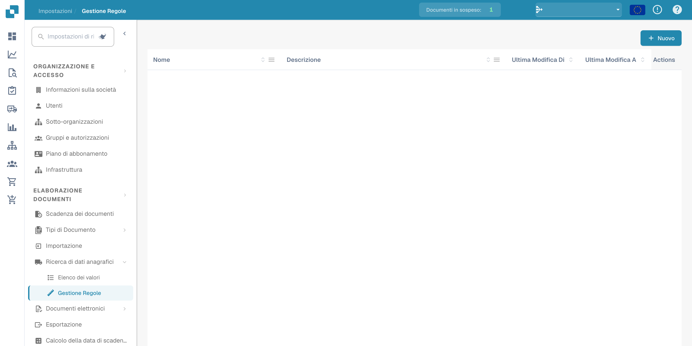
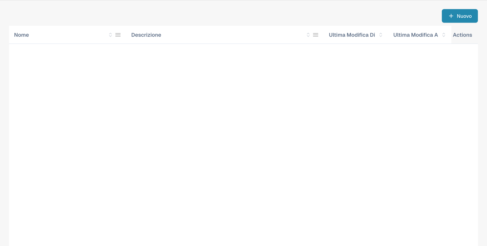
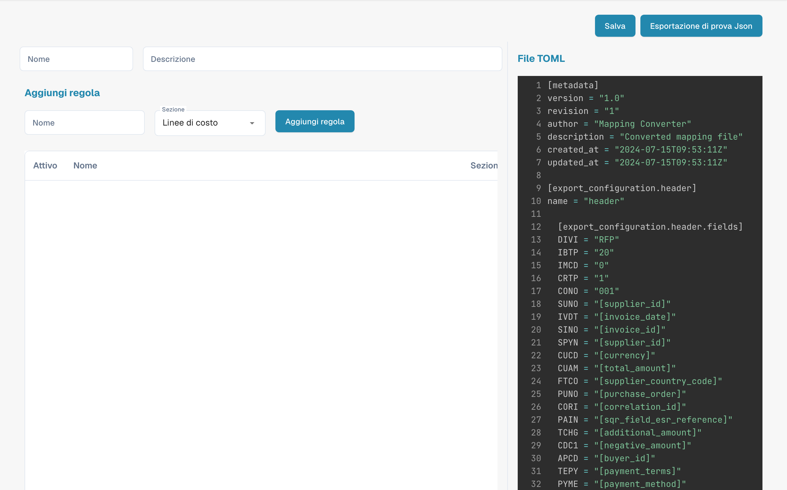

# Gestione delle regole

<figure><figcaption>
Gestione delle regole con i nomi configurati nascosti.
</figcaption></figure>

Rule Management ti permette di creare e gestire regole di risoluzione dei conflitti basate su TOML, utilizzate durante il PO Matching e l'esportazione dei documenti. Ogni set di regole definisce come DocBits gestisce le discrepanze tra i dati della fattura e quelli dell'ordine d'acquisto.

## Elenco delle regole

La tabella principale mostra tutte le configurazioni delle regole:

| Colonna | Descrizione |
|--------|-------------|
| **Nome** | Il nome del set di regole. Gli elementi contrassegnati con **predefinito** sono modelli forniti dal sistema. |
| **Descrizione** | Un riepilogo di ciò che il set di regole gestisce. |
| **Ultima modifica di** | L'utente che ha modificato per ultimo questo set di regole. |
| **Ultima modifica a** | Data e ora dell'ultima modifica. |
| **Azioni** | Menu con tre puntini per modificare, copiare o eliminare. |

Fai clic su **+ New** per creare un nuovo set di regole, oppure fai clic su un nome esistente per aprire l'editor delle regole.

---

## Riferimento sulla struttura delle regole

Questa sezione offre una spiegazione approfondita delle regole di risoluzione dei conflitti utilizzate nel sistema di fatturazione di DocBits. Queste regole sono progettate per gestire automaticamente le discrepanze tra i dettagli della fattura e i dati dell'ordine d'acquisto (PO), garantendo una riconciliazione finanziaria accurata. Il sistema applica queste regole per elaborare righe di fattura, costi aggiuntivi e imposte, e genera rettifiche o note appropriate quando necessario.

## Struttura delle regole

### 1. Metadata

• version: identifica la versione del file di mapping.

• revision: numero di revisione per il tracciamento delle modifiche.

• author: indica il creatore del file di mapping.

• description: una breve descrizione dello scopo del file.

• created_at & updated_at: data e ora di creazione e dell'ultimo aggiornamento del file.

### 2. Configurazione dell’esportazione

La sezione di configurazione dell'esportazione definisce il mapping tra i campi dati del sistema e i campi corrispondenti nei file di esportazione.

• Header: definisce i campi di intestazione dei dati di fattura esportati.

• Tax Lines: specifica i campi per le righe d'imposta nell'esportazione.

• Order Header Charges: associa i campi relativi ai costi aggiuntivi a livello di intestazione dell'ordine.

• Receipt Lines: associa i campi per le singole righe di una ricevuta.

• Order Line Charges: definisce i campi per i costi aggiuntivi relativi a specifiche righe d'ordine.

• Cost Lines: specifica i campi per le righe di ripartizione dei costi.

• Debit Note & Credit Note: definisce i campi per la generazione di note di debito e di credito in caso di discrepanze.

### 3. Regole per la risoluzione dei conflitti

Queste regole gestiscono le discrepanze tra i dati della fattura e i corrispondenti dati del PO. Ogni regola è composta da diversi elementi:

• Name: il nome descrittivo della regola, che indica il tipo di discrepanza che gestisce.

• Section: indica a quale parte della fattura (ad es. receipt_lines, line_charges) si applica la regola.

• Active: valore booleano (true o false) che indica se la regola è attualmente attiva.

• Match Criteria: condizioni che attivano la regola in base al confronto tra i dati effettivi della fattura e i dati attesi del PO.

• Actions: definisce cosa deve fare il sistema quando la regola viene attivata, ad esempio modificare i valori, applicare costi aggiuntivi o generare note di credito/debito.

## Elementi comuni nelle regole

### Operatori di confronto

Questi operatori definiscono come i valori effettivi della fattura vengono confrontati con i valori attesi del PO:

• uguale a

• maggiore di

• maggiore o uguale a

• minore di

• minore o uguale a

• entro la tolleranza

• fuori dalla tolleranza

### Stato di approvazione

Indica se una discrepanza è approvata o meno:

• approvata

• rifiutata

• qualsiasi

### Tipi di azione

Definisce le azioni specifiche da eseguire quando viene rilevata una discrepanza:

• riga di ricevuta

• riga di costo

• costo aggiuntivo di intestazione

• costo aggiuntivo di riga

• riga d'imposta

• riga di ricevuta della nota di debito

• riga di costo della nota di debito

• costo aggiuntivo di intestazione della nota di debito

• costo aggiuntivo di riga della nota di debito

• riga di ricevuta della nota di credito

• riga di costo della nota di credito

• costo aggiuntivo di intestazione della nota di credito

• costo aggiuntivo di riga della nota di credito

• riga d'imposta della nota di credito

### Esempi di regole

#### [Caso 1, 2, 3: quantità e prezzo unitario entro la tolleranza](transactionconfig-pro-template/case-1-2-3-quantity-and-unit-price-within-tolerance.md)

• Scopo: gestisce gli scenari in cui sia la quantità sia il prezzo unitario in fattura rientrano nei limiti di tolleranza accettati rispetto al PO.

• Azione: il sistema accetta i valori della fattura e calcola l'importo totale.

#### [Caso 4, 5: quantità entro la tolleranza, prezzo unitario fuori tolleranza (approvato)](./#caso-4-5-quantita-entro-la-tolleranza-prezzo-unitario-fuori-tolleranza-approvato)

• Scopo: si applica quando la quantità è entro la tolleranza ma il prezzo unitario è fuori tolleranza ed è stato approvato.

• Azione: il sistema adegua il prezzo unitario a quello del PO e applica gli eventuali costi aggiuntivi di riga necessari.

#### [Caso 6: quantità entro la tolleranza, prezzo unitario fuori dalla tolleranza negativa (rifiutato)](transactionconfig-pro-template/case-6-quantity-within-tolerance-unit-price-outside-negative-tolerance-rejected.md)

• Scopo: gestisce i casi in cui il prezzo unitario è inferiore al previsto e fuori dall'intervallo di tolleranza, con conseguente rifiuto.

• Azione: il sistema adegua il prezzo unitario a quello del PO, genera una nota di credito per la differenza e applica i costi aggiuntivi di intestazione secondo necessità.

### Gestione di costi aggiuntivi e imposte

### Tolleranza dei costi per unità

• Le regole di questa categoria gestiscono le discrepanze nei costi per unità, con azioni specifiche a seconda che il costo sia entro o fuori tolleranza e che sia approvato o rifiutato.

### Rettifiche delle righe d'imposta

• Queste regole gestiscono le discrepanze fiscali modificando le righe d'imposta o generando le corrispondenti note di credito o di debito in base alle differenze tra i dati fiscali della fattura e quelli del PO.

### Enum e opzioni

• Enums: elenchi predefiniti di valori che garantiscono coerenza tra le regole (ad es. operatori di confronto, tipi di approvazione).

• Options: scelte predefinite per la gestione di quantità o prezzi unitari, che offrono flessibilità nella definizione delle regole.

## Spiegazione degli screenshot

### Screenshot 1: interfaccia Rule Management

<figure><figcaption>
Panoramica della gestione delle regole e delle relative azioni.
</figcaption></figure>

Questo screenshot mostra l'interfaccia Rule Management, in cui gli amministratori possono visualizzare e gestire tutte le regole di risoluzione dei conflitti. Gli elementi principali sono:

• Add Rule Button: consente di aggiungere nuove regole.

• List of Rules: mostra tutte le regole attive con dettagli come nome, sezione e stato di attivazione.

• Section Dropdown: filtra le regole in base alla sezione a cui si applicano (ad es. Receipt Lines, Line Charges).

### Screenshot 2: modifica dettagliata di una regola

<figure><figcaption>
Editor delle regole TOML con un esempio di configurazione tecnica.
</figcaption></figure>

Questo screenshot illustra la vista dettagliata di una regola specifica in fase di modifica. Gli elementi principali sono:

• Criteria Section: definisce le condizioni in cui la regola viene attivata. Ad esempio, i criteri potrebbero specificare che la regola deve essere applicata se quantità e prezzo unitario differiscono dal PO ma rientrano nella tolleranza.

• Actions Section: specifica quali azioni devono essere eseguite quando i criteri sono soddisfatti. Può trattarsi di modificare le righe della fattura, generare note di credito o di debito oppure applicare costi aggiuntivi.

• Document Type and Costing Elements: consente all'amministratore di associare azioni specifiche a tipi di documento ed elementi di costo, offrendo flessibilità nella gestione di scenari diversi.
