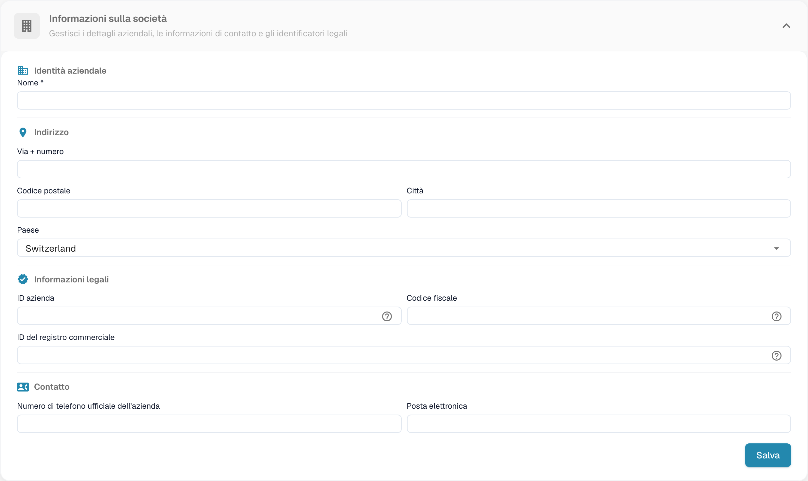
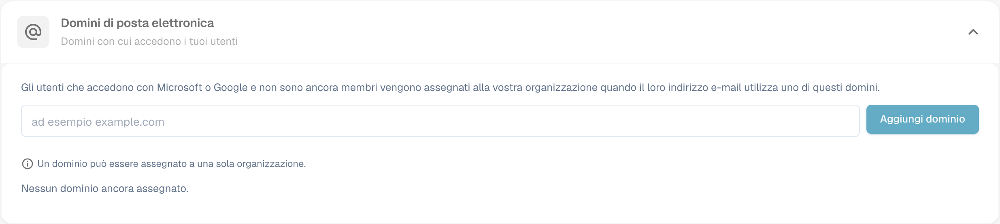

# Informazioni aziendali

<figure><figcaption>
Informazioni sull’azienda con i valori dell’organizzazione nascosti.
</figcaption></figure>

La pagina Company Information ti permette di gestire il profilo della tua azienda, le preferenze e i dettagli dell'abbonamento. È organizzata nelle sezioni seguenti:

## Company Information

Questa sezione contiene i dati principali della tua azienda, raggruppati in quattro aree:

### Company Identity

* **Nome** *(obbligatorio)*: la ragione sociale della tua azienda.

### Address

* **Via + numero**: l'indirizzo (via e numero civico) della tua azienda.
* **Codice postale**: il codice postale (CAP).
* **Città**: il nome della città.
* **Paese**: seleziona il tuo paese dal menu a discesa.

### Legal Information

* **ID azienda**: un identificatore univoco della tua azienda, usato per le integrazioni e come riferimento interno.
* **Codice fiscale**: il tuo numero di identificazione fiscale per la rendicontazione finanziaria.
* **ID del registro commerciale**: il tuo numero di registro commerciale per la documentazione legale.

### Contact

* **Telefono ufficiale dell’azienda**: il numero di telefono principale della tua azienda.
* **Posta elettronica**: l'indirizzo e-mail principale usato per le comunicazioni ufficiali.

Dopo aver inserito o aggiornato i campi, fai clic su **Salva** per applicare le modifiche. Le icone **?** accanto agli identificatori legali mostrano indicazioni aggiuntive sul campo. Seleziona il titolo della sezione per espandere o comprimere il modulo.

## E-mail domains

Gli amministratori dell'organizzazione possono aprire **Impostazioni → Informazioni aziendali → Domini di posta elettronica** per gestire i domini usati per l'assegnazione automatica all'organizzazione. Quando una persona accede con Microsoft o Google e non è ancora membro di un'organizzazione, DocBits può assegnarla a questa organizzazione se il suo indirizzo e-mail utilizza uno dei domini elencati. Un dominio può appartenere a una sola organizzazione.

<figure><figcaption>
Configurazione dei domini e-mail dell’azienda.
</figcaption></figure>

Inserisci solo il dominio, ad esempio `example.com`, nel campo e seleziona **Aggiungi dominio** oppure premi Invio. Il primo dominio diventa il dominio primario. Se sono elencati più domini, usa **Rendere primario** su un'altra riga per cambiarlo, oppure l'icona del cestino per rimuovere un dominio. Errori come un dominio non valido, un provider di posta personale o un dominio già assegnato altrove compaiono sotto il campo. **Nessun dominio ancora assegnato** significa che questa organizzazione non ha alcuna regola di dominio.

Prima di aggiungere un dominio, verifica quale organizzazione deve ricevere i nuovi accessi. Per gestire le appartenenze esistenti, continua con [Utenti](../groups-users-and-permissions/users/README.md).

## Company Preferences

Configura le impostazioni predefinite valide per tutta l'azienda:

* **Modello di data**: scegli come vengono visualizzate le date in tutto DocBits (ad es. `%m/%d/%Y`, `%d.%m.%Y`).
* **Formattazione degli importi**: seleziona il formato numerico degli importi (ad es. Deutsch per `1.000,00`, English per `1,000.00`).
* **Nuova finestra di dialogo per le informazioni sulla versione**: attiva o disattiva la visualizzazione di una notifica agli utenti quando viene rilasciata una nuova versione di DocBits.

Fai clic su **Salva** dopo aver apportato le modifiche.

## App-Color

Personalizza il colore principale dell'interfaccia di DocBits. È utile per distinguere visivamente ambienti diversi (ad es. dev e produzione).

* **Colore**: inserisci un codice colore esadecimale (ad es. `#2388AE`) oppure usa il selettore di colori.
* Fai clic su **Salva** per applicare, oppure su **Ripristina** per ripristinare il colore predefinito.

## Subscription Plan

Visualizza i tuoi piani di abbonamento attivi e i relativi dettagli:

* **Nome del piano**: il nome di ciascun piano attivo (ad es. DocBits, DocFlow Users, DocSearch).
* **giorni rimasti**: quanti giorni mancano alla scadenza del piano.
* **Start Date / End Date**: il periodo di abbonamento.
* **Numero di utenti**: il numero totale di utenti della tua organizzazione.
* **Numero di sotto-organizzazioni**: il numero di sotto-organizzazioni configurate.
* **Numero di fornitori**: il numero di fornitori registrati.

## Subscription Usage

Monitora il consumo mensile di token e workflow:

| Colonna | Descrizione |
|--------|-------------|
| **Tipo** | Il tipo di utilizzo (Document o Workflow). |
| **From / To** | Le date del periodo di fatturazione. |
| **Token utilizzati** | Il numero di token consumati nel periodo corrente. |
| **Token rimanenti** | I token ancora disponibili nel periodo corrente. |

Usa il pulsante **Selezionare** per filtrare per intervalli di date specifici.
