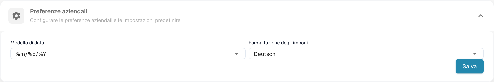
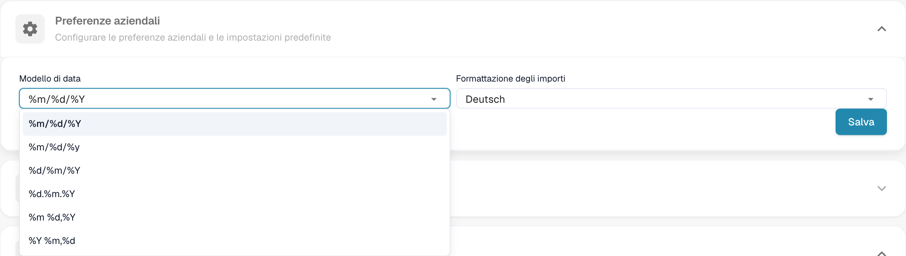

# Preferenze aziendali

## Video tutorial: Società, abbonamento e controllo


Informazioni sulla società, piano di abbonamento e registri di controllo in DocBits


Il video mostra le informazioni e le preferenze della società, il piano di abbonamento, l'attività di accesso e i registri di controllo.

Nelle informazioni sull’azienda, aprire le preferenze per definire i formati di data e importo dell’organizzazione.

<figure><figcaption>
Preferenze dell’azienda e formati di importi e date.
</figcaption></figure>

Scegliere un formato della data adatto ai documenti. I simboli %d, %m e %Y sono codici tecnici del formato.

<figure><figcaption>
Selezione del formato della data nelle preferenze dell’azienda.
</figcaption></figure>

Il formato degli importi è indipendente; il nome configurato può restare invariato. Verificare entrambi i formati prima del salvataggio. La vecchia finestra di notifica della versione non fa parte della vista attuale. Nessuna preferenza è stata modificata per queste immagini.


