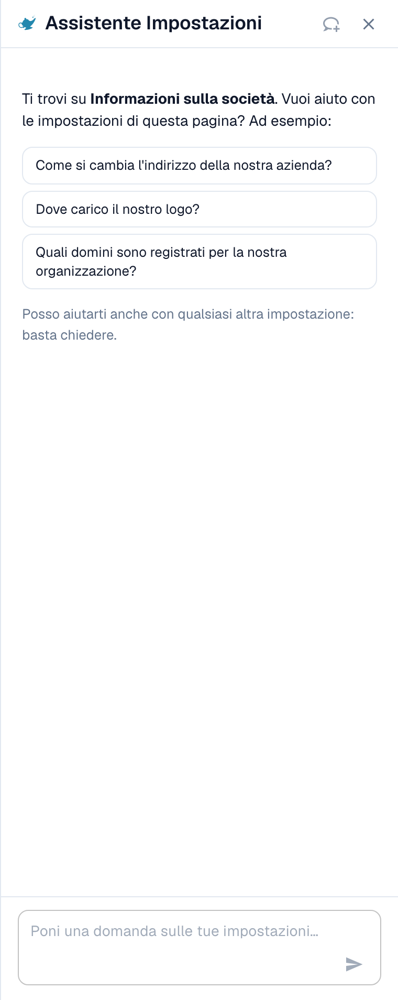
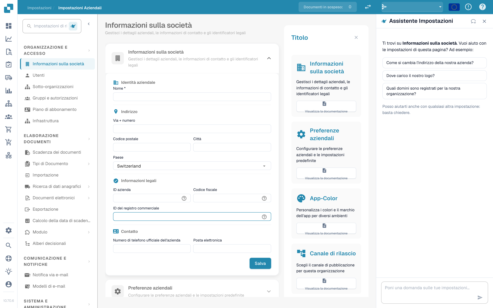

# Assistente impostazioni: come attivarlo

L'**Assistente impostazioni** (Settings Assistant) è un pannello di chat all'interno dell'area Impostazioni. Fai una domanda in linguaggio naturale, ed esso legge la configurazione della tua organizzazione, risponde e ti porta direttamente all'impostazione giusta. Può anche avvisarti quando qualcosa nella tua configurazione ha smesso di funzionare e, con la tua conferma, modificare un'impostazione al posto tuo.

È molto utile quando sai **cosa** vuoi ("smettere di dividere i documenti in base ai codici a barre") ma non **dove** si trova l'impostazione, oppure quando ti chiedi **perché** qualcosa non accade ("Perché l'abbinamento ordini non è attivo?").

<figure><figcaption>
L'Assistente impostazioni nella pagina Informazioni sulla società: un saluto per la pagina corrente, tre domande di esempio e il campo della domanda. Una scheda di avviso compare sopra il saluto quando un'importazione ha smesso di funzionare (vedi <a href="settings-assistant-chat.md#segnalazioni-lassistente-ti-avvisa">Segnalazioni</a>).
</figcaption></figure>

L'assistente è **disattivato per impostazione predefinita**. Questa pagina mostra dove attivarlo e come aprirlo. Cosa puoi chiedergli e cosa può modificare è descritto nella pagina [Assistente impostazioni: cosa può fare la chat](settings-assistant-chat.md).

## Chi può usarlo

* L'**amministratore dell'organizzazione** attiva o disattiva l'assistente per l'intera organizzazione.
* Una volta attivato, ogni amministratore che può aprire le **Impostazioni** può mostrare o nascondere il pannello per sé.
* Le modifiche (applicare una raccomandazione, disattivare o eliminare una connessione di importazione, creare una regola) sono limitate agli **amministratori dell'organizzazione**. Gli altri utenti ricevono il messaggio _Available to administrators only._

## Attivarlo

1. Vai su **Impostazioni → Impostazioni globali → Informazioni sulla società**. L'intestazione della pagina mostra **Company Settings**.
2. Apri la sezione **Assistenti** (Assistants).
3. Attiva **Abilita l'assistente impostazioni** (Enable the settings assistant).

<figure><figcaption>
La sezione Assistenti. L'assistente impostazioni ha un proprio interruttore. L'assistente di convalida e la voce narrante delle spiegazioni sono funzioni separate.
</figcaption></figure>

Un breve messaggio conferma **Settings assistant enabled**. L'impostazione è disattivata per impostazione predefinita. Finché è disattivata, il pannello e il suo pulsante non compaiono da nessuna parte.


L'**Assistente di convalida** (Validation assistant) nella stessa sezione è una funzione diversa. Spiega i campi bloccanti all'interno di un documento e non può modificare alcuna impostazione. Attivare o disattivare uno dei due non influisce sull'altro.


## Aprire e chiudere il pannello

In ogni pagina dell'area Impostazioni trovi un piccolo **pulsante a forma di lampada del genio** accanto al campo di ricerca delle impostazioni. Fai clic per **mostrare** o **nascondere** l'assistente.

<figure><figcaption>
L'assistente si trova sul <strong>lato destro</strong> di ogni pagina delle Impostazioni: navigazione a sinistra, la pagina al centro, l'assistente accanto. Qui in <strong>Company Settings → Company Information</strong>. Il pulsante per mostrarlo o nasconderlo è l'icona della lampada accanto a <strong>Search Settings</strong> in alto nella navigazione.
</figcaption></figure>

* Il pannello ricorda la tua scelta per ogni utente, quindi resta aperto la volta successiva.
* Su uno schermo largo (1280 pixel o più) si trova accanto alla pagina. Puoi trascinarne il bordo per cambiare la larghezza.
* Su uno schermo stretto si apre come sovrapposizione. **Esc** o un clic all'esterno lo chiude.
* **Nuova chat** (New chat; l'icona del fumetto nell'intestazione) cancella la conversazione. La conversazione sopravvive anche al ricaricamento della pagina, ma non alla chiusura della scheda del browser.

## Cosa fare dopo

* Fai la tua prima domanda: vedi [Assistente impostazioni: cosa può fare la chat](settings-assistant-chat.md).
* L'assistente funziona con il livello IA **Fast**. Non esiste un'impostazione dell'organizzazione per scegliere un modello diverso.

## Risoluzione dei problemi

| Problema                                                                   | Causa e soluzione                                                                                                                                |
| -------------------------------------------------------------------------- | ------------------------------------------------------------------------------------------------------------------------------------------------ |
| Nell'area Impostazioni non c'è il pulsante a forma di lampada del genio    | L'interruttore dell'organizzazione è disattivato. Un amministratore dell'organizzazione lo attiva in **Informazioni sulla società → Assistenti** |
| La sezione **Assistenti** manca in Informazioni sulla società              | Solo gli amministratori dell'organizzazione la vedono                                                                                            |
| Il pannello dice **The assistant is being set up**                         | La funzione non è ancora disponibile nel tuo ambiente                                                                                            |
| Il pannello c'è, ma le risposte dicono _Available to administrators only._ | Il tuo account non è un amministratore dell'organizzazione                                                                                       |

## Pagine correlate

* [Assistente impostazioni: cosa può fare la chat](settings-assistant-chat.md)
* [Preferenze aziendali](../company-preferences.md)
