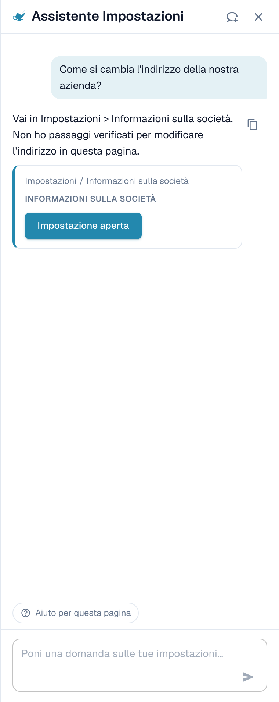
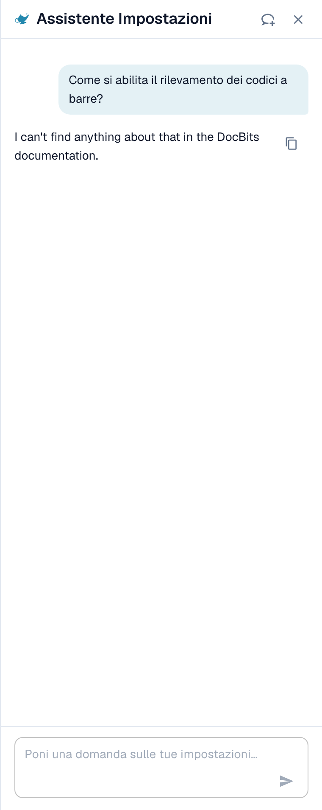
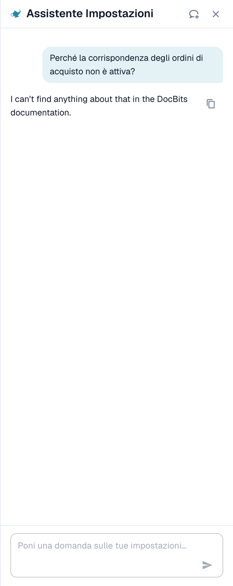
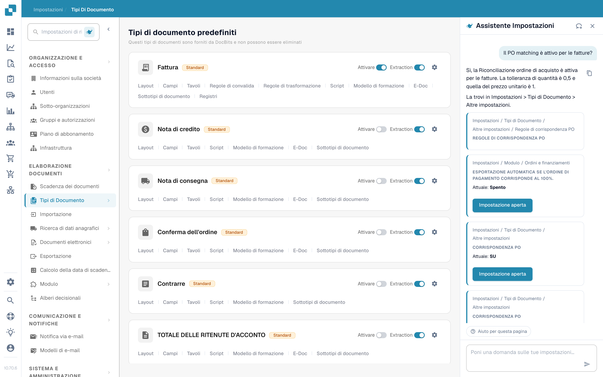
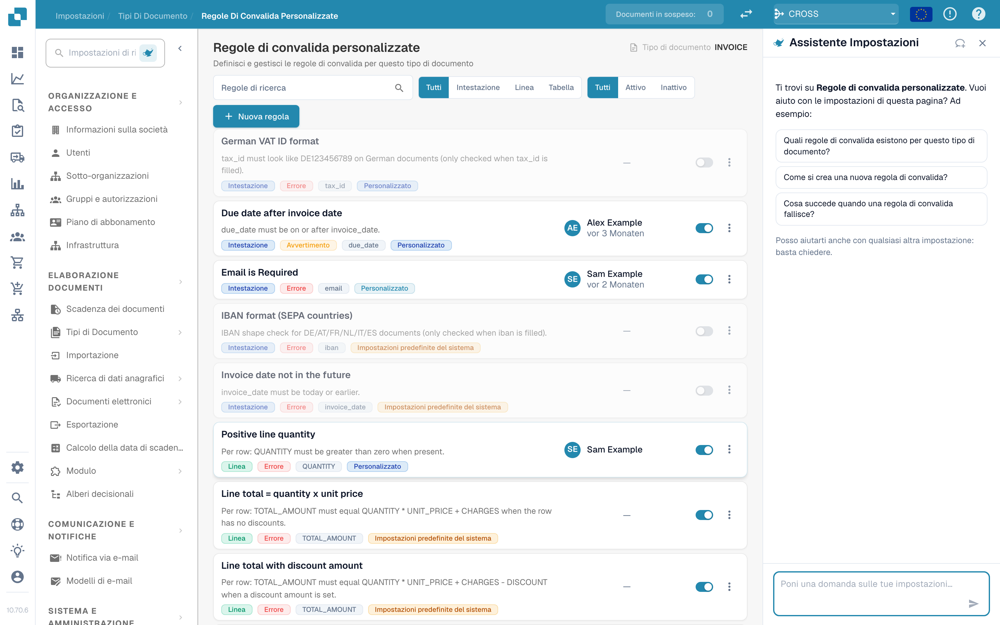
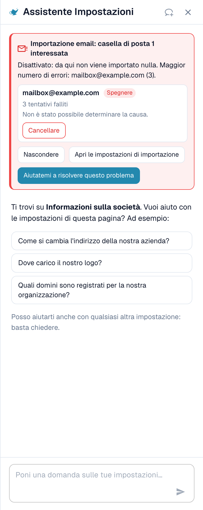

# Assistente impostazioni: cosa può fare la chat

## Panoramica

La chat dell'**Assistente impostazioni** risponde a domande sulle tue impostazioni, ti avvisa quando un'importazione smette di funzionare e, con la tua conferma, modifica un'impostazione al posto tuo. Prima di usarla, un amministratore deve [attivare l'assistente](./).

### Cosa può fare

| Vuoi…                                   | Esempio                                                                               | Cosa ottieni                                                                                                                                                                              |
| --------------------------------------- | ------------------------------------------------------------------------------------- | ----------------------------------------------------------------------------------------------------------------------------------------------------------------------------------------- |
| Trovare un'impostazione                 | "Dove trovo le impostazioni di importazione e-mail?"                                  | Il percorso (ad esempio Impostazioni / Importazione), un pulsante **Apri impostazione** (Open setting) che salta all'impostazione e la evidenzia                                          |
| Capire un'impostazione                  | "Come abilito il rilevamento dei codici a barre?"                                     | Una breve spiegazione di ogni impostazione corrispondente: quando attivarla, quando lasciarla disattivata                                                                                 |
| Controllare la tua configurazione       | "Perché l'abbinamento ordini non è attivo?"                                           | Il valore attuale di ogni impostazione correlata nella tua organizzazione (**Attuale: Attivo** o **Attuale: Disattivo**; in inglese **Current: On** o **Current: Off**) e quale ti blocca |
| Individuare un'importazione guasta      | Una scheda rossa in alto nel pannello                                                 | Quale casella e-mail o connessione FTP non funziona, quante volte e un probabile motivo                                                                                                   |
| Modificare un'impostazione in sicurezza | **Disattiva** (Switch off) su una casella e-mail guasta in una scheda di segnalazione | Un'anteprima della modifica. Nulla viene salvato finché non confermi. Ogni modifica può essere annullata.                                                                                 |
| Conoscere una pagina                    | **Guarda la spiegazione video** (Watch video explanation)                             | Un breve video per la pagina in cui ti trovi (disponibile per pagine selezionate)                                                                                                         |


L'assistente funziona con il livello IA **Fast**. Non esiste un'impostazione dell'organizzazione per scegliere un modello diverso.


## Fare domande

Scrivi una domanda nel campo in basso ("Ask a question about your settings…") e premi **Invio**. L'assistente mostra cosa sta facendo ("Reading configuration…", "Searching documentation…", "Writing answer…") e puoi fermarlo in qualsiasi momento con **Stop**.

### Il pannello sa in quale pagina ti trovi

Quando apri il pannello in una pagina delle impostazioni, ti saluta per **quella pagina** e propone tre domande adatte. Sono esempi reali:

| Pagina                        | Domande di esempio                                                                                                                                |
| ----------------------------- | ------------------------------------------------------------------------------------------------------------------------------------------------- |
| Informazioni sulla società    | "How do I change our company address?", "Where do I upload our logo?", "Which domains are registered for our organization?"                       |
| Importazione                  | "Is email import active for us?", "Which email address do we send documents to?", "How do I set up an FTP or SFTP import?"                        |
| Classificazione ed estrazione | "Which AI model is used for extraction?", "Is splitting documents on barcodes active for us?", "Can I use a different AI model for one supplier?" |
| Utenti                        | "How do I invite a new user?", "How do I make a user an administrator?", "How do I deactivate a user?"                                            |
| Panoramica delle impostazioni | "How do I enable barcode detection?", "Why isn't PO matching active?", "Where do I find the email import settings?"                               |

Fai clic su una domanda e viene inviata subito. Sotto le tre domande il pannello dice _I can also help with any other setting — just ask._ Durante una conversazione, il chip **Aiuto per questa pagina** (Help with this page) resta in basso e chiede "What can I configure on this page?".

### Esempio 1: trovare un'impostazione

Chiedi **"How do I change our company address?"**

<figure><figcaption>
La risposta indica il posto, e la scheda ti dà il percorso esatto e un pulsante <strong>Open setting</strong>.
</figcaption></figure>

La risposta dice dove si trova l'indirizzo. La scheda sotto mostra il percorso (**Settings / Company Settings**) e il pulsante **Open setting**. Fai clic: DocBits apre la pagina, scorre fino all'impostazione e la evidenzia per qualche secondo.

### Esempio 2: capire un'impostazione che ha più nomi

Chiedi **"How do I enable barcode detection?"**

<figure><figcaption>
Quando una parola corrisponde a più impostazioni, l'assistente elenca ciascuna con <strong>Enable when</strong> e <strong>Leave off when</strong>.
</figcaption></figure>

"Rilevamento dei codici a barre" può indicare tre impostazioni diverse, quindi l'assistente chiede _Did you mean: QR Code Extraction, Barcode Assignment, or Split Document on Barcode?_ e le spiega una per una:

* **QR Code Extraction**: legge automaticamente codici a barre e codici QR supportati durante l'elaborazione. Abilitala quando i tuoi documenti contengono codici utili.
* **Barcode Assignment**: permette a un revisore di assegnare a mano ai campi i valori dei codici a barre decodificati durante la convalida. Richiede che l'estrazione rilevi prima il codice e non rende l'elaborazione touchless.
* **Split Document on Barcode**: divide un file caricato in documenti separati alle pagine separatrici. Usala solo quando i codici separatori sono affidabili.

### Esempio 3: scoprire perché qualcosa non accade

Chiedi **"Why isn't PO matching active?"**

<figure><figcaption>
Per una domanda "perché" l'assistente legge la tua configurazione e mostra ogni impostazione con il suo valore <strong>Current</strong>.
</figcaption></figure>

L'assistente legge le impostazioni della tua organizzazione e riferisce ciò che ha trovato. In questo esempio l'abbinamento ordini è **On** per tutti e quattro i tipi di documento, e l'impostazione **Auto export if PO matched 100%** è **Off**, quindi l'abbinamento e l'esportazione automatici non vengono eseguiti. Ogni scheda mostra **Current: On / Off** e un pulsante **Open setting**, così puoi correggere subito.

### Esempio 4: abbinamento ordini

Apri **Impostazioni → Tipi di documento** e chiedi **"Is PO matching active for invoices?"** (questa domanda è anche uno dei tre suggerimenti in quella pagina).

<figure><figcaption>
La pagina <strong>Document Types</strong> con l'assistente a destra. La risposta dice <strong>PO Matching is active for invoices in your organisation</strong> e mostra tre impostazioni correlate: <strong>PO Matching</strong> (Current: On), le <strong>PO match rules</strong> e <strong>Auto export if PO matched 100%</strong> (Current: Off).
</figcaption></figure>

L'assistente legge l'impostazione per il tipo di documento e aggiunge le impostazioni che le appartengono. In questo esempio l'abbinamento è attivo, ma l'esportazione automatica dopo un abbinamento al 100 % è disattivata, quindi le fatture abbinate aspettano ancora una persona. Ogni scheda ha un pulsante **Open setting**.

* Per le **regole di abbinamento e le tolleranze** usa la pagina [Regole di abbinamento degli ordini d'acquisto](../../document-types/more-settings/purchase-order/purchase-order-matching-rules.md).
* Per vedere **perché i documenti di un fornitore non vengono abbinati** apri [Touchless Intelligence: Diagnosi dell'abbinamento ordini](../../../../analytics-dashboard/touchless-intelligence/touchless-po-matching-diagnosis.md). Mostra il motivo, i documenti interessati e il flusso decisionale.

### Esempio 5: convalida dei campi (regole di convalida personalizzate)

Nella pagina **Impostazioni → Tipi di documento → Regole di convalida personalizzate** il pannello ti saluta per questa pagina e suggerisce tre domande.

<figure><figcaption>
La pagina <strong>Custom Validation Rules</strong> con l'assistente a destra. L'elenco delle regole è al centro, i tre suggerimenti del pannello sono: <strong>Which validation rules exist for this document type?</strong>, <strong>How do I create a new validation rule?</strong> e <strong>What happens when a validation rule fails?</strong>
</figcaption></figure>

Usa qui l'assistente per **trovare** l'impostazione giusta e per capire cosa fa una regola. Per **creare o modificare** una regola, lavora nella pagina stessa: vedi [Regole di convalida personalizzate](../../document-types/custom-validation-rules.md) e [Duplicare una regola di convalida personalizzata](../../document-types/duplicate-a-custom-validation-rule.md). Se l'assistente crea una regola per te, la regola viene sempre creata **inattiva**, e la attivi tu.


Non confondere le **Regole di convalida personalizzate** (regole per i campi di un tipo di documento) con la **Convalida delle fatture elettroniche** (il controllo dei file XRechnung, ZUGFeRD e Factur-X). Sono due pagine diverse.


### Esempio 6: altre domande da provare

* "Which AI model is used for extraction?"
* "Is splitting documents on barcodes active for us?"
* "How do I deactivate a user?"
* "Where do I set how long documents are kept?"
* "Which settings affect the touchless rate?"
* "Show me a screenshot of the supplier portal settings."


Se una domanda è fuori dall'area delle impostazioni, o l'assistente non trova nulla al riguardo nelle informazioni DocBits di cui dispone, lo dice. Ad esempio, una domanda su qualcosa che non è un'impostazione restituisce _I can't find anything about … in the DocBits information available here_ insieme a un link alla pagina più vicina. Non tira a indovinare.


### Link e screenshot nelle risposte

* Le risposte possono contenere link **View documentation**. Puntano solo a docs.docbits.com e si aprono in una nuova scheda. I link alla documentazione compaiono quando la ricerca nella documentazione è disponibile per il tuo ambiente.
* Le risposte possono mostrare **screenshot** dalla documentazione. Fai clic su una miniatura per ingrandirla.
* **Copy answer** (la piccola icona di copia accanto a una risposta) copia il testo.

## Segnalazioni: l'assistente ti avvisa

Quando qualcosa nella tua configurazione ha smesso di funzionare, compare una **scheda rossa** in alto nel pannello. Non devi chiedere nulla. L'assistente controlla di nuovo ogni volta che apri il pannello e ogni volta che torni alla scheda del browser.

<figure><figcaption>
Una segnalazione espansa: la casella, il suo stato (<strong>Switched off</strong>), il numero di tentativi falliti e il motivo.
</figcaption></figure>

Attualmente ci sono due controlli:

| Controllo           | Titolo della scheda                                                        | Cosa conta                                                    |
| ------------------- | -------------------------------------------------------------------------- | ------------------------------------------------------------- |
| Importazione e-mail | "Email import: 1 mailbox affected" / "Email import: 3 mailboxes affected"  | Caselle e-mail con accessi falliti                            |
| Importazione FTP    | "FTP import: 1 connection affected" / "FTP import: 2 connections affected" | Connessioni con tentativi di connessione o di accesso falliti |

Ogni scheda ha tre pulsanti:

* **Show errors** (poi **Hide**): elenca le caselle o le connessioni interessate, fino a dieci, con lo stato (**Switched off** o **Retrying**), il numero di tentativi falliti e il motivo.
* **Open import settings**: apre **Impostazioni → Importazione**.
* **Help me fix this**: avvia una chat. L'assistente pone a se stesso la domanda "My email import has stopped working. Can you help me fix it?" e ti guida attraverso il motivo.

La riga di riepilogo ti dice quanto è grave:

| Riga di riepilogo                                        | Significato                                                      |
| -------------------------------------------------------- | ---------------------------------------------------------------- |
| _Switched off: nothing is being imported from here._     | Tutte le caselle interessate sono disattivate. Non arriva nulla. |
| _Still being retried, but imports are probably failing._ | DocBits continua a provare, ma l'accesso non funziona.           |
| _1 switched off, 2 still being retried._                 | Un misto dei due casi.                                           |

### Motivi che puoi vedere

L'assistente traduce l'errore tecnico in uno di questi motivi:

| Motivo mostrato                                                                                    | Cosa fare                                                                                                     |
| -------------------------------------------------------------------------------------------------- | ------------------------------------------------------------------------------------------------------------- |
| Sign-in blocked by policy (e.g. basic authentication disabled, or an app password/MFA is required) | Chiedi all'amministratore della posta una password per app oppure passa la casella all'autenticazione moderna |
| Sign-in rejected (check username and password)                                                     | La password è cambiata. Inserisci quella nuova nelle impostazioni di importazione                             |
| Mailbox or path not found                                                                          | La casella è stata rinominata o eliminata. Controlla l'indirizzo o la cartella                                |
| Server not reachable                                                                               | Controlla il nome del server e il tuo firewall                                                                |
| Timeout while connecting                                                                           | Il server è lento o bloccato. Riprova più tardi                                                               |
| Certificate or TLS connection failed                                                               | Controlla l'impostazione di crittografia e il certificato del server                                          |
| Reason could not be determined                                                                     | Apri le impostazioni di importazione e prova la connessione                                                   |

### Disattivare o eliminare una connessione guasta

In una riga espansa puoi usare **Switch off** (mostrato solo se è ancora attiva) o **Delete**. Entrambi seguono lo stesso flusso sicuro:

1. Fai clic sul pulsante. L'assistente chiede _Switch off (name)? Nothing will be imported from this mailbox until it is switched on again._ oppure _Delete (name)? It is removed permanently and cannot be undone._
2. Confermi con **Yes, switch off** o **Yes, delete**, oppure fai clic su **Cancel**.
3. Compare la riga del risultato: _(name) was switched off._ con un pulsante **Undo**. Una connessione eliminata non ha **Undo**, perché l'eliminazione è permanente.

Se nel frattempo qualcun altro ha modificato la casella, vedi _This mailbox was changed in the meantime. Please check it and try again._ Non viene modificato nulla.

## Modificare le impostazioni in sicurezza

L'assistente non cambia mai nulla da solo. Ogni modifica segue gli stessi quattro passi:

1. **Anteprima**: vedi l'impostazione, il suo ambito (**Organization**) e il valore **attuale → proposto**. Non è ancora stato salvato nulla.
2. **La tua conferma**: fai clic su **Confirm** (o **Yes**). Solo un amministratore dell'organizzazione può farlo.
3. **Riga del risultato**: la chat mostra **Changed: (setting) → (value)**.
4. **Annulla**: un pulsante con un conto alla rovescia ("14 min left") ti permette di ripristinare la modifica. La modifica viene registrata anche nel log.

**Esempio (illustrativo).** Una scheda di raccomandazione per un'impostazione che l'assistente può scrivere mostra un pulsante **Apply** accanto a **Open setting**. Supponi che la scheda riguardi **Auto export if PO matched 100%**. Fai clic su **Apply**. La finestra **Apply this change?** mostra _Current: Off → Proposed: On_. Fai clic su **Confirm**. Compare il messaggio **Setting updated.** con un pulsante **Undo**. Se noti un errore entro circa 15 minuti, fai clic su **Undo** e il vecchio valore torna. Le schede senza pulsante **Apply** servono solo alla navigazione: usa **Open setting** e cambia il valore tu stesso.

Se il valore è cambiato da quando hai aperto la finestra, vedi _This setting changed since you opened this dialog. Preview it again._ e non viene applicato nulla.

### Cosa può modificare l'assistente

| Modifica                                                                        | Richiesta di esempio (illustrativa)                                           |
| ------------------------------------------------------------------------------- | ----------------------------------------------------------------------------- |
| Una singola impostazione dell'organizzazione (**Apply** su una raccomandazione) | "Switch on automatic PO match and export"                                     |
| Attivare o disattivare tipi di documento                                        | "Deactivate document type Delivery Note"                                      |
| Rinominare un gruppo di accesso                                                 | "Rename the group Buyers to Purchasing"                                       |
| Modalità di ricerca di un campo di ricerca (Auto o Manual)                      | "Search suppliers manually instead of automatically"                          |
| Eliminare un campo                                                              | "Delete the field Cost Center"                                                |
| Creare da un catalogo una regola di convalida inattiva                          | Apri la pagina **Regole di convalida personalizzate** e descrivi il controllo |
| Creare una regola di trasformazione inattiva                                    | "Create a rule that removes dashes from the supplier VAT number"              |
| Disattivare o eliminare una connessione di importazione                         | Usa i pulsanti nella scheda di segnalazione                                   |

### Bozze di regole

Se chiedi una **regola di trasformazione**, l'assistente mostra prima un'**anteprima della regola** (Rule preview):

* il nome della regola e una frase semplice ("Remove dashes from the supplier VAT number"),
* la destinazione (campo dell'intestazione, colonna di una tabella, righe di una tabella, attributo del documento),
* una prova su documenti di esempio: **Applies to 4 of 5 samples**, con ogni documento contrassegnato come **Applies**, **Does not apply** o **Applies, no change**.

Con **Create rule** la salvi. La regola viene creata **inattiva**: la attivi tu dopo averla controllata. Puoi annullare la creazione per **15 minuti**. Dopo, elimina la regola nell'elenco delle regole. Tramite l'assistente si possono creare al massimo **10 regole all'ora**.

## Spiegazioni video

In pagine selezionate (attualmente **Layout**, **Utenti** e **Sotto-organizzazioni**) l'assistente offre **Watch video explanation**. Il video viene riprodotto nel pannello, ha sottotitoli e una trascrizione (**Show transcript**) e usa la tua lingua quando esiste una versione.

## Limiti e messaggi

| Messaggio                                                             | Significato                                                                          |
| --------------------------------------------------------------------- | ------------------------------------------------------------------------------------ |
| Too many requests. Please wait a moment.                              | Hai inviato molte domande in fretta. **Retry** diventa attivo dopo una breve attesa. |
| Available to administrators only.                                     | Il tuo account non è un amministratore dell'organizzazione.                          |
| The assistant is temporarily unavailable.                             | Riprova tra qualche minuto.                                                          |
| The assistant is taking too long to respond.                          | La risposta non è iniziata in tempo. Fai clic su **Retry**.                          |
| Something went wrong. Please try again.                               | Un errore generico. L'**Error ID** può essere copiato per il supporto.               |
| The assistant is being set up                                         | La funzione non è ancora disponibile nel tuo ambiente.                               |
| You've switched organizations — this response no longer applies here. | Hai cambiato organizzazione mentre una risposta o una modifica era aperta.           |

Una conversazione conserva gli ultimi 50 turni nel tuo browser. Una domanda può contenere fino a 4000 caratteri.

## Suggerimenti

* Chiedi **una cosa alla volta**. "Where is the email import and is it on?" funziona meglio come due domande.
* Usa il **saluto della pagina**. Le tre domande sono scritte per la pagina in cui ti trovi e sono il modo più rapido per iniziare.
* Di' **cosa vuoi ottenere**, non il nome di un'impostazione. "I want invoices to be exported without anyone looking at them" trova le impostazioni giuste.
* Controlla l'**anteprima** prima di confermare, soprattutto i valori **attuale → proposto**.
* Non sei sicuro? Usa **Open setting** e guarda la pagina. L'assistente non nasconde mai dove si trova un'impostazione.

## Pagine correlate

* [Assistente impostazioni: come attivarlo](./)
* [Dashboard di analisi](../../../../analytics-dashboard/)
* [DocBits MCP](../../../../../advanced-functions-and-tools/docbits-mcp/)
