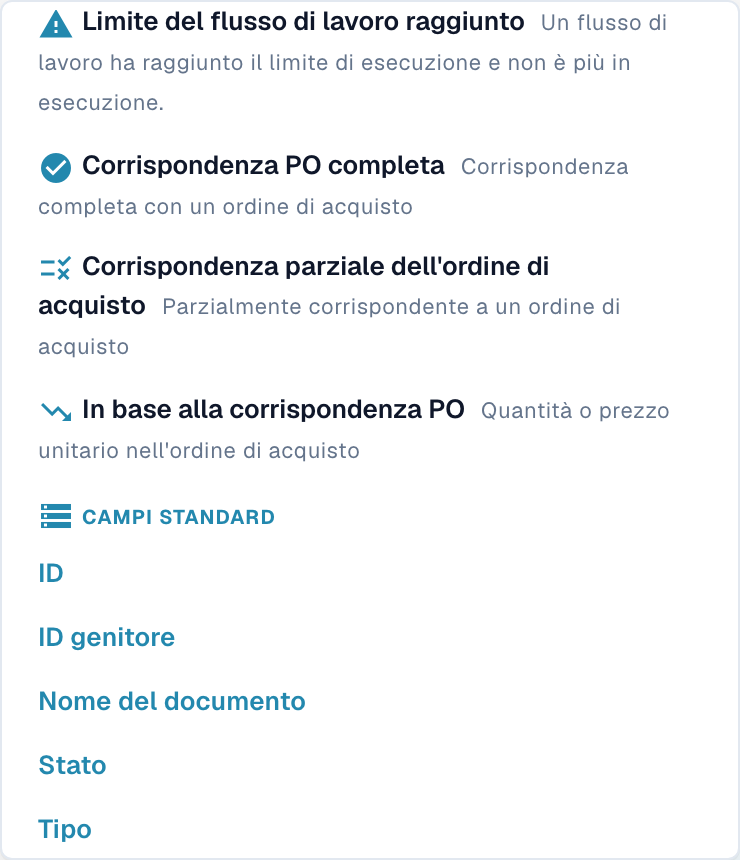
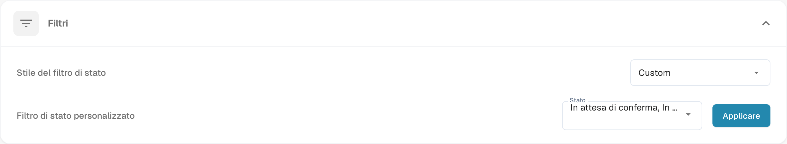

# Personalizzare i Filtri

La dashboard offre filtri di ricerca per trovare documenti. Le impostazioni amministrative dei filtri di stato configurano invece la presentazione dei relativi controlli: sono operazioni distinte.

## Filtrare i documenti nella dashboard

Apri il menu dei filtri accanto alla ricerca e scegli i criteri disponibili nella tua versione, ad esempio tipo di documento, persona assegnata o intervallo di date. Controlla i criteri attivi e i risultati; rimuovi il singolo criterio o azzera la selezione quando serve. Non presumere un operatore logico universale tra tutti i filtri: verifica il risultato della combinazione usata.

<figure><figcaption>
Menu dei filtri della dashboard con opzioni di abbinamento degli ordini e campi standard. In base alla corrispondenza PO è un’etichetta ambigua del caso di scostamento inferiore; il testo non chiarisce quale grandezza venga confrontata. Nessun filtro è stato applicato.
</figcaption></figure>

## Configurare i filtri di stato

Apri **Impostazioni → Dashboard → Filtri**. Controlla **Stile del filtro di stato** e **Filtro di stato personalizzato**. Il valore **Custom** resta in inglese nella versione illustrata. Se devi modificare questa preferenza, scegli la configurazione desiderata e usa il comando di applicazione previsto dalla schermata.

<figure><figcaption>
Impostazioni dei filtri di stato della dashboard. Stile del filtro di stato e Filtro di stato personalizzato sono visibili; Custom resta in inglese. Il valore di stato selezionato è troncato. Nessuna preferenza è stata modificata.
</figcaption></figure>

Il salvataggio della preferenza amministrativa non dimostra che una ricerca specifica restituisca documenti corretti. La verifica delle immagini non ha eseguito query funzionali sui filtri intelligenti.
