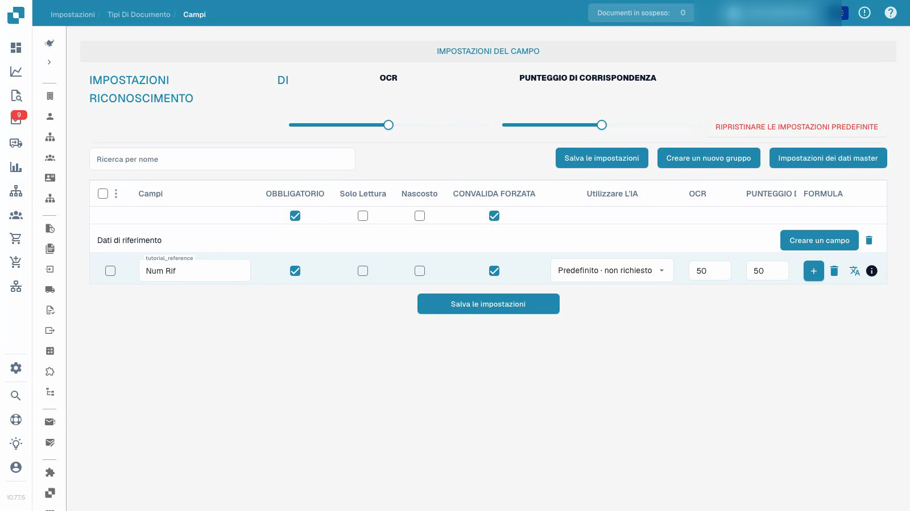

# Tipi di documento

Il video dimostra la configurazione dei campi in un tipo di documento di prova personalizzato e isolato.


Tipi di documento


[Guarda con i sottotitoli](https://docbits-videos.fra1.cdn.digitaloceanspaces.com/settings-assistant/document-types-fields-admin/v1/it.html)

Nota: alcune etichette dei prodotti nativi potrebbero non essere tradotte. La registrazione preserva l'interfaccia utente effettiva.

## Panoramica

I tipi di documento definiscono la configurazione utilizzata per diversi tipi di documenti. DocBits fornisce tipi standard come fatture e note di credito. I tipi personalizzati consentono a un amministratore di configurare un’altra categoria di documenti aziendali. I tipi standard non possono essere eliminati; gestisci i tipi personalizzati all'interno delle autorizzazioni dell'organizzazione.

## Controlli su una scheda del tipo di documento

| Controllo | Scopo |
| --- | --- |
| Attiva | Abilita o disabilita il tipo di documento per l'elaborazione. |
| Extraction | Scegli la modalità di estrazione mostrata dal controllo nativo: Flex o Fix. Questa è una selezione della modalità, separata dall'interruttore Attiva. |
| Impostazioni, mostrate come un ingranaggio | Apri un'ulteriore configurazione per quel tipo di documento. |

I collegamenti disponibili dipendono dal tipo, dalle autorizzazioni e dai moduli abilitati. L'interfaccia corrente può offrire layout, campi, tabelle, script, addestramento del modello e sottotipi di documento. Le regole di trasformazione, le regole di convalida e la configurazione dei documenti elettronici sono disponibili laddove si applicano le rispettive funzionalità. Altre opzioni di configurazione possono trovarsi all'interno delle impostazioni del tipo di documento anziché in una scheda separata sotto ogni scheda.

## Configurare i campi e le informazioni richieste

Il video utilizza un tipo di documento di prova personalizzato e isolato e già creato. Modifica il campo di riferimento di quel tipo; non modifica la configurazione della fattura esistente.

1. Apri il tipo di documento e seleziona i suoi campi.
2. Controlla il gruppo di campi e il nome tecnico stabile del campo. Un'etichetta di visualizzazione leggibile è un'impostazione separata; la sua modifica non crea un nuovo ID campo.
3. Rendi obbligatorio il campo di riferimento mantenendolo visibile e modificabile. Le informazioni richieste devono essere fornite; l'impostazione non inventa un valore mancante né garantisce un'estrazione corretta.
4. Configura la revisione esplicita del campo separatamente dal valore richiesto. Sola lettura, nascosto, le soglie OCR e le soglie Match Score hanno i propri effetti; non sono interruttori intercambiabili.
5. Salva la configurazione, riaprila e verifica l'etichetta di visualizzazione e le impostazioni memorizzate.

<figure><figcaption>
Campi salvati in un tipo di documento di prova isolato.
</figcaption></figure>

Il risultato dimostrato prova che la configurazione del campo è stata salvata e ricaricata. Non costituisce addestramento del modello, approvazione della fattura, esportazione o un test di convalida a valle. Prima di utilizzare una configurazione in produzione, testare documenti rappresentativi e il flusso di lavoro previsto per gli utenti ordinari.

## Regole di convalida personalizzate

Laddove questa funzione è disponibile, apri le regole di convalida del tipo di documento. Per riutilizzare una regola esistente, segui [Duplicare una regola di convalida personalizzata](duplicate-a-custom-validation-rule.md). Questo è separato dale singole impostazioni dei campi mostrati nel video.

## Creare un tipo di documento personalizzato

Apri la sezione dei tipi di documento personalizzati, scegli Nuovo e inserisci un nome chiaro. Completa i passaggi di configurazione offerti per la modalità di estrazione prevista, i campi, i gruppi e le eventuali tabelle. L'addestramento del modello e la configurazione dell'estrazione sono separati dal semplice salvataggio di un’impostazione di campo obbligatorio.


Vedi [Configurare un tipo di documento](../../../setup/document-types/) per la procedura di configurazione.


## Registrazione aggiuntiva


Tipi di documento

