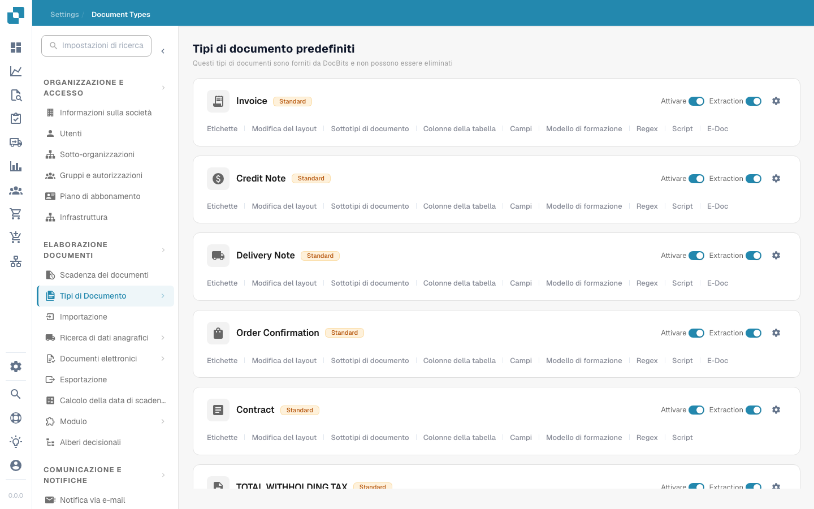

# Tipi di documenti


DocBits Spiegazione dei tipi di documento: crea, configura e assegna impostazioni di elaborazione


<figure><figcaption>
Pagina Document Types
</figcaption></figure>

## Panoramica

La pagina Document Types elenca tutti i tipi di documento riconosciuti ed elaborati da DocBits. È divisa in due sezioni:

* **Tipi Documento Default**: tipi preconfigurati forniti da DocBits (Fattura, Nota di Credito, Nota di Consegna, Conferma d'Ordine, Contratto, ZUGFeRD, ecc.). Non possono essere eliminati.
* **Custom Document Types**: tipi che crei per le esigenze specifiche della tua attività. Possono essere modificati ed eliminati.

## Controlli per tipo di documento

Ogni scheda di un tipo di documento mostra:

| Controllo | Descrizione |
|---------|-------------|
| **Activate** | Interruttore per attivare o disattivare questo tipo di documento per l'elaborazione. |
| **Extraction** | Interruttore per attivare o disattivare l'estrazione dei dati basata sull'IA per questo tipo. |
| **Settings** (icona a forma di ingranaggio) | Apre ulteriori opzioni di configurazione per il tipo di documento. |

## Schede di configurazione

Sotto ogni tipo di documento puoi accedere alle seguenti schede di configurazione:

| Scheda | Descrizione |
|-----|-------------|
| **Labels** | Gestisce le etichette visualizzate e le traduzioni per il tipo di documento. |
| **Edit layout** | Modifica l'aspetto del documento nella vista di validazione, comprese le posizioni dei campi. |
| **Sottotipi documento** | Configura le sottocategorie per questo tipo di documento (ad es. diversi formati di fattura). |
| **Table columns** | Personalizza quali colonne di dati compaiono nella tabella delle righe. |
| **Fields** | Gestisce i campi di dati estratti dal documento (aggiungere, modificare o rimuovere campi). |
| **Model Training** | Configura e addestra il modello IA usato per riconoscere ed estrarre i dati. |
| **Regex** | Imposta espressioni regolari per l'estrazione dei dati basata su pattern. |
| **Scripts** | Scrivi script di elaborazione personalizzati che vengono eseguiti durante l'elaborazione del documento. |
| **E-Doc** | Configura gli standard dei documenti elettronici (XRechnung, ZUGFeRD, EDI, FatturaPA). |

## Regole di convalida personalizzate

Apri un tipo di documento e seleziona **Custom Validation Rules** per gestirne le regole di validazione. Per riutilizzare una regola esistente senza ricrearla, segui [Duplicate a Custom Validation Rule](duplicate-a-custom-validation-rule.md). La guida spiega il nome della regola, la chiave della regola e i controlli di conferma.

## Creare un tipo di documento personalizzato

1. Scorri fino alla sezione **Custom Document Types**.
2. Fai clic su **+ New**.
3. Inserisci un nome per il nuovo tipo di documento.
4. Configura campi, layout e impostazioni di estrazione secondo necessità.


Consulta [Setup Document Type](../../../setup/document-types/) per le istruzioni di configurazione dettagliate.

