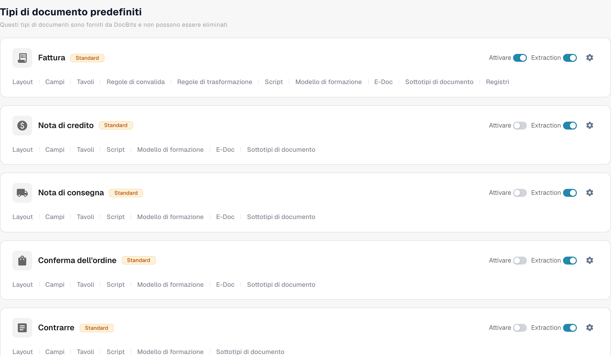

# Attivare o disattivare un tipo di documento

Gli amministratori possono scegliere quali tipi di documento sono disponibili per la loro organizzazione. Puoi cambiarlo nella pagina **Tipi di Documento** senza eliminare il tipo o la sua configurazione.

1. Apri **Settings → Document Types**.
2. Trova il tipo di documento, ad esempio **Fattura**, in **Tipi di documento predefiniti** oppure in **Tipi di documenti personalizzati**.
3. Usa l'interruttore con l'etichetta **Attivare** nella scheda di quel tipo. Un interruttore colorato indica che il tipo è attivo; un interruttore grigio indica che è inattivo. Attendi il messaggio di conferma prima di lasciare la pagina. Per questo interruttore non esiste un pulsante Save separato.

<figure><figcaption>
Tipi di documento e comandi di attivazione. Le etichette Tavolo/Tavoli si riferiscono a tabelle di dati.
</figcaption></figure>

L'interruttore **Estrazione** accanto ad **Attivare** è un'impostazione diversa. Seleziona la modalità di estrazione (Flex o Fix); non attiva né disattiva il tipo di documento. L'icona a forma di ingranaggio apre ulteriori impostazioni per quel tipo. I link sotto il nome del tipo aprono i suoi layout, campi, tabelle, script e le altre aree di configurazione disponibili.

DocBits fornisce i tipi di documento predefiniti, che non possono essere eliminati. Puoi anche creare e gestire tipi personalizzati. Consulta [Adding and Editing Document Types](adding-editing-document-types.md) per i passaggi successivi della configurazione e [Table Columns](table-columns/README.md) per configurare le righe estratte.
