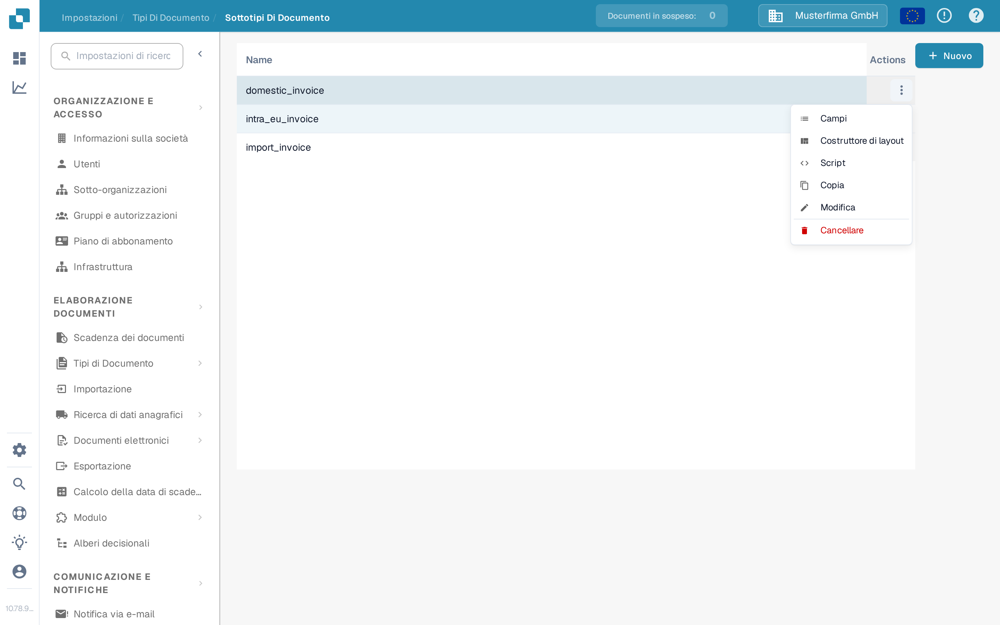
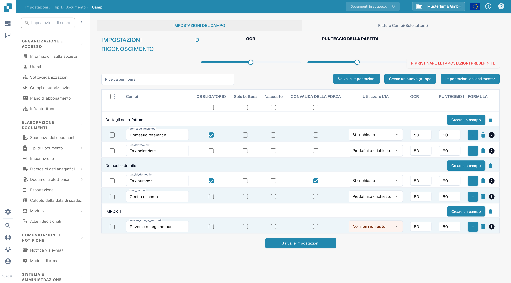
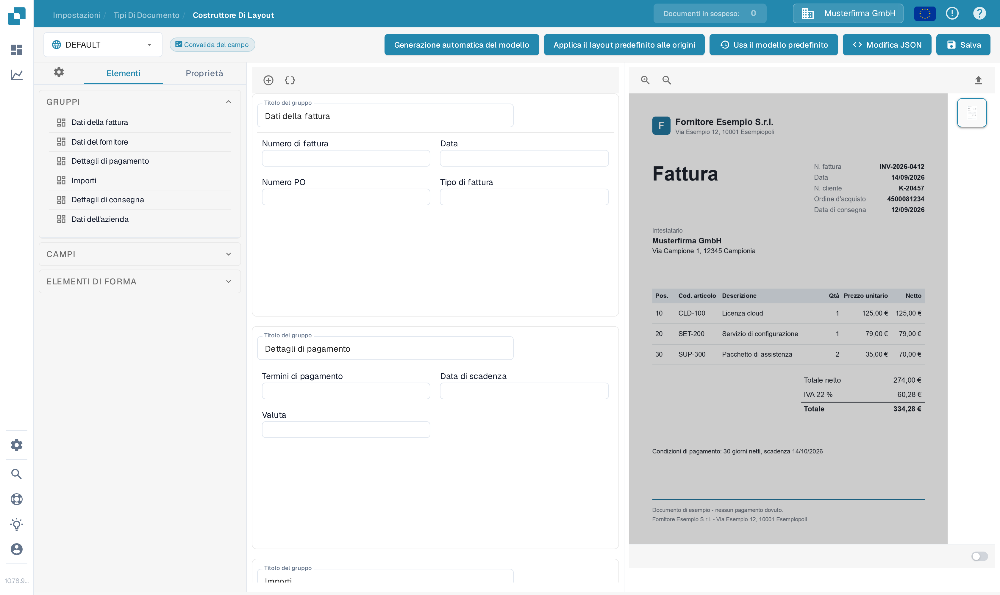
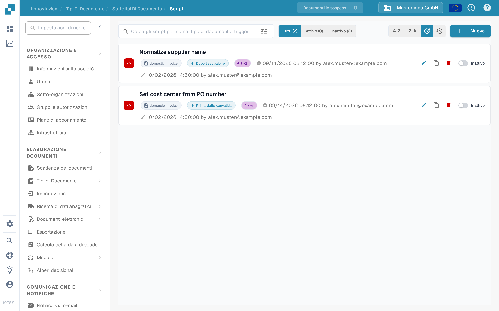

# Configurare sottotipi

Usare un sottotipo di documento quando fatture dello stesso tipo di documento richiedono campi diversi, un layout di convalida diverso o propri script di elaborazione. Prima [creare un sottotipo](creating-a-new-sub-type.md), poi aprire **Impostazioni → Tipi di Documento**, scegliere il tipo di documento e aprire **Sottotipi di Documento**. Nella riga del sottotipo, aprire **Azioni** (i tre puntini). Il menu offre **Campi**, **Costruttore di layout** e **Script**; contiene anche [Copia, Modifica ed Elimina](using-actions.md).

<figure><figcaption>
Scegliere la parte del sottotipo che si desidera configurare.
</figcaption></figure>

## Campi

Selezionare **Campi** per decidere quali informazioni gli utenti vedono e inseriscono per questo sottotipo. È possibile creare un campo in un gruppo, contrassegnare un campo esistente come obbligatorio, di sola lettura o nascosto e regolare le opzioni di riconoscimento. Selezionare **Salva le impostazioni** dopo aver apportato le modifiche. Usare [Aggiungere e modificare i campi](fields/adding-and-editing-fields.md) per i passaggi, [Configurazione delle proprietà dei campi](fields/configuring-field-properties-1.md) per le opzioni delle colonne e [Impostazioni dei dati master](fields/master-data-settings.md) quando un campo deve usare dati di ricerca.

<figure><figcaption>
Impostazioni dei campi nell'organizzazione di test della documentazione. Non vengono mostrati dati di clienti.
</figcaption></figure>

## Costruttore di layout

Selezionare **Costruttore di layout** per organizzare gruppi e campi nella schermata di convalida del documento. Il lato sinistro elenca gli elementi; il lato destro accetta un documento di esempio per l'anteprima. Verificare il risultato e selezionare **Salva** quando il layout è pronto. La [guida del Costruttore di Layout](../../../setup/document-types/layout-builder.md) spiega gli elementi, l'anteprima del documento e il salvataggio di un layout.

<figure><figcaption>
Layout del sottotipo prima di aggiungere un documento di esempio.
</figcaption></figure>

## Script

Selezionare **Script** per visualizzare gli script di questo sottotipo. In un elenco vuoto, selezionare **Nuovo** o **Crea script** per iniziare. La ricerca e i filtri **Tutti**, **Attivo** e **Inattivo** aiutano a trovare gli script esistenti. Seguire [Creazione e modifica degli script](script/creating-and-editing-scripts.md) per crearne uno, e [Attivazione e gestione degli script](script/script-activation-and-management.md) prima di attivarlo per l'elaborazione.

<figure><figcaption>
Nessuno script è stato creato nel sottotipo di test della documentazione.
</figcaption></figure>
