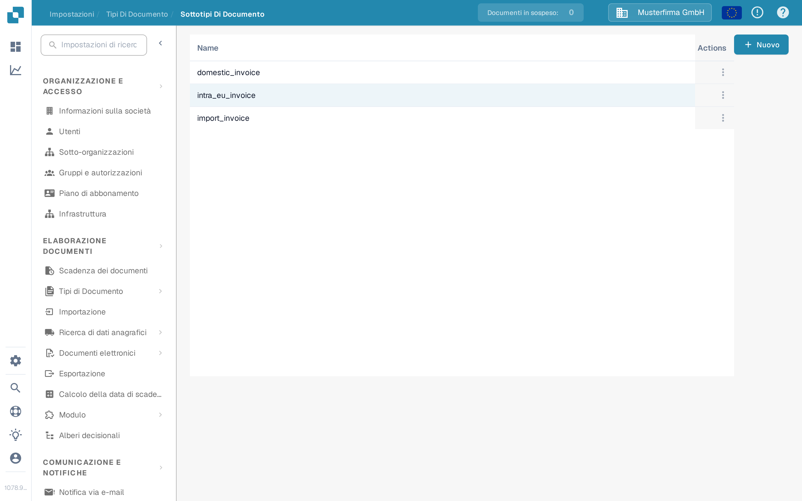
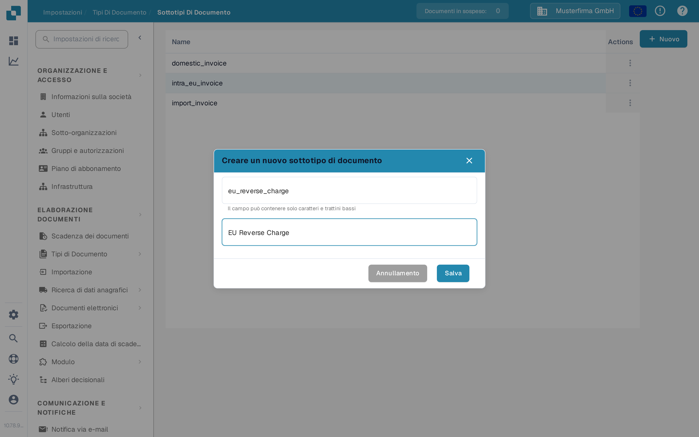

# Creare un nuovo Sottotipo

Creare un sottotipo di documento quando uno stesso tipo di documento richiede impostazioni dei campi, un layout di convalida o script propri. È necessario avere accesso a **Impostazioni → Tipi di Documento**.

## 1. Aprire il tipo di documento

Aprire **Impostazioni → Tipi di Documento**. Nella scheda del tipo di documento interessato, selezionare **Sottotipi di documento**. L'esempio seguente usa **Fattura**; scegliere il tipo che corrisponde ai propri documenti. Gli altri link della scheda portano alle impostazioni dell'intero tipo di documento.

<figure><figcaption>
Aprire i sottotipi del tipo di documento che si desidera configurare.
</figcaption></figure>

## 2. Avviare un nuovo sottotipo

In **Sottotipi di documento**, selezionare **+ Nuovo**. I sottotipi esistenti compaiono nell'elenco; il menu **Azioni** (i tre puntini) si riferisce a una riga esistente. Se **+ Nuovo** non reagisce a un clic del mouse, portare il focus sul pulsante con la tastiera e premere **Invio**.

<figure><figcaption>
L'organizzazione di test della documentazione contiene solo un sottotipo di esempio sintetico.
</figcaption></figure>

## 3. Denominarlo e salvarlo

Inserire un **Name** con lettere e caratteri di sottolineatura, quindi inserire un **Title** descrittivo. Entrambi i campi sono obbligatori. I nomi in questo screenshot sono solo esempi. Selezionare **Salva** per creare il sottotipo oppure **Annullamento** per uscire senza crearlo.

<figure><figcaption>
Alla creazione vengono inseriti solo Name e Title.
</figcaption></figure>

Dopo il salvataggio, il nuovo sottotipo compare nell'elenco. Per definirne campi, layout o script, aprire il suo menu **Azioni** e seguire [Configurare sottotipi](configure-subtypes.md). Queste impostazioni vengono effettuate dopo la creazione, non nella finestra **+ Nuovo**.
