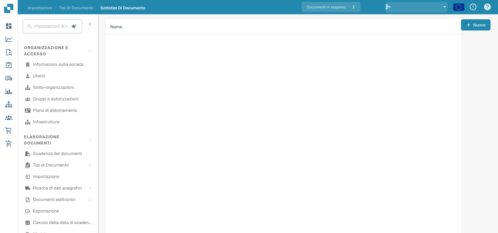
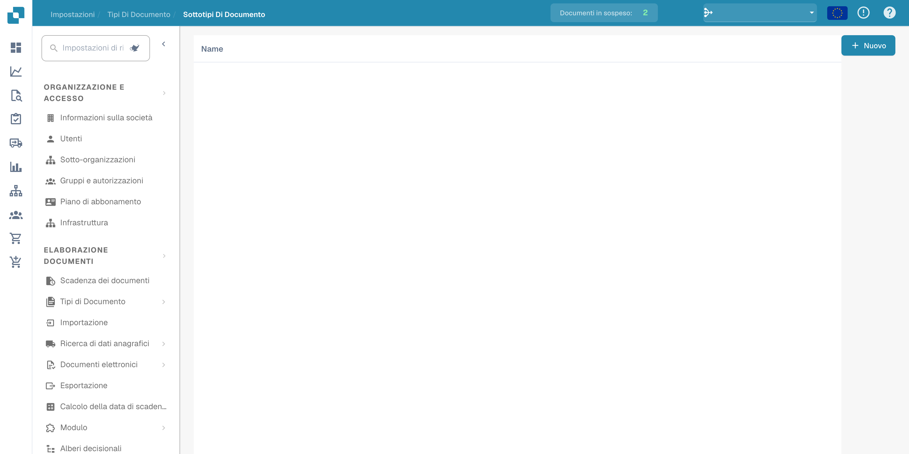

# Sottotipi di documento

I sottotipi distinguono categorie all’interno di un tipo di documento. Aprire i tipi di documento nelle impostazioni e scegliere il collegamento ai sottotipi del tipo previsto.

<figure><figcaption>
Panoramica dei sottotipi di documento.
</figcaption></figure>

L’elenco presenta i sottotipi configurati. Alcune intestazioni possono restare in inglese nell’interfaccia.

<figure><figcaption>
Elenco dei sottotipi di documento nell’amministrazione.
</figcaption></figure>

Creare un nuovo sottotipo e verificarne nome e configurazione prima di salvarlo. Gli esempi presentano panoramica ed elenco; non dimostrano un sottotipo creato né impostazioni salvate.
