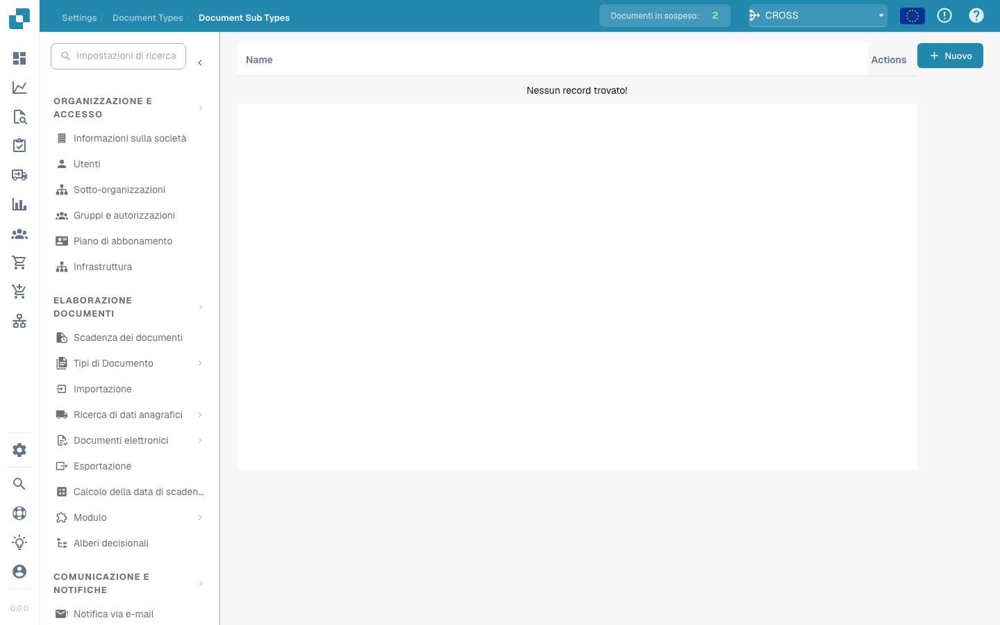

# Sottotipi di Documento

<figure><figcaption></figcaption></figure>

#### Panoramica

I Tipi di Documenti Secondari sono essenzialmente versioni specializzate dei principali tipi di documenti. Ad esempio, sotto il tipo di documento principale "Fattura," potrebbero esserci tipi secondari come "Fattura Standard," "Fattura Pro-forma," e "Nota di Credito," ognuno con requisiti di dati leggermente diversi o regole di elaborazione.

#### Funzionalità Chiave e Opzioni

1. **Elenco dei Tipi Secondari**:

* Ogni riga rappresenta un tipo secondario di un tipo di documento principale.
* Include il nome del tipo secondario e un insieme di azioni che possono essere eseguite su di esso.

2. **Azioni**:

* **Campi**: Configura quali campi dati sono inclusi nel tipo secondario e come vengono gestiti.
* **Modifica Layout**: Modifica il layout visivo per come le informazioni vengono visualizzate e inserite per questo tipo secondario.
* **Script**: Allega o modifica script che eseguono operazioni specifiche quando i documenti di questo tipo secondario vengono elaborati.
* **Copia**: Duplica una configurazione di tipo secondario esistente da utilizzare come base per una nuova.
* **Elimina**: Rimuove il tipo secondario se non è più necessario.

3. **Aggiunta di Nuovi Tipi Secondari**:

* Il pulsante "+ Nuovo" consente agli amministratori di creare nuovi tipi secondari, definendo proprietà e regole uniche secondo necessità.

I Tipi di Documenti Secondari in Docbits forniscono un modo flessibile e potente per gestire una varietà di documenti all'interno di un singolo sistema, garantendo che ciascun tipo e tipo secondario venga elaborato in modo accurato ed efficiente secondo le sue specifiche uniche.


