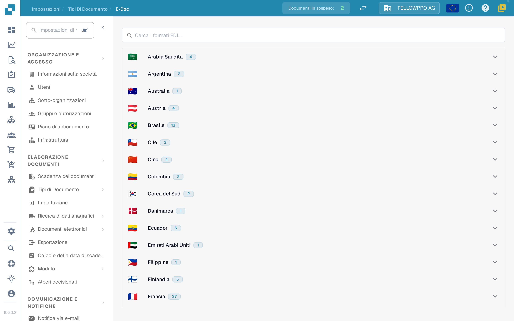
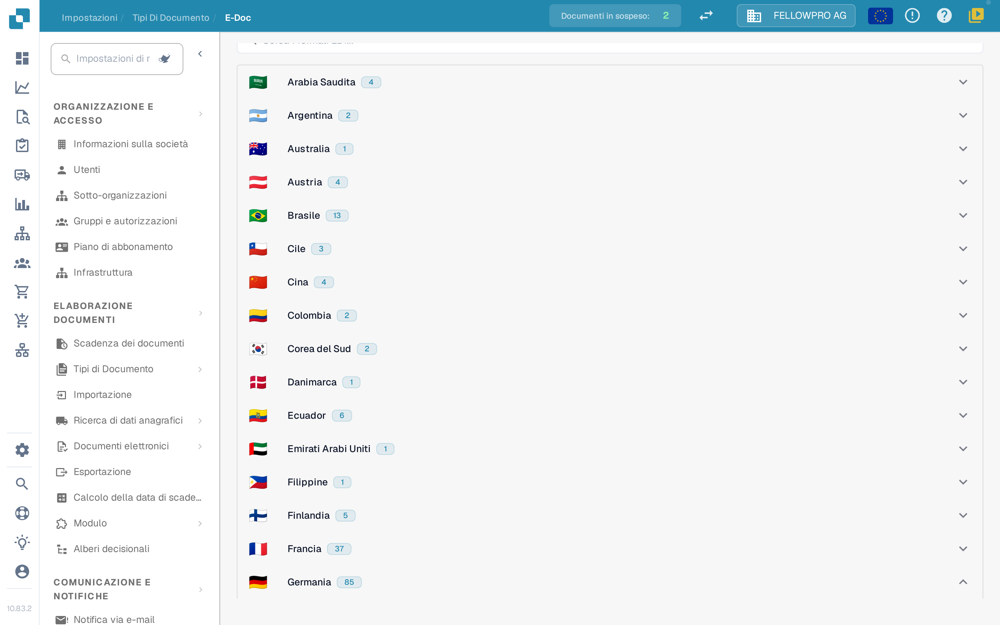
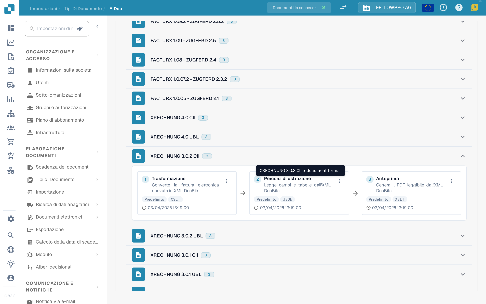
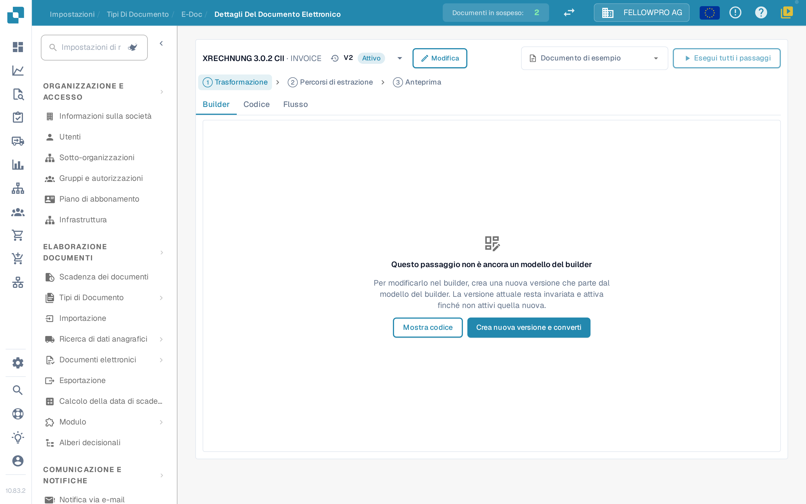
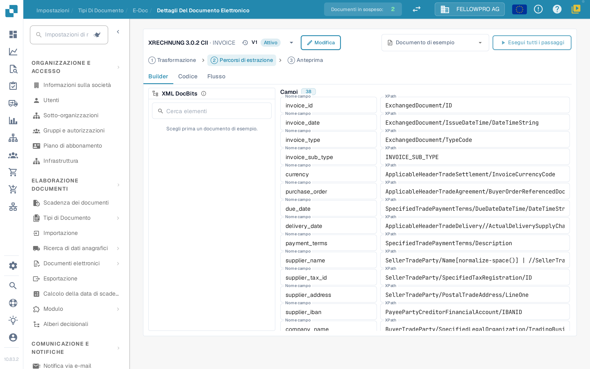

# Documenti elettronici e configurazione EDI


Tutorial DocBits sulle fatture elettroniche: elaborare XRechnung / ZUGFeRD (Factur-X), convalidare i dati e automatizzare i flussi di lavoro


I documenti elettronici come XRechnung, ZUGFeRD/Factur-X, CFDI o FatturaPA arrivano come XML o come PDF ibrido. DocBits legge il file, estrae i dati della fattura e genera un PDF leggibile. Le impostazioni **E-Doc** contengono le regole di ogni formato utilizzato dalla vostra organizzazione.

## Aprire l'amministrazione E-Doc

1. Aprire **Impostazioni → Tipi di documento**.
2. Selezionare il tipo di documento, ad esempio **Fattura**, e aprire **E-Doc**.

I formati sono raggruppati per paese. Ogni paese mostra la propria bandiera, il nome e quanti formati contiene.

<figure><figcaption>
I formati sono raggruppati per paese e chiusi all'inizio.
</figcaption></figure>

Selezionare un paese per aprire i suoi formati. All'interno di un paese la versione più recente viene per prima. I formati combinati come Factur-X / ZUGFeRD si trovano sotto la Germania. Il campo di ricerca cerca contemporaneamente nei nomi dei formati e dei paesi.

<figure><figcaption>
Aprite un paese per vedere i suoi formati.
</figcaption></figure>

## I formati e i loro passaggi

Ogni formato mostra i propri passaggi come tre schede unite da frecce, nell'ordine in cui DocBits li esegue:

| Passaggio | Cosa fa |
| --- | --- |
| **Trasformazione** | Mappa l'XML in arrivo sull'XML di DocBits. |
| **Percorsi di estrazione** | Definisce quali valori DocBits prende dall'XML trasformato. |
| **Anteprima** | Definisce il layout del PDF leggibile generato da DocBits. |

Gli altri attributi del formato sono elencati sotto le schede.

<figure><figcaption>
I tre passaggi di un formato: Trasformazione, Percorsi di estrazione e Anteprima.
</figcaption></figure>

Selezionare una scheda per aprire quel passaggio.

## Modificare un passaggio

La pagina di dettaglio ha la stessa struttura per tutti e tre i passaggi:

* L'intestazione mostra il formato e un menu a tendina con le sue versioni, compreso lo stato di ciascuna. Dal menu a tendina si può attivare, modificare o eliminare una versione.
* **Builder**, **Codice** e **Flusso** permettono di passare dall'editor visivo al foglio di stile o al JSON sottostante, e al risultato della pipeline.
* **Documento di esempio** offre i documenti più recenti di questo formato; si può anche incollare un ID o un URL di documento.
* **Esegui tutti i passaggi** esegue trasformazione, estrazione e anteprima per il documento di esempio in un'unica volta.
* **Ctrl + S** salva una bozza.

Modificare una versione attiva o già utilizzata non la cambia: DocBits crea una copia bozza e apre quella. Una bozza non utilizzata si modifica direttamente. Un passaggio scritto a mano resta in **Codice** finché il builder non può assumerlo invariato.

<figure><figcaption>
La pagina di dettaglio: menu delle versioni nell'intestazione, schede Builder, Codice e Flusso, documento di esempio e il passaggio stesso.
</figcaption></figure>

### Trasformazione

Il **Builder** mostra l'XML di origine a sinistra, il mapping al centro e l'XML risultante a destra. Selezionate un elemento nell'albero di origine e trascinatelo su un campo, oppure aggiungete un valore di testo fisso.

Un campo può essere composto da più parti, e ogni parte può avere una condizione: **esiste**, **manca**, **uguale a**, **diverso da** o un'espressione XPath libera, unite con **tutti** o **almeno uno**. I tre pannelli si possono ridimensionare, e l'area del risultato ha un elenco **Campi** e la vista **XML**.

### Percorsi di estrazione

Il builder dei percorsi di estrazione mostra l'XML di DocBits a sinistra, i campi al centro e il percorso usato da ogni campo a destra. Selezionate un campo e impostate il suo percorso; le voci esistenti, incluse le vecchie voci piatte, continuano a funzionare.

<figure><figcaption>
Il builder dei percorsi di estrazione: XML di DocBits, campi e i loro percorsi.
</figcaption></figure>

### Anteprima

Il builder di anteprima dispone il PDF con blocchi trascinabili e mostra il risultato accanto. Dimensioni della pagina, margini, dimensione del carattere, colori e spaziatura dei blocchi sono impostati per l'intero documento e valgono per ogni blocco.

### Flusso

**Flusso** mostra l'intera pipeline per il documento di esempio scelto: cosa ha prodotto la trasformazione, quali valori hanno trovato i percorsi di estrazione e come l'anteprima li rappresenta. Usatelo per verificare una modifica dall'inizio alla fine senza uscire dalla pagina.

## Pagine correlate

* [Formati eDocs, versioni e guide per paese](supported-electronic-documents/README.md)

Le schermate di questa pagina mostrano l'interfaccia in italiano.
