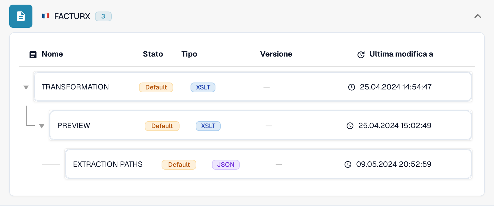
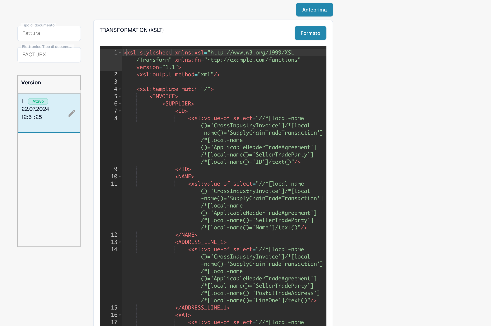

# Una nota di credito elettronica viene riconosciuta come fattura

Una nota di credito elettronica può apparire come **Invoice** anche quando l’XML originale contiene un codice di nota di credito. Verificate la configurazione effettivamente utilizzata prima di considerare questo comportamento un difetto del prodotto. Una **TRANSFORMATION** specifica dell’organizzazione ha la precedenza su quella predefinita per il formato eDoc interessato. Una costante come `<INVOICE_TYPE>Invoice</INVOICE_TYPE>` può quindi sostituire la classificazione predefinita.

## Verificare la classificazione delle note di credito elettroniche

Il video mostra una verifica in sola lettura in DocBits, usando FACTURX 1.0.05 / ZUGFeRD 2.1 come esempio. Le mappature e le versioni possono variare nella vostra organizzazione. Verificate sempre la Transformation attiva del formato rilevato.

Il precedente esempio XSLT mostrato nel video contiene rami per 381 e 389. Verificate nella Transformation effettiva quali codici conserva questa versione specifica; l’elenco generale dei codici non ne dimostra la copertura in tutte le mappature storiche.



[Verificare la classificazione delle note di credito elettroniche](https://docbits-videos.fra1.cdn.digitaloceanspaces.com/settings-assistant/edocs_credit_note/v2/it.mp4)

[WebVTT](https://docbits-videos.fra1.cdn.digitaloceanspaces.com/settings-assistant/edocs_credit_note/v2/it.vtt)

## Verificare il codice del documento

Leggete il codice del tipo nell’XML originale, non soltanto nel PDF o nel titolo del documento. La sua posizione dipende dalla sintassi XML. CII usa `ExchangedDocument/TypeCode`; UBL usa `InvoiceTypeCode` o `CreditNoteTypeCode`. Tenete conto degli spazi dei nomi XML quando verificate un’espressione XPath.

| Codice | Significato | Classificazione da verificare |
| --- | --- | --- |
| `380` | Fattura commerciale | Invoice |
| `381` | Nota di credito | Credit Note |
| `261` | Nota di credito emessa dal cliente in autofatturazione | Credit Note nella mappatura predefinita (FACTURX/ZUGFeRD) |
| `383` | Nota di debito | Non mappare a Credit Note solo perché rettifica una fattura |
| `384` | Fattura corretta | Non mappare a Credit Note solo perché corregge una fattura |

La mappatura predefinita delle note di credito FACTURX/ZUGFeRD comprende **381 e 261**. Un requisito aziendale che menziona soltanto 381 non rende 383 o 384 codici di nota di credito. Concordate qualsiasi scostamento previsto con il responsabile dell’integrazione contabile.

## Individuare dove cambia il valore

1. **Identificare il formato effettivo.** Aprite **Impostazioni → Tipi di documento → Invoice → E-Doc**. Selezionate il formato rilevato per il documento interessato, per esempio **FACTURX**. Un PDF ZUGFeRD può contenere XML Factur-X; controllare le regole di un altro formato non spiegherà il comportamento di questo documento.
2. **Verificare la sorgente e la versione effettivamente utilizzate.** Esaminate **TRANSFORMATION**. L’elenco distingue **Default** e **Custom**. Aprite la regola e annotate la versione attiva e la relativa sorgente. Una bozza più recente non è necessariamente attiva. Per un documento storico, individuate la sorgente e la versione usate durante quella elaborazione; la versione attiva oggi può essere diversa. Confrontate la sorgente personalizzata dell’organizzazione con quella predefinita; non date per scontato che venga utilizzata quest’ultima.

<figure><figcaption>Lo stato indica la sorgente di ogni regola. Questo esempio usa le impostazioni predefinite.</figcaption></figure>

3. **Esaminare l’XML trasformato.** Per FACTURX/ZUGFeRD, cercate `INVOICE_TYPE` nell’XSLT effettivamente utilizzato. Per un codice originale pari a 381, un output fisso `<INVOICE_TYPE>Invoice</INVOICE_TYPE>` indica un problema di configurazione. Provate la trasformazione proposta ed esaminatene l’output; il risultato atteso per una nota di credito è `Credit Note`. Conservate tutte le altre mappature necessarie specifiche dell’organizzazione.
4. **Verificare Extraction Paths.** Assicuratevi che il campo DocBits con ID `invoice_type` legga il nodo di classificazione previsto nell’**XML trasformato**. FACTURX/ZUGFeRD usa spesso `INVOICE_TYPE`; XRechnung può mantenere `TypeCode` (CII), `InvoiceTypeCode` o `CreditNoteTypeCode` (UBL). Esaminate la sorgente effettiva e il suo output prima di scegliere un percorso. Dopo una riorganizzazione dell’XML, i percorsi che puntavano al file originale potrebbero non essere più validi. Consultate la [guida a Extraction Paths](edi/edi-extraction-paths-file-guide.md).
5. **Verificare le elaborazioni successive.** Esaminate gli script che possono assegnare un valore a `invoice_type`, quindi confrontate il campo memorizzato, la dashboard e i dati esportati. Una trasformazione corretta non dimostra, da sola, che uno script successivo conservi il valore. Il rendering di **Preview** mostra la presentazione; non dimostra la classificazione memorizzata.

<figure><figcaption>Esaminate la sorgente e la versione selezionate prima di creare o attivare una modifica.</figcaption></figure>

La procedura MCP completa è descritta in [Configurare DocBits con Claude o Codex](../../../../../advanced-functions-and-tools/docbits-mcp/configuration-with-claude-or-codex.md). `list_edoc_custom_attributes`, `get_edoc_attribute_source` e `list_edoc_attribute_versions` identificano sorgente e valore attivo. `preview_edoc_custom_xslt` prova una trasformazione candidata. `compare_edoc_extraction` confronta solo Extraction Paths e richiede un attributo personalizzato dei percorsi di estrazione. `test_electronic_document` prova la configurazione attiva, non una bozza inattiva.

## Correggere e attivare in sicurezza

1. Annotate la versione attualmente attiva e conservatene la sorgente per poterla ripristinare.
2. Create una **bozza** con l’icona a forma di matita. Modificate la condizione di classificazione o il percorso di estrazione individuato durante la diagnosi. Evitate di sostituire l’intera trasformazione per correggere un solo campo.
3. Selezionate la bozza e salvatela con **Save**. Il salvataggio di una bozza **non** la attiva.
4. Provate la bozza in un’organizzazione di sviluppo o di test con documenti rappresentativi: codici 380 e 381. Includete 261, 383 e 384 se il formato rilevato e il vostro processo li accettano. Verificate la classificazione, gli importi e gli altri campi personalizzati. Confrontate i risultati con quelli della versione attiva.
5. Dopo il superamento delle verifiche, usate il **segno di spunta** della bozza per attivarla. Confermate che la versione desiderata mostri ora **Active**. Con MCP, l’attivazione usa `activate_edoc_attribute_version`; è una modifica distinta dalla simulazione.
6. Elaborate un nuovo documento di test. Verificate il valore memorizzato di `invoice_type`, la dashboard, gli importi e l’esportazione verso **Infor ERP / SAP** o il vostro sistema di destinazione. Conservate la versione precedente per poterla ripristinare.


Non ripristinate le regole predefinite di un’organizzazione senza aver confrontato e conservato le personalizzazioni necessarie. Non riavviate in blocco l’elaborazione dei documenti storici. Un riavvio elimina i dati estratti e i log di esportazione e può ripetere le approvazioni o le esportazioni. Verificate lo stato di esportazione, le approvazioni e le modifiche manuali di ogni documento prima di decidere come rielaborarlo.


## Verificare separatamente il segno degli importi

La classificazione e il segno degli importi sono due verifiche correlate. L’impostazione [Set Negative Sign for Credit Notes](../../../document-processing/module/set-negative-sign-for-credit-notes.md) è attiva per impostazione predefinita, ma può essere disattivata. Quando è attiva, memorizza gli importi delle note di credito come valori negativi. Verificate l’impostazione effettiva dell’organizzazione e la convenzione del segno adottata dal sistema destinatario; non deducete il tipo di documento dal solo segno.

Se il risultato rimane errato con la sorgente attiva verificata, conservate per l’assistenza l’XML originale, il formato rilevato, gli ID delle versioni, l’output trasformato, la mappatura di estrazione e le eventuali modifiche introdotte dagli script successivi. Questi elementi consentono di stabilire se la discrepanza deriva dalla configurazione o richiede un’ulteriore analisi del prodotto.

<!-- Evidenze interne: TRL-72. La costante specifica dell’organizzazione è una causa probabile; gli script successivi e le versioni storiche effettivamente utilizzate non sono stati esclusi in modo conclusivo. -->
