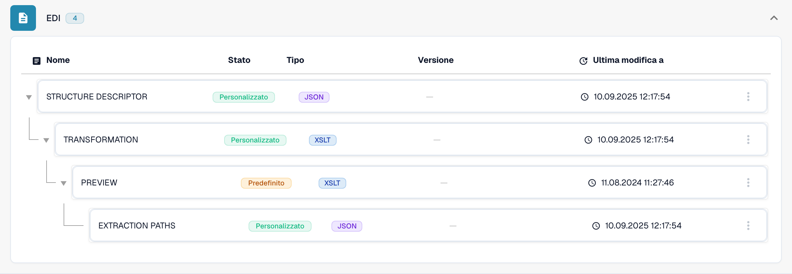
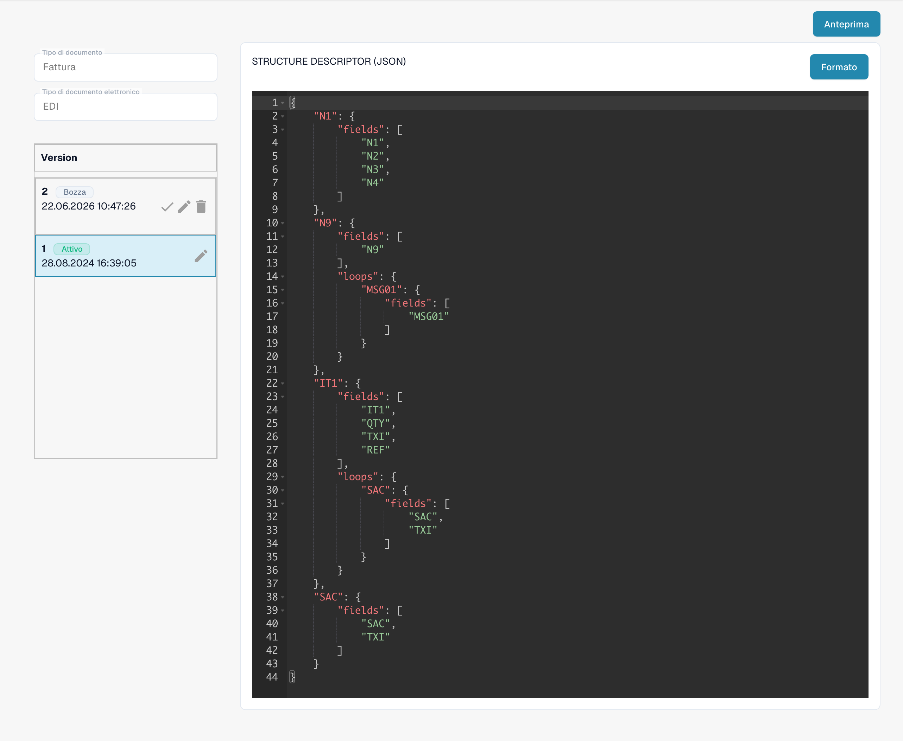
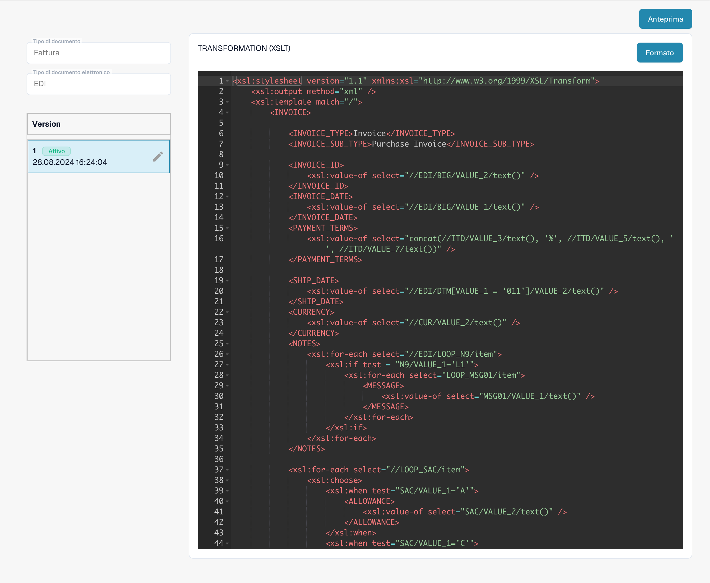
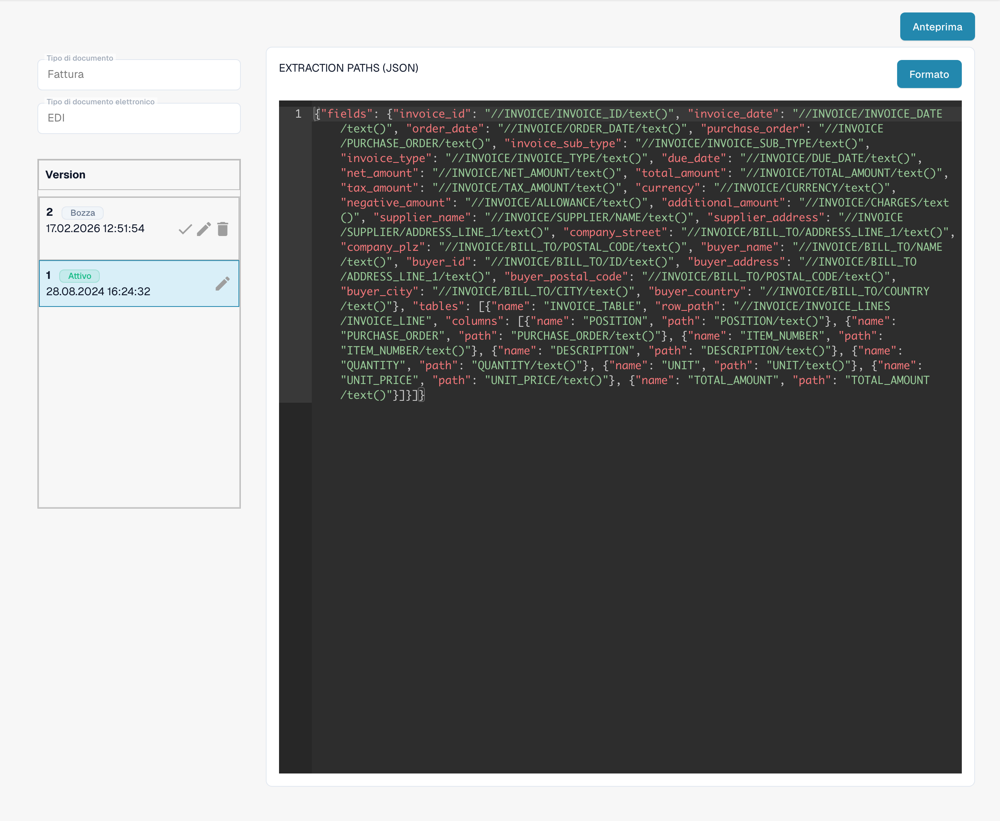

# Configurare gli attributi EDI

Selezionare il formato effettivo del messaggio e il tipo di documento. Controllare gli attributi esistenti e le versioni attive prima di modificare la configurazione.

<figure><figcaption>
Formato EDI esistente con i quattro attributi configurati.
</figcaption></figure>

Definire segmenti, elementi e cicli in un descrittore di struttura JSON. Provare messaggi rappresentativi e controllare l’XML intermedio generato.

<figure><figcaption>
Attributo STRUCTUREDESCRIPTOR attivo: descrittore di struttura JSON nell’editor di sola lettura.
</figcaption></figure>

Utilizzare TRANSFORMATION con XSLT per convertire l’XML intermedio nell’XML standard richiesto. Configurare PREVIEW separatamente per la presentazione; XSLT non elabora direttamente il JSON.

<figure><figcaption>
Attributo TRANSFORMATION attivo: codice sorgente XSLT per trasformare l’XML intermedio.
</figcaption></figure>

Configurare EXTRACTIONPATHS come JSON con espressioni XPath per l’XML risultante. Controllare campi, righe e importi con esempi reali. Validare una bozza prima dell’attivazione; le schermate mostrano una configurazione attiva esistente.

<figure><figcaption>
Attributo EXTRACTIONPATHS attivo: configurazione JSON contenente espressioni XPath di estrazione.
</figcaption></figure>

Nella versione dell’interfaccia illustrata, l’intestazione Version del pannello delle versioni resta in inglese. Gli identificatori tecnici degli attributi e il codice di configurazione restano invariati.
