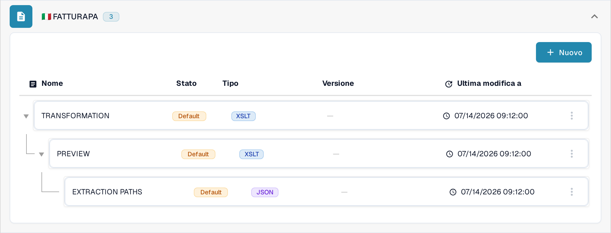
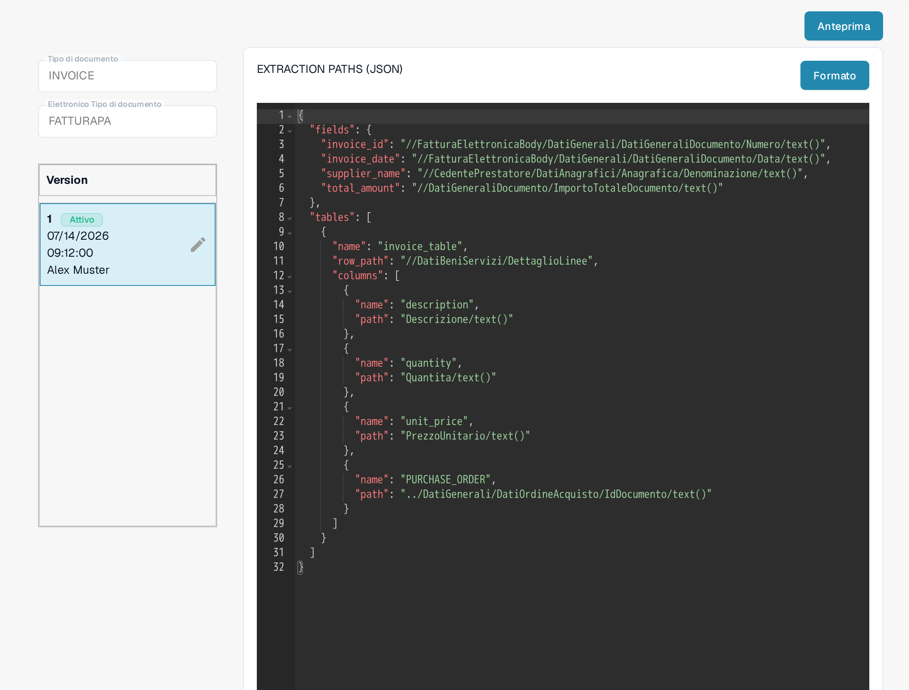
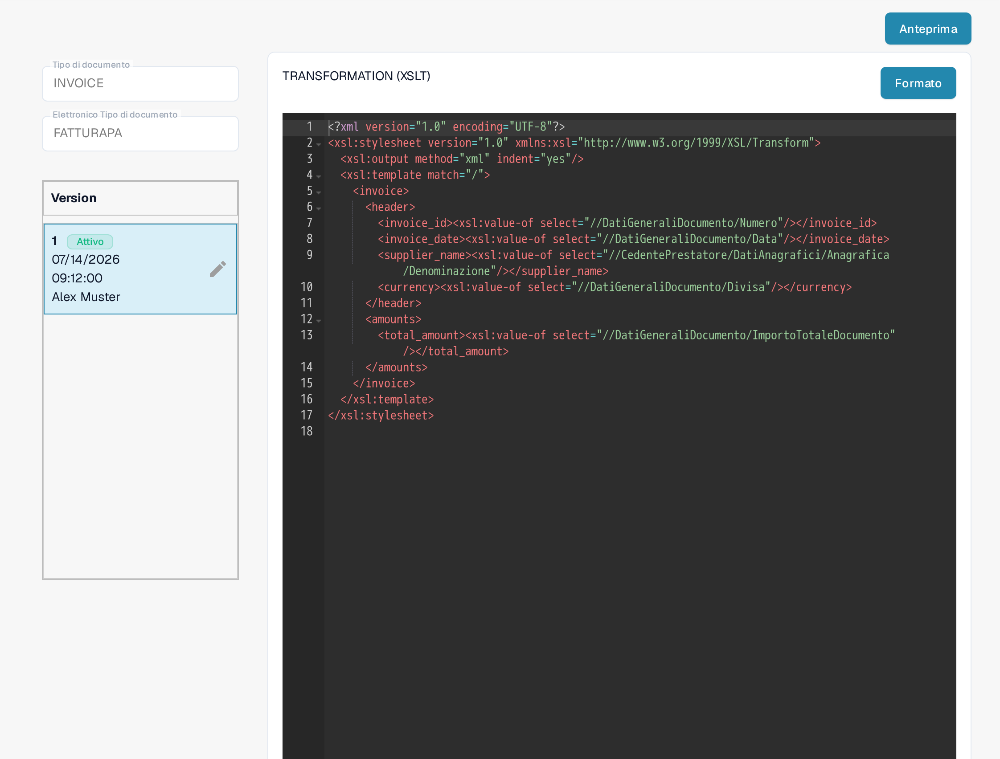
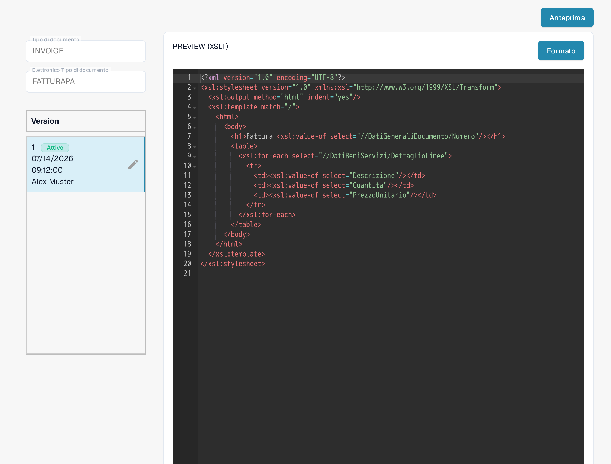

# FatturaPA: visualizzare un attributo sulle righe fattura

FatturaPA è il formato di fattura elettronica italiano. Questa pagina spiega dove controllare un attributo di riga, ad esempio il numero dell'ordine di acquisto, prima di modificarne la mappatura o l'anteprima della fattura. **Non aggiungere una seconda colonna `PURCHASE_ORDER` senza prima controllare la mappatura attiva:** la mappatura attuale della Sandbox ne contiene già una.

## Trovare i tre file FatturaPA

Aprire **Impostazioni → Tipi di Documento → E-Doc**, selezionare **INVOICE**, quindi espandere **FATTURAPA**. L'elenco attuale contiene tre file diversi:

* **TRANSFORMATION (XSLT)** legge l'XML sorgente FatturaPA e produce i dati fattura normalizzati.
* **PREVIEW (XSLT)** crea l'anteprima visiva della fattura in stile HTML/PDF a partire da questi dati.
* **EXTRACTION PATHS (JSON)** mappa i valori normalizzati nei campi e nelle colonne della tabella di DocBits.

<figure><figcaption>
L'elenco attuale dei file FATTURAPA nella Sandbox in italiano.
</figcaption></figure>

## Controllare il valore di riga estratto

Aprire **EXTRACTION PATHS (JSON)**. Nella versione attiva, trovare l'array `tables` con le sue `columns`. La versione visibile nella Sandbox include già `{"name": "PURCHASE_ORDER", "path": "PURCHASE_ORDER"}`. Controllare il valore in una fattura di prova reale prima di modificarlo. Se serve un altro attributo, individuarne il valore nei dati normalizzati, quindi aggiungere un nome di colonna distinto e il percorso corrispondente in una versione bozza.

<figure><figcaption>
La mappatura di estrazione JSON attiva contiene già una colonna per il numero d'ordine.
</figcaption></figure>

Per la spiegazione dettagliata dei percorsi di estrazione, vedere la [Guida al File dei Percorsi di Estrazione EDI](edi/edi-extraction-paths-file-guide.md).

## Modificare trasformazione o anteprima solo quando necessario

Se il valore normalizzato manca, esaminare **TRANSFORMATION (XSLT)** e il percorso XML sorgente che dovrebbe produrlo. Una modifica qui influisce sui dati usati dai passaggi successivi di mappatura e anteprima. Se il valore viene estratto correttamente ma è assente dalla fattura visiva, esaminare **PREVIEW (XSLT)** e la riga della tabella interessata in quel modello. I due file XSLT hanno scopi diversi.

<figure><figcaption>
La trasformazione legge l'XML sorgente e crea i campi fattura normalizzati.
</figcaption></figure>

<figure><figcaption>
L'anteprima controlla l'output visivo della fattura.
</figcaption></figure>

Come si lavora con i due file XSLT è spiegato nella [Guida al File di Trasformazione EDI](edi/edi-transformation-file-guide.md) e nella [Guida al File Anteprima EDI](edi/edi-preview-file-guide.md).

Usare la matita su una scheda di versione per preparare una modifica. Controllare la bozza e usare **Anteprima** con una fattura FatturaPA rappresentativa prima di attivarla. Le schermate mostrano le versioni attuali; in questa sessione della Sandbox non è stata salvata alcuna bozza né eseguito un test di anteprima.

L'istruzione precedente, secondo cui tutti i documenti elettronici hanno la Gran Bretagna come origine, non è una regola generale affidabile. Verificare paese, valuta e formato numerico della fattura rispetto al documento sorgente e alla configurazione della propria organizzazione.
