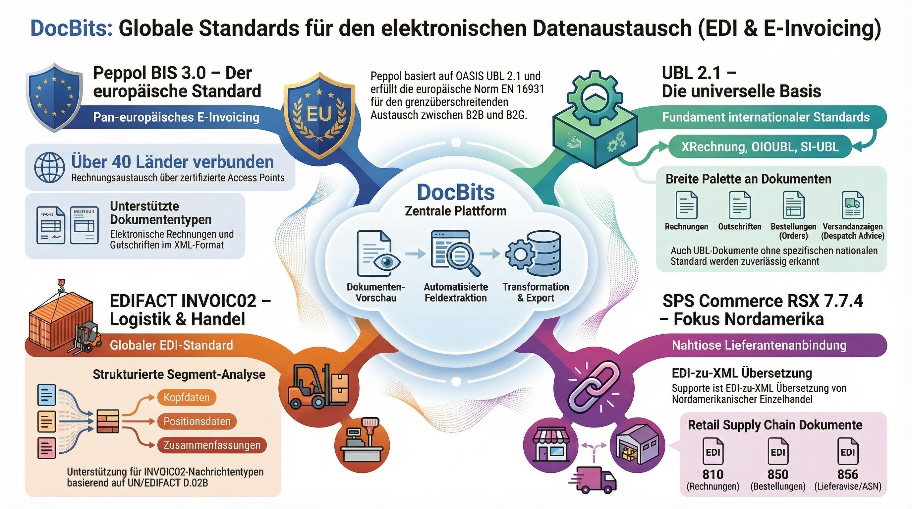

# Documenti elettronici supportati

DocBits supporta oltre **120 standard di fatturazione elettronica e di documenti** in più di **30 paesi**. Ogni formato viene rilevato e analizzato automaticamente e i suoi campi vengono estratti per un'elaborazione fluida dei documenti.

## Come funzionano i documenti elettronici in DocBits

1. **Caricamento** — Trascina un file XML/EDI oppure ricevilo tramite API/email
2. **Rilevamento automatico** — DocBits identifica lo standard esatto e la versione
3. **Anteprima** — Viene generata un'anteprima HTML leggibile
4. **Estrazione dei campi** — Vengono estratti i campi chiave (numero fattura, importi, righe)
5. **Validazione ed esportazione** — I dati vengono validati ed esportati nel tuo sistema ERP


Per la configurazione dettagliata consulta [EDI Settings](../). Per gli approfondimenti su Peppol, XRechnung e ZUGFeRD consulta le pagine dedicate qui sotto.


## Link rapidi

| Argomento                      | Link                                                                         |
| ---------------------------- | ---------------------------------------------------------------------------- |
| Panoramica EDI               | [EDI Settings](../)                                                          |
| XRechnung (tutte le versioni)   | [XRechnung](../xrechnung/)                                                   |
| ZUGFeRD / Factur-X           | [ZUGFeRD](../zugferd/)                                                       |
| Peppol BIS 3.0               | [Peppol BIS Billing](../peppol-bis-billing-3.0)                              |
| Panoramica standard e-fattura| [Standard attualmente supportati](../currently-supported-e-invoice-standards/) |

***

## Europa

<figure><figcaption>
Panoramica degli standard europei di e-fattura
</figcaption></figure>

### 🇩🇪 Germania

<figure><figcaption>
XRechnung — tutte le 26 versioni (CII &#x26; UBL)
</figcaption></figure>

<figure><figcaption>
ZUGFeRD / Factur-X — tutte le versioni
</figcaption></figure>

### 🇦🇹 Austria

| Standard               | Pagina                                                  |
| ---------------------- | ----------------------------------------------------- |
| ebInterface (panoramica)| [AUSTRIA EBINTERFACE](austria-ebinterface.md)         |
| ebInterface 6.0        | [AUSTRIA EBINTERFACE 6.0](austria-ebinterface-6-0.md) |
| ebInterface 6.1        | [AUSTRIA EBINTERFACE 6.1](austria-ebinterface-6-1.md) |

### 🇩🇰 Danimarca

| Standard          | Pagina                                |
| ----------------- | ----------------------------------- |
| OIOUBL (panoramica)| [DENMARK OIOUBL](denmark-oioubl.md) |
| OIOUBL 2.1        | [OIOUBL 2.1](oioubl-2-1.md)         |

### 🇫🇮 Finlandia

| Standard      | Pagina                              |
| ------------- | --------------------------------- |
| Finvoice 1.3  | [FINVOICE 1.3](finvoice-1-3.md)   |
| Finvoice 2.0  | [FINVOICE 2.0](finvoice-2-0.md)   |
| Finvoice 2.01 | [FINVOICE 2.01](finvoice-2-01.md) |
| Finvoice 3.0  | [FINVOICE 3.0](finvoice-3-0.md)   |
| TEAPPSXML     | [TEAPPSXML](teappsxml.md)         |

### 🇫🇷 Francia

| Standard                          | Pagina                                                  |
| --------------------------------- | ----------------------------------------------------- |
| Factur-X (generico)               | [FACTURX](facturx.md)                                 |
| Factur-X 1.0.05 / ZUGFeRD 2.1     | [FACTURX 1.0.05](facturx-1-0-05-zugferd-2-1.md)       |
| Factur-X 1.0.07.2 / ZUGFeRD 2.3.2 | [FACTURX 1.0.07.2](facturx-1-0-07-2-zugferd-2-3-2.md) |

### 🇩🇪 Germania

| Standard                        | Pagina                                                      |
| ------------------------------- | --------------------------------------------------------- |
| XRechnung 1.0–3.0.2 (CII & UBL) | [26 versions](xrechnung-1-0-cii.md) — see full list below |
| ZUGFeRD 1.0–2.3.2               | [7 versions](zugferd-1-0.md) — see full list below        |

Tutte le 26 versioni di XRechnung

| Versione | CII                           | UBL                           |
| ------- | ----------------------------- | ----------------------------- |
| 1.0     | [CII](xrechnung-1-0-cii.md)   | [UBL](xrechnung-1-0-ubl.md)   |
| 1.1     | [CII](xrechnung-1-1-cii.md)   | [UBL](xrechnung-1-1-ubl.md)   |
| 1.2     | [CII](xrechnung-1-2-cii.md)   | [UBL](xrechnung-1-2-ubl.md)   |
| 1.2.1   | [CII](xrechnung-1-2-1-cii.md) | [UBL](xrechnung-1-2-1-ubl.md) |
| 1.2.2   | [CII](xrechnung-1-2-2-cii.md) | [UBL](xrechnung-1-2-2-ubl.md) |
| 2.0     | [CII](xrechnung-2-0-cii.md)   | [UBL](xrechnung-2-0-ubl.md)   |
| 2.0.1   | [CII](xrechnung-2-0-1-cii.md) | [UBL](xrechnung-2-0-1-ubl.md) |
| 2.1     | [CII](xrechnung-2-1-cii.md)   | [UBL](xrechnung-2-1-ubl.md)   |
| 2.2     | [CII](xrechnung-2-2-cii.md)   | [UBL](xrechnung-2-2-ubl.md)   |
| 2.3     | [CII](xrechnung-2-3-cii.md)   | [UBL](xrechnung-2-3-ubl.md)   |
| 3.0     | [CII](xrechnung-3-0-cii.md)   | [UBL](xrechnung-3-0-ubl.md)   |
| 3.0.1   | [CII](xrechnung-3-0-1-cii.md) | [UBL](xrechnung-3-0-1-ubl.md) |
| 3.0.2   | [CII](xrechnung-3-0-2-cii.md) | [UBL](xrechnung-3-0-2-ubl.md) |

Tutte le 7 versioni di ZUGFeRD

| Versione              | Pagina                                            |
| -------------------- | ----------------------------------------------- |
| ZUGFeRD 1.0          | [ZUGFERD 1.0](zugferd-1-0.md)                   |
| ZUGFeRD 1.0 Basic    | [ZUGFERD 1.0 BASIC](zugferd-1-0-basic.md)       |
| ZUGFeRD 1.0 Comfort  | [ZUGFERD 1.0 COMFORT](zugferd-1-0-comfort.md)   |
| ZUGFeRD 1.0 Extended | [ZUGFERD 1.0 EXTENDED](zugferd-1-0-extended.md) |
| ZUGFeRD 2.2          | [ZUGFERD 2.2](zugferd-2-2.md)                   |
| ZUGFeRD 2.3          | [ZUGFERD 2.3](zugferd-2-3.md)                   |
| ZUGFeRD 2.3.2        | [ZUGFERD 2.3.2](zugferd-2-3-2.md)               |

### 🇮🇹 Italia

| Standard  | Pagina                      |
| --------- | ------------------------- |
| FatturaPA | [FATTURAPA](fatturapa.md) |

### 🇳🇱 Paesi Bassi

| Standard   | Pagina                        |
| ---------- | --------------------------- |
| SI-UBL 2.0 | [SI-UBL 2.0](si-ubl-2-0.md) |

### 🇳🇴 Norvegia

| Standard        | Pagina                                  |
| --------------- | ------------------------------------- |
| EHF Invoice 3.0 | [EHF INVOICE 3.0](ehf-invoice-3-0.md) |

### 🇵🇱 Polonia

| Standard | Pagina                    |
| -------- | ----------------------- |
| KSeF     | [KSEF](ksef.md)         |
| KSeF FA2 | [KSEF FA2](ksef-fa2.md) |
| KSeF FA3 | [KSEF FA3](ksef-fa3.md) |

### 🇪🇸 Spagna

| Standard            | Pagina                                |
| ------------------- | ----------------------------------- |
| Facturae (panoramica)| [FACTURAE](facturae.md)             |
| Facturae 3.2        | [FACTURAE 3.2](facturae-3-2.md)     |
| Facturae 3.2.1      | [FACTURAE 3.2.1](facturae-3-2-1.md) |
| Facturae 3.2.2      | [FACTURAE 3.2.2](facturae-3-2-2.md) |

### 🇸🇪 Svezia

| Standard       | Pagina                                |
| -------------- | ----------------------------------- |
| Svefaktura 1.0 | [SVEFAKTURA 1.0](svefaktura-1-0.md) |

***

## Asia-Pacifico

<figure><figcaption>
Panoramica degli standard di e-fattura dell'area Asia-Pacifico
</figcaption></figure>

### 🇦🇺 Australia / 🇳🇿 Nuova Zelanda

| Standard               | Pagina                                                |
| ---------------------- | --------------------------------------------------- |
| AUNZ PINT              | [AUNZ PINT](aunz-pint.md)                           |
| AUNZ PINT Self-Billing | [AUNZ PINT SELF-BILLING](aunz-pint-self-billing.md) |
| PINT A-NZ              | [PINT A-NZ](pint-a-nz.md)                           |

### 🇮🇳 India

| Standard      | Pagina                                          |
| ------------- | --------------------------------------------- |
| GST E-Invoice | [INDIA GST E-INVOICE](india-gst-e-invoice.md) |

### 🇮🇩 Indonesia

| Standard | Pagina                                        |
| -------- | ------------------------------------------- |
| E-Faktur | [INDONESIA E-FAKTUR](indonesia-e-faktur.md) |

### 🇨🇳 Cina

| Standard          | Pagina                            |
| ----------------- | ------------------------------- |
| Fapiao (panoramica)| [CHINA FAPIAO](china-fapiao.md) |

### 🇯🇵 Giappone

| Standard             | Pagina                                            |
| -------------------- | ----------------------------------------------- |
| JP PINT              | [JP PINT](jp-pint.md)                           |
| JP PINT Self-Billing | [JP PINT SELF-BILLING](jp-pint-self-billing.md) |

### 🇰🇷 Corea

| Standard      | Pagina                                          |
| ------------- | --------------------------------------------- |
| E-Tax Invoice | [KOREA E-TAX INVOICE](korea-e-tax-invoice.md) |
| NTS           | [KOREA NTS](korea-nts.md)                     |

### 🇲🇾 Malesia

| Standard | Pagina                    |
| -------- | ----------------------- |
| MyInvois | [MYINVOIS](myinvois.md) |

### 🇵🇭 Filippine

| Standard | Pagina                                  |
| -------- | ------------------------------------- |
| EIS      | [PHILIPPINES EIS](philippines-eis.md) |

### 🇸🇬 Singapore

| Standard      | Pagina                              |
| ------------- | --------------------------------- |
| InvoiceNow    | [INVOICENOW](invoicenow.md)       |
| InvoiceNow SG | [INVOICENOW SG](invoicenow-sg.md) |

### 🇹🇼 Taiwan

| Standard | Pagina                          |
| -------- | ----------------------------- |
| eGUI     | [TAIWAN EGUI](taiwan-egui.md) |

### 🇹🇭 Thailandia

| Standard      | Pagina                                                |
| ------------- | --------------------------------------------------- |
| E-Tax Invoice | [THAILAND E-TAX INVOICE](thailand-e-tax-invoice.md) |

### 🇻🇳 Vietnam

| Standard  | Pagina                                      |
| --------- | ----------------------------------------- |
| E-Invoice | [VIETNAM E-INVOICE](vietnam-e-invoice.md) |

***

## America Latina

<figure><figcaption>
Panoramica degli standard di e-fattura dell'America Latina
</figcaption></figure>

### 🇦🇷 Argentina

| Standard                              | Pagina                                                              |
| ------------------------------------- | ----------------------------------------------------------------- |
| AFIP (Factura A)                      | [ARGENTINA AFIP](argentina-afip.md)                               |
| Factura Electrónica (tutti gli altri tipi) | [ARGENTINA FACTURA ELECTRONICA](argentina-factura-electronica.md) |

### 🇧🇷 Brasile

| Standard                                     | Pagina                           |
| -------------------------------------------- | ------------------------------ |
| NF-e (Nota Fiscal Eletrônica)                | [BRAZIL NF-E](brazil-nfe.md)   |
| NFC-e (Nota Fiscal de Consumidor Eletrônica) | [BRAZIL NFC-E](brazil-nfce.md) |
| CT-e (Conhecimento de Transporte Eletrônico) | [BRAZIL CT-E](brazil-cte.md)   |
| NFS-e (Nota Fiscal de Serviços Eletrônica)   | [BRAZIL NFS-E](brazil-nfse.md) |

### 🇨🇱 Chile

| Standard | Pagina                      |
| -------- | ------------------------- |
| DTE      | [CHILE DTE](chile-dte.md) |

### 🇨🇴 Colombia

| Standard | Pagina                              |
| -------- | --------------------------------- |
| DIAN     | [COLOMBIA DIAN](colombia-dian.md) |

### 🇨🇷 Costa Rica

| Standard           | Pagina                        |
| ------------------ | --------------------------- |
| Fattura elettronica | [COSTA RICA](costa-rica.md) |

### 🇪🇨 Ecuador

| Standard | Pagina                          |
| -------- | ----------------------------- |
| SRI      | [ECUADOR SRI](ecuador-sri.md) |

### 🇲🇽 Messico

| Standard | Pagina                                  |
| -------- | ------------------------------------- |
| CFDI 3.3 | [MEXICO CFDI 3.3](mexico-cfdi-3-3.md) |
| CFDI 4.0 | [MEXICO CFDI 4.0](mexico-cfdi-4-0.md) |

### 🇵🇾 Paraguay

| Standard  | Pagina                                        |
| --------- | ------------------------------------------- |
| DTE       | [PARAGUAY DTE](paraguay-dte.md)             |
| SIFEN     | [PARAGUAY SIFEN](paraguay-sifen.md)         |
| SIFEN 150 | [PARAGUAY SIFEN 150](paraguay-sifen-150.md) |

### 🇵🇪 Perù

| Standard            | Pagina                                                    |
| ------------------- | ------------------------------------------------------- |
| CPE                 | [PERU CPE](peru-cpe.md)                                 |
| CPE UBL 2.0         | [PERU CPE UBL 2.0](peru-cpe-ubl-2-0.md)                 |
| CPE UBL 2.1         | [PERU CPE UBL 2.1](peru-cpe-ubl-2-1.md)                 |
| Factura Electronica | [PERU FACTURA ELECTRONICA](peru-factura-electronica.md) |

### 🇺🇾 Uruguay

| Standard       | Pagina                                                |
| -------------- | --------------------------------------------------- |
| CFE            | [URUGUAY CFE](uruguay-cfe.md)                       |
| CFE 24         | [URUGUAY CFE 24](uruguay-cfe-24.md)                 |
| CFE 25         | [URUGUAY CFE 25](uruguay-cfe-25.md)                 |
| E-Factura      | [URUGUAY E-FACTURA](uruguay-e-factura.md)           |
| E-Nota Credito | [URUGUAY E-NOTA CREDITO](uruguay-e-nota-credito.md) |

***

## Medio Oriente e Asia centrale

<figure><figcaption>
Panoramica degli standard di e-fattura di Medio Oriente e Asia centrale
</figcaption></figure>

### 🇰🇿 Kazakistan

| Standard | Pagina                                |
| -------- | ----------------------------------- |
| ESF      | [KAZAKHSTAN ESF](kazakhstan-esf.md) |

### 🇸🇦 Arabia Saudita

| Standard          | Pagina                                      |
| ----------------- | ----------------------------------------- |
| ZATCA Fatoorah    | [ZATCA FATOORAH](zatca-fatoorah.md)       |
| ZATCA Reporting   | [ZATCA REPORTING](zatca-reporting.md)     |
| ZATCA Simplified  | [ZATCA SIMPLIFIED](zatca-simplified.md)   |
| ZATCA Tax Invoice | [ZATCA TAX INVOICE](zatca-tax-invoice.md) |

### 🇹🇷 Turchia

| Standard | Pagina                                  |
| -------- | ------------------------------------- |
| E-Arsiv  | [TURKEY E-ARSIV](turkey-e-arsiv.md)   |
| E-Fatura | [TURKEY E-FATURA](turkey-e-fatura.md) |

### 🇦🇪 Emirati Arabi Uniti

| Standard    | Pagina                                  |
| ----------- | ------------------------------------- |
| VAT Invoice | [UAE VAT INVOICE](uae-vat-invoice.md) |

***

## Standard internazionali

<figure><figcaption>
Panoramica degli standard internazionali (Peppol, UBL, EDIFACT, SPS Commerce)
</figcaption></figure>

| Standard               | Pagina                                                |
| ---------------------- | --------------------------------------------------- |
| PEPPOL BIS 3.0         | [PEPPOL BIS 3.0](peppol-bis-3-0.md)                 |
| UBL 2.1                | [UBL 2.1](ubl-2-1.md)                               |
| INVOIC02 (EDIFACT)     | [INVOIC02](invoic02.md)                             |
| SPS Commerce RSX 7.7.4 | [SPS COMMERCE RSX 7.7.4](sps-commerce-rsx-7-7-4.md) |
