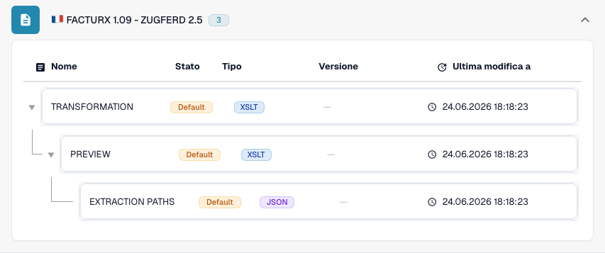

# Francia

Usate questa guida per identificare la famiglia configurata e l’ambito delle versioni prima di provare un file sorgente.

[Tutti i paesi e ambito del supporto](../README.md)

## Video esplicativo del paese

La narrazione localizzata e i sottotitoli WebVTT spiegano la selezione del formato, la configurazione e le verifiche di accettazione.

Questa panoramica in sola lettura mostra la configurazione esistente del paese in DocBits. Verificate la fonte utilizzata e la versione attiva, quindi provate fatture, note di credito ed esportazioni rappresentative nella vostra organizzazione.



[Francia — Video esplicativo del paese](https://docbits-videos.fra1.cdn.digitaloceanspaces.com/settings-assistant/edocs_country_france/v2/it.mp4)

[WebVTT](https://docbits-videos.fra1.cdn.digitaloceanspaces.com/settings-assistant/edocs_country_france/v2/it.vtt)

## Varianti e limiti delle versioni

Factur-X ha voci generiche e specifiche per pubblicazione, tra cui 1.0.05, 1.08 e 1.09. VRBL FR CIUS 1.0 è distinto.

**Sintassi:** CII / PDF + XML

Il marcatore XML 1p0 e Factur-X XMP Version 1.0 non identificano una versione di pubblicazione. Mantenete l’etichetta generica quando la pubblicazione è sconosciuta.

Le tabelle riportano una verifica del catalogo di sviluppo effettuata il 17 ottobre 2026 e del relativo codice di elaborazione. Descrivono le regole e i componenti di configurazione disponibili, senza certificare ogni file, requisito legale o distribuzione in produzione. L’organizzazione può sostituire le impostazioni predefinite.

## Matrice delle regole e dei componenti esaminati

| Etichetta esatta del formato | Chiave del documento della regola | Componenti disponibili |
| --- | --- | --- |
| `FACTURX` | `INVOICE` | C / T / P / E |
| `FACTURX 1.0.05 - ZUGFERD 2.1` | `INVOICE` | C / T / P / E |
| `FACTURX 1.0.05 BASIC` | `INVOICE` | C / T / P / E |
| `FACTURX 1.0.05 EN16931` | `INVOICE` | C / T / P / E |
| `FACTURX 1.0.05 EXTENDED` | `INVOICE` | C / T / P / E |
| `FACTURX 1.08 - ZUGFERD 2.4` | `INVOICE` | C / T / P / E |
| `FACTURX 1.09 - ZUGFERD 2.5` | `INVOICE` | C / T / P / E |
| `VRBL FR CIUS 1.0` | `INVOICE` | C / T / P / E |

C = classificazione, T = Transformation, P = Preview, E = Extraction Paths. La chiave del documento è la chiave di ricerca della regola o configurazione; non garantisce il valore finale memorizzato di invoice_type. Una trasformazione può classificare una nota di credito tramite una mappatura INVOICE.

Un trattino indica che la verifica dello stato non ha rilevato un componente dedicato per questa esatta combinazione di formato e chiave del documento. Non esclude una mappatura condivisa o di ripiego. Verificate il meccanismo di risoluzione effettivamente utilizzato e un file rappresentativo prima di fare affidamento su quel percorso.

### Ulteriori etichette di configurazione

Queste etichette hanno voci di configurazione, ma nessuna regola di classificazione autonoma nel catalogo esaminato. Una famiglia generica o un’identificazione più precisa può selezionare un percorso compatibile. La loro sola presenza non dimostra il rilevamento automatico di quella pubblicazione o di quel profilo.

- `FACTURX 1.0.05 BASIC WL`
- `FACTURX 1.0.05 MINIMUM`
- `FACTURX 1.0.06 BASIC`
- `FACTURX 1.0.06 BASIC WL`
- `FACTURX 1.0.06 EN16931`
- `FACTURX 1.0.06 EXTENDED`
- `FACTURX 1.0.06 MINIMUM`
- `FACTURX 1.0.07 BASIC`
- `FACTURX 1.0.07 BASIC WL`
- `FACTURX 1.0.07 EN16931`
- `FACTURX 1.0.07 EXTENDED`
- `FACTURX 1.0.07 MINIMUM`
- `FACTURX 1.0.07.2 - ZUGFERD 2.3.2`
- `FACTURX 1.0.07.2 BASIC`
- `FACTURX 1.0.07.2 BASIC WL`
- `FACTURX 1.0.07.2 EN16931`
- `FACTURX 1.0.07.2 EXTENDED`
- `FACTURX 1.0.07.2 MINIMUM`
- `FACTURX 1.08 BASIC`
- `FACTURX 1.08 BASIC WL`
- `FACTURX 1.08 EN16931`
- `FACTURX 1.08 EXTENDED`
- `FACTURX 1.08 MINIMUM`
- `FACTURX 1.09 BASIC`
- `FACTURX 1.09 BASIC WL`
- `FACTURX 1.09 EN16931`
- `FACTURX 1.09 EXTENDED`
- `FACTURX 1.09 MINIMUM`

### Factur-X / ZUGFeRD: non inventare una versione di pubblicazione

Un Guideline ID CII armonizzato può identificare una famiglia e un profilo pur condividendo lo stesso marcatore 1p0 tra più versioni. Factur-X XMP Version 1.0 è un marcatore di schema, non una pubblicazione come 1.08 o 1.09. I metadati XMP di ZUGFeRD possono dichiararne la versione. In assenza di metadati autorevoli, mantenete il risultato della famiglia generica e confermate il file originale con il mittente.

MINIMUM e BASIC WL possono omettere informazioni sulle righe necessarie alle elaborazioni successive. BASIC, EN16931/COMFORT ed EXTENDED offrono coperture di dati diverse. Un profilo più esteso può contenere campi non utilizzati dalla vostra mappatura di estrazione. Verificate i campi richiesti con esempi reali.

## Trovare la mappatura in DocBits

<figure><figcaption>
Interfaccia reale di sviluppo: il formato rappresentativo e i relativi componenti di configurazione disponibili. Le altre versioni sono elencate nella matrice.
</figcaption></figure>

## Verifiche di accettazione

La verifica di un componente conferma la presenza della configurazione. Non è un test di elaborazione completo per ogni versione. Provate il contenuto esatto e il percorso di elaborazione di fatture o note di credito richiesto dall’integrazione.

## Verificare un formato nell’organizzazione

1. Conservate l’XML originale o il PDF con il relativo XML incorporato. Leggete lo spazio dei nomi, lo schema o l’identificatore di personalizzazione, nonché la versione e il profilo dichiarati.

2. Aprite Impostazioni → Tipi di documento → E-Doc per il documento aziendale pertinente. Cercate il formato esatto del documento elettronico indicato nella guida.

3. Verificate la sorgente Default o Custom effettivamente utilizzata e la sua versione di configurazione attiva. Esaminate Transformation, Preview ed Extraction Paths. Salvare una bozza non la attiva.

4. Provate file sorgente rappresentativi per ogni sintassi, versione e documento aziendale necessari. Verificate i campi principali, gli importi, le imposte, la classificazione fattura/nota di credito e l’esportazione ERP.

5. Confermate separatamente i criteri di validazione e il trasporto. Conservate le mappature personalizzate e controllate le approvazioni e la cronologia delle esportazioni prima di riavviare l’elaborazione dei documenti esistenti.

## Riferimento al formato correlato

- [🇫🇷 FACTURX](../facturx.md)
- [🇫🇷 FACTURX 1.0.05 - ZUGFERD 2.1](../facturx-1-0-05-zugferd-2-1.md)
- [🇫🇷 FACTURX 1.0.07.2 - ZUGFERD 2.3.2](../facturx-1-0-07-2-zugferd-2-3-2.md)
- [🇫🇷 FACTURX 1.09 - ZUGFERD 2.5](../facturx-1-09-zugferd-2-5.md)
