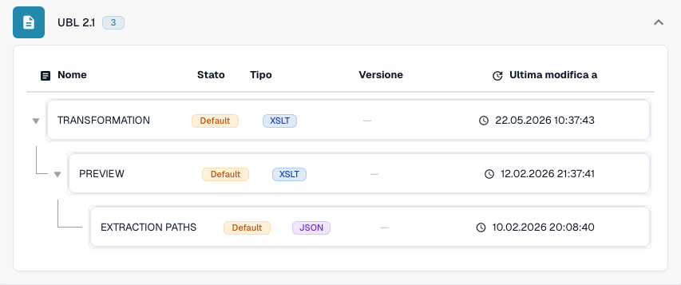

# Internazionale

Usate questa guida per identificare la famiglia configurata e l’ambito delle versioni prima di provare un file sorgente.

[Tutti i paesi e ambito del supporto](../README.md)

## Varianti e limiti delle versioni

Le voci internazionali comprendono Peppol BIS 3.0, UBL 2.1, CII puro, EDI, INVOIC02, cXML, OCI, BOD e SPS Commerce RSX 7.7.4.

**Sintassi:** UBL / CII / EDI / cXML

Le mappature per fatture, ordini, risposte e avvisi di spedizione sono distinte. L’elaborazione dei file non fornisce, di per sé, un punto di accesso Peppol o la connettività con i partner commerciali.

Le tabelle riportano una verifica del catalogo di sviluppo effettuata il 17 ottobre 2026 e del relativo codice di elaborazione. Descrivono le regole e i componenti di configurazione disponibili, senza certificare ogni file, requisito legale o distribuzione in produzione. L’organizzazione può sostituire le impostazioni predefinite.

## Matrice delle regole e dei componenti esaminati

| Etichetta esatta del formato | Chiave del documento della regola | Componenti disponibili |
| --- | --- | --- |
| `BOD` | `PURCHASE_ORDER` | C / — / — / — |
| `CXML ORDER CONFIRMATION` | `ORDER_CONFIRMATION` | C / T / P / E |
| `CXML PURCHASE ORDER` | `PURCHASE_ORDER` | C / T / P / E |
| `EDI` | `PURCHASE_ORDER` | C / T / P / E |
| `EDI` | `ORDER_CONFIRMATION` | C / T / P / E |
| `EDI` | `INVOICE` | C / T / P / E |
| `INVOIC02` | `INVOICE` | C / T / P / E |
| `OCI CATALOG ORDER` | `PURCHASE_ORDER` | C / T / P / E |
| `PEPPOL BIS 3.0` | `INVOICE` | C / T / P / E |
| `PEPPOL DESPATCH ADVICE 3.0` | `DELIVERY_NOTE` | C / T / P / E |
| `PEPPOL ORDER 3.0` | `PURCHASE_ORDER` | C / T / P / E |
| `PEPPOL ORDER RESPONSE 3.0` | `ORDER_CONFIRMATION` | C / T / P / E |
| `PURCHASE ORDER BOD` | `PURCHASE_ORDER` | C / T / P / E |
| `PURE CII D16B EU` | `INVOICE` | C / T / P / E |
| `PURE CII D16B EU CREDITNOTE` | `CREDIT_NOTE` | C / T / P / E |
| `PURE CII D16B NON-EU` | `INVOICE` | C / T / P / E |
| `PURE CII D16B NON-EU CREDITNOTE` | `CREDIT_NOTE` | C / T / P / E |
| `PURE CII D22B EU` | `INVOICE` | C / T / P / E |
| `PURE CII D22B EU CREDITNOTE` | `CREDIT_NOTE` | C / T / P / E |
| `PURE CII D22B NON-EU` | `INVOICE` | C / T / P / E |
| `PURE CII D22B NON-EU CREDITNOTE` | `CREDIT_NOTE` | C / T / P / E |
| `PURE CII D23B EU` | `INVOICE` | C / T / P / E |
| `PURE CII D23B EU CREDITNOTE` | `CREDIT_NOTE` | C / T / P / E |
| `PURE CII D23B NON-EU` | `INVOICE` | C / T / P / E |
| `PURE CII D23B NON-EU CREDITNOTE` | `CREDIT_NOTE` | C / T / P / E |
| `PURE CII D24B EU` | `INVOICE` | C / T / P / E |
| `PURE CII D24B EU CREDITNOTE` | `CREDIT_NOTE` | C / T / P / E |
| `PURE CII D24B NON-EU` | `INVOICE` | C / T / P / E |
| `PURE CII D24B NON-EU CREDITNOTE` | `CREDIT_NOTE` | C / T / P / E |
| `PURE CII V1 EU` | `INVOICE` | C / T / P / E |
| `PURE CII V1 EU CREDITNOTE` | `CREDIT_NOTE` | C / T / P / E |
| `PURE CII V1 NON-EU` | `INVOICE` | C / T / P / E |
| `PURE CII V1 NON-EU CREDITNOTE` | `CREDIT_NOTE` | C / T / P / E |
| `SPS COMMERCE RSX 7.7.4` | `PURCHASE_ORDER_ACKNOWLEDGMENT` | C / T / P / E |
| `SPS COMMERCE RSX 7.7.4` | `ADVANCE_SHIP_NOTICE` | C / T / P / E |
| `SPS COMMERCE RSX 7.7.4` | `PURCHASE_ORDER` | C / T / P / E |
| `SPS COMMERCE RSX 7.7.4` | `INVOICE` | C / T / P / E |
| `SPS COMMERCE RSX 7.7.4` | `PURCHASE_ORDER_CHANGE` | C / T / P / E |
| `UBL 2.1` | `INVOICE` | C / T / P / E |
| `UBL 2.1 CREDITNOTE` | `CREDIT_NOTE` | C / T / P / E |
| `UBL 2.1 DESPATCH ADVICE` | `DELIVERY_NOTE` | C / T / P / E |
| `UBL 2.1 ORDER` | `PURCHASE_ORDER` | C / T / P / E |
| `UBL 2.1 ORDER RESPONSE` | `ORDER_CONFIRMATION` | C / T / P / E |

C = classificazione, T = Transformation, P = Preview, E = Extraction Paths. La chiave del documento è la chiave di ricerca della regola o configurazione; non garantisce il valore finale memorizzato di invoice_type. Una trasformazione può classificare una nota di credito tramite una mappatura INVOICE.

Un trattino indica che la verifica dello stato non ha rilevato un componente dedicato per questa esatta combinazione di formato e chiave del documento. Non esclude una mappatura condivisa o di ripiego. Verificate il meccanismo di risoluzione effettivamente utilizzato e un file rappresentativo prima di fare affidamento su quel percorso.

## Trovare la mappatura in DocBits

<figure><figcaption>
Interfaccia reale di sviluppo: il formato rappresentativo e i relativi componenti di configurazione disponibili. Le altre versioni sono elencate nella matrice.
</figcaption></figure>

## Video esplicativo del paese

La narrazione localizzata e i sottotitoli WebVTT spiegano la selezione del formato, la configurazione e le verifiche di accettazione.


Internazionale — Video esplicativo del paese



WebVTT


## Verifiche di accettazione

La verifica di un componente conferma la presenza della configurazione. Non è un test di elaborazione completo per ogni versione. Provate il contenuto esatto e il percorso di elaborazione di fatture o note di credito richiesto dall’integrazione.

## Verificare un formato nell’organizzazione

1. Conservate l’XML originale o il PDF con il relativo XML incorporato. Leggete lo spazio dei nomi, lo schema o l’identificatore di personalizzazione, nonché la versione e il profilo dichiarati.

2. Aprite Impostazioni → Tipi di documento → E-Doc per il documento aziendale pertinente. Cercate il formato esatto del documento elettronico indicato nella guida.

3. Verificate la sorgente Default o Custom effettivamente utilizzata e la sua versione di configurazione attiva. Esaminate Transformation, Preview ed Extraction Paths. Salvare una bozza non la attiva.

4. Provate file sorgente rappresentativi per ogni sintassi, versione e documento aziendale necessari. Verificate i campi principali, gli importi, le imposte, la classificazione fattura/nota di credito e l’esportazione ERP.

5. Confermate separatamente i criteri di validazione e il trasporto. Conservate le mappature personalizzate e controllate le approvazioni e la cronologia delle esportazioni prima di riavviare l’elaborazione dei documenti esistenti.

## Riferimento al formato correlato

- [INVOIC02](../invoic02.md)
- [🇪🇺 PEPPOL BIS 3.0](../peppol-bis-3-0.md)
- [SPS COMMERCE RSX 7.7.4](../sps-commerce-rsx-7-7-4.md)
- [UBL 2.1](../ubl-2-1.md)
