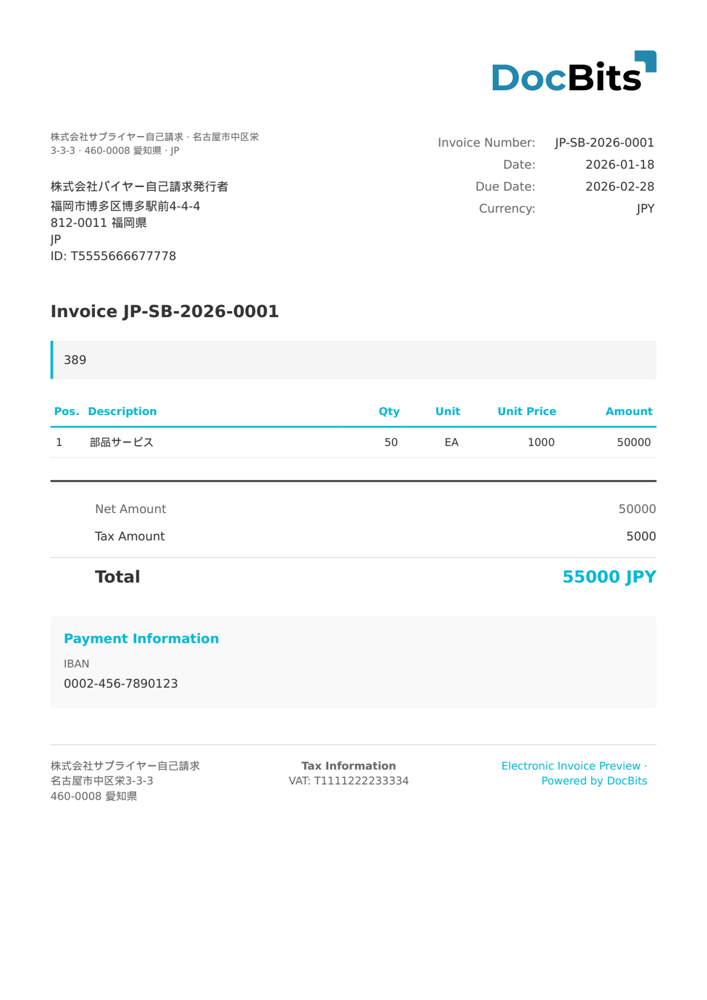

# 🇯🇵 JP PINT SELF-BILLING

| Proprietà             | Valore               |
| --------------------- | -------------------- |
| **Paese / Regione**   | Giappone             |
| **Tipi di documento** | Self-Billed Invoice  |
| **Formato**           | UBL 2.1 XML          |
| **Standard**          | JP PINT Self-Billing |

JP PINT Self-Billing è la variante di autofatturazione del modello di fattura giapponese Peppol International. Consente agli acquirenti di emettere fatture per conto dei fornitori, seguendo la stessa struttura JP PINT con i ruoli delle parti invertiti, come consentito a condizioni specifiche dalla normativa fiscale giapponese.

## Stato del supporto

| Componente         | Stato       |
| ------------------ | ----------- |
| Anteprima          | ✅ Supported |
| Estrazione campi   | ✅ Supported |
| Trasformazione     | ✅ Supported |

## Anteprima predefinita

<figure><figcaption>
Anteprima predefinita DocBits per una fattura JP PINT Self-Billing del Giappone
</figcaption></figure>

## Correlati

* [Documenti elettronici supportati](./)
* [JP PINT](jp-pint.md)
