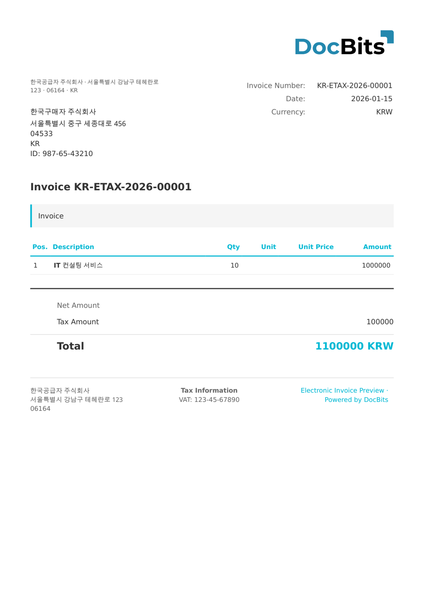

# 🇰🇷 KOREA E-TAX INVOICE

| Proprietà             | Valore                             |
| --------------------- | ---------------------------------- |
| **Paese / Regione**   | Corea del Sud                      |
| **Tipi di documento** | Tax Invoice                        |
| **Formato**           | XML                                |
| **Standard**          | Korean E-Tax Invoice (NTS HomeTax) |

Korea E-Tax Invoice è lo standard di fattura fiscale elettronica gestito dal National Tax Service (NTS) tramite il sistema HomeTax. Le aziende devono emettere fatture fiscali elettroniche per le transazioni B2B e trasmetterle all'NTS. Il formato include il numero di registrazione aziendale, la ripartizione dell'imposta e il numero di approvazione dell'NTS.

## Stato del supporto

| Componente         | Stato       |
| ------------------ | ----------- |
| Anteprima          | ✅ Supported |
| Estrazione campi   | ✅ Supported |
| Trasformazione     | ✅ Supported |

## Anteprima predefinita

<figure><figcaption>
Anteprima predefinita DocBits per una Korea e-Tax Invoice
</figcaption></figure>

## Correlati

* [Documenti elettronici supportati](./)
