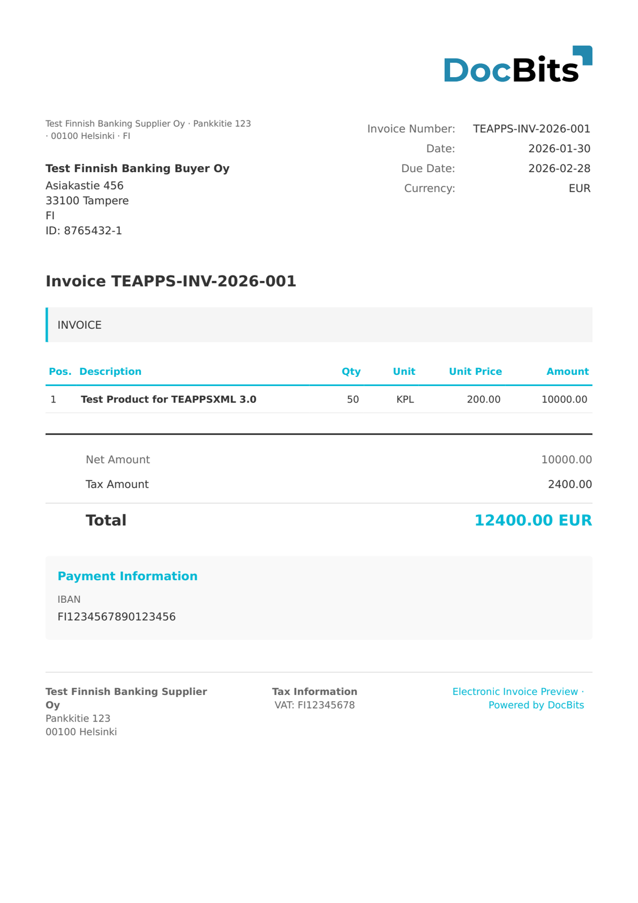

# 🇫🇮 TEAPPSXML

<!-- edocs-country-scope -->


Consultate la guida del paese per i limiti delle versioni, la configurazione effettivamente utilizzata e il video esplicativo del paese. [Finlandia](countries/finland.md). Verificate la versione sorgente prima di scegliere una mappatura. L’etichetta TEAPPSXML non indica una versione.


| Proprietà             | Valore                   |
| --------------------- | ------------------------ |
| **Paese / Regione**   | Finlandia                |
| **Tipi di documento** | Fattura, Nota di credito |
| **Formato**           | XML                      |
| **Standard**          | TEAPPSXML 3.0            |

TEAPPSXML è un formato finlandese di fatturazione elettronica utilizzato da Tieto (oggi TietoEVRY) per lo scambio di fatture. È comunemente impiegato insieme a Finvoice nel mercato finlandese, in particolare dalle organizzazioni che utilizzano sistemi ERP e finanziari basati su Tieto.

## Stato del supporto

| Componente       | Stato        |
| ---------------- | ------------ |
| Anteprima        | ✅ Supportato |
| Estrazione campi | ✅ Supportato |
| Trasformazione   | ✅ Supportato |

## Anteprima predefinita

<figure><figcaption>
Anteprima DocBits predefinita per una fattura finlandese TEAPPSXML
</figcaption></figure>

## Correlati

* [Documenti elettronici supportati](./)
